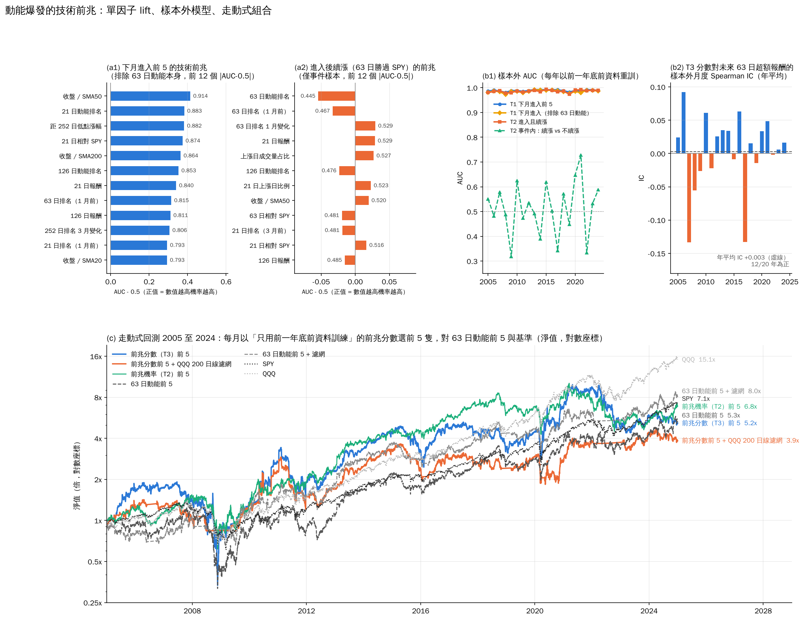
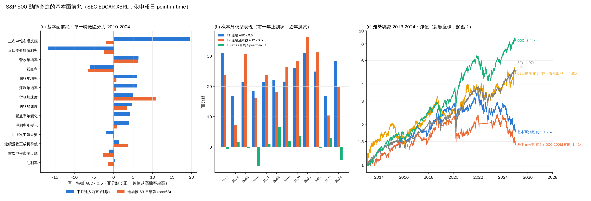

# 17. 反推動能爆發的前兆：技術面與基本面

[回索引](../README.md) · [完整報告](./ANALYSIS.md) · [上一節](./16-playbook.md) · [下一節](./18-verdict.md)

> 資料：S&P 500 成份股，Yahoo Finance 調整後收盤價。短期分析期間 2024-01-02 至 2026-10-16；長期回測 2000-01-03 至 2024-12-31。

第 15 節的「每月換成動能最高 5 隻」沒有超額報酬。這一節反過來問：一隻股票在進入前 5 名之前，有沒有事先看得到的技術或基本面資料，能分辨（a）誰下個月會進榜，（b）進榜後誰會續漲。方法是事件研究：先用事後資料定義事件，再回到事件前的時點取特徵，與對照組比較，最後把特徵做成分數放回第 15 節的引擎走動式回測。共用事件表腳本 `sp500_precursor_events.py`，技術面 `sp500_precursor_technical.py`，基本面 `sp500_precursor_fundamental.py`。

## 17.1 事件與對照組

- **事件**：月底 t，某時點成份股首次進入 63 日動能前 5 名（t−1 月底可排名但不在前 5）。2000 到 2024 年共 963 個事件，每年約 40 個。
- **對照組**：同一個月底可排名、t 與 t−1 都不在前 5 的其他成份股，全部約 10 萬列；另外每個事件配 10 隻隨機抽樣，供需要平衡樣本的分析。
- **標籤**：從執行日（訊號次一交易日）收盤起 21、63、126 日的報酬減去 SPY 同期；`cont63` = 63 日勝過 SPY，代表「爆發延續」。
- **基準事實**：進榜股票接下來 63 日超額報酬中位數 −0.35%，續漲率 49.1%；對照組 +0.26%、50.7%。進榜本身沒有資訊，這就是第 15 節的結論，也是這一節要預測的目標。
- 特徵一律只用訊號日 t 以前的資料，兩個腳本都有無前視的斷言與抽查（例如把價格歷史截斷在 2012-06-29 重算全部特徵，與用完整歷史算的完全相同）。

## 17.2 技術面：37 個特徵、25 年

特徵在訊號日取值：各期間報酬與其橫截面排名（含 1 個月與 3 個月前的排名、排名變化）、10 日急拉、距 252 日低點漲幅、距 252 日高點回撤、相對 SPY 強弱、收盤對 20 / 50 / 200 日線、均線排列、波動與波動壓縮、上漲日比例、成交量比率、上漲日成交量占比、放量天數、成交金額排名。成交量另以 yfinance 補下載，659 / 660 檔有資料。

**（a）誰下個月會進榜**：單因子 AUC 極高（排除 63 日動能本身後仍 0.79 到 0.91），樣本外模型 AUC 0.985。但內容是套套邏輯：

| 特徵 | AUC | P(進榜 ｜ 最高五分位) ÷ 基準 |
|---|---|---|
| 收盤 / 50 日線 | 0.914 | 3.7 倍 |
| 21 日動能排名 | 0.883 | 3.2 倍 |
| 距 252 日低點漲幅 | 0.882 | 3.5 倍 |
| 21 日相對 SPY | 0.874 | 3.2 倍 |
| 收盤 / 200 日線 | 0.864 | 3.6 倍 |
| 126 日動能排名 | 0.853 | 3.3 倍 |
| 上漲日成交量占比 | 0.743 | 2.5 倍 |
| 21 日波動 | 0.739 | 2.7 倍 |

進榜前一個月的股票已經「價格遠在均線之上、離 52 週低點很遠、短中長期排名都在前段、波動放大、量在上漲日放大」。這是在描述爆發正在發生，不是預告它將要發生。

**（b）進榜後誰會續漲**：全部特徵都無力。最好的 |AUC − 0.5| 只有 0.03 到 0.05（63 日排名 1 月變化 0.529、21 日報酬 0.529、上漲日成交量占比 0.527、21 日上漲日比例 0.523）；低分位的事件數只有 14 到 66 個，差異在抽樣噪音內。

**時間切分模型**（特徵在月內排序到 0 到 1，錨定擴張視窗每年重訓，2005 到 2024 共 20 個樣本外年份）：
- 進榜：AUC 0.989（排除 63 日家族 0.985），20 / 20 年高於 0.5，但如上所述沒有用處。
- 進榜且續漲，只看事件內：AUC 平均 0.512，範圍 0.32 到 0.73，11 / 20 年高於 0.5。
- 對未來 63 日超額報酬排名做 ridge 迴歸：全宇宙月度 Spearman IC 平均 +0.003（−0.13 到 +0.09），12 / 20 年為正。係數符號 20 年中九成五以上同號（3 個月前的 252 日排名為負、距低點漲幅為正、成交金額排名為負），但幅度小到 IC 等於零。

**走動式組合 2005-01 至 2024-12**（每月只用前一年底前訓練的模型打分，0.1% 成本，基準同窗重跑）：

| 策略 | CAGR | 年化波動 | Sharpe | 最大回撤 | 最差年 | 2020-24 |
|---|---|---|---|---|---|---|
| 前兆分數（迴歸）前 5 | 8.6% | 42.8% | 0.40 | −82.6% | −49.7% | 2.8% |
| 前兆分數前 5 + QQQ 200 日線濾網 | 7.0% | 31.8% | 0.36 | −58.6% | −34.5% | 5.4% |
| 前兆機率（分類）前 5 | 10.1% | 30.0% | 0.47 | −60.1% | −37.9% | 0.1% |
| 前兆機率前 5 + 濾網 | 10.2% | 24.2% | 0.52 | −45.6% | −13.5% | 2.1% |
| 63 日動能前 5（第 15 節同窗） | 8.7% | 33.5% | 0.42 | −75.0% | −63.4% | 13.3% |
| 63 日動能前 5 + 濾網 | 11.0% | 26.6% | 0.52 | −39.2% | −23.3% | 11.3% |
| SPY | 10.3% | 19.0% | 0.61 | −55.2% | −36.2% | 14.3% |
| QQQ | 14.5% | 21.5% | 0.74 | −53.4% | −40.8% | 19.5% |
| 隨機前 5 中位數 / p90 | 6.8% / 10.1% | | | −62.6% | | |

前兆分數沒有打敗單純動能：迴歸版 8.6% 對 8.7%，波動與回撤更大；分類版 10.1% 看似最好，但剛好等於隨機前 5 的 p90、低於 SPY，2020 到 2024 年只有 0.1%，而且迴歸與分類兩個版本結果差這麼多本身就說明是噪音。加濾網後全部低於「63 日動能前 5 + 濾網」的 11.0%。

**技術面結論**：進入前 5 之前，技術面能看到的只有「它已經是強勢股」，而第 15 節已證明這不帶來超額報酬。沒有任何技術特徵能分辨續漲與反轉。

## 17.3 基本面：SEC EDGAR 時點財報、2010 年起

資料來源是 SEC EDGAR 的 XBRL 公司事實 API，每個數字以**申報日**為可得日（不是財報期間結束日），所以訊號日只用到當時已公開的季報。660 檔中 644 檔對應到 CIK，612 檔有可用季度資料（38,373 列，2009 年第二季起）；2010 到 2024 年的 586 個進榜事件有 560 個（95.6%）算得出特徵。營收與 EPS 的覆蓋率約九成，毛利率只有四成（金融、保險、多數藥廠不報毛利）。已處理：同一季取最早申報值（不用事後重述）、Q4 = 年度減三季、非日曆會計年度、EPS 的股票分割校正。

特徵在訊號日取最近一季已申報的數字：營收年增率、EPS 年增率、淨利年增率、毛利率與營益率及其年變化、營收加速度（本季年增率減上季）、EPS 加速度、連續營收正成長季數、距上次申報天數、近四季盈餘殖利率，以及**上次與前次申報的市場反應**（申報日前一日收盤到後兩日的超額報酬，作為盈餘驚喜的代理）。

**（a）誰下個月會進榜**（事件 560、對照約 5,500）：

| 特徵 | AUC | P(進榜 ｜ 最高五分位) ÷ 基準 |
|---|---|---|
| 上次申報市場反應 | 0.695 | 2.2 倍 |
| 近四季盈餘殖利率（低 = 貴） | 0.331 | 最低五分位 2.2 倍 |
| 營收年增率 | 0.564 | 1.6 倍 |
| EPS 年增率 / 淨利年增率 | 0.559 | 1.6 倍 |
| 營收加速度 | 0.551 | 1.5 倍 |

前兩名其實是價格資訊：財報後跳漲、估值已高，仍是在描述動能本身。純財務成長變數的 AUC 只有 0.55 到 0.56。

**（b）進榜後誰會續漲**（463 個有完整 63 日標籤的事件）：唯一像樣的是**營收加速度**，AUC 0.608；進榜者中本季營收年增率高於上季的（251 個）續漲率 53.8%、63 日超額報酬中位數 +1.9%，沒有加速的（212 個）39.2%、−2.8%。其次營收年增率 0.562、連續正成長季數 0.536。上次申報反應對續漲沒有分辨力（0.482）。

**時間切分模型**（2013 到 2024 共 12 個樣本外年份）：進榜 AUC 0.733、進榜且續漲 0.727，12 / 12 年高於 0.5，但區分力主要來自申報反應與估值這兩個含價格的變數。對全股池未來 63 日超額報酬的 ridge 迴歸，月度 IC 平均 +0.005（−0.06 到 +0.07），7 / 12 年為正，等於沒有預測力。

**走動式組合 2013-01 至 2024-12**（同一 612 檔覆蓋股池，0.1% 成本）：

| 策略 | CAGR | Sharpe | 最大回撤 | 最差年 | 2020-24 |
|---|---|---|---|---|---|
| 基本面分數前 5 | 4.8% | 0.32 | −50.8% | −38.7% | −8.9% |
| 基本面分數前 5 + QQQ 200 日線濾網 | 3.0% | 0.25 | −40.3% | −38.7% | −8.8% |
| 基本面分數前 10 | 7.9% | 0.47 | −39.7% | −30.6% | 2.1% |
| 進榜機率前 5 / + 濾網 | 7.6% / 10.2% | 0.40 / 0.51 | −62.2% | −55.7% / −18.2% | 0.6% / 11.6% |
| 規則：營收加速度前 5 | 7.2% | 0.41 | −47.8% | −21.1% | 2.3% |
| 規則：上次申報反應前 5 | 4.1% | 0.29 | −61.0% | −36.3% | 4.7% |
| 63 日動能前 20 再用基本面分數挑 5 | 11.2% | 0.53 | −36% 到 −48% | | 5.1% |
| 63 日動能前 20 再用營收加速度挑 5 | 10.8% | 0.57 | | | 7.2% |
| 63 日動能前 5（同股池）/ + 濾網 | **14.0% / 13.2%** | 0.63 / 0.64 | −44.1% / −37.7% | −19.5% / −23.3% | 13.3% / 11.3% |
| SPY | 14.3% | 0.89 | −33.7% | −18.6% | 14.3% |
| QQQ | 19.5% | 0.97 | −35.1% | −33.2% | 19.5% |
| 隨機前 5 中位數 / p90 | 8.9% / 13.1% | | | | |

所有基本面組合都輸給同股池的動能前 5（14.0%）與 SPY，多數還低於隨機中位數 8.9%。「動能前 20 再用基本面挑 5」也只有 10.8% 到 11.7%，比純動能前 5 差。營收加速度在事件內的 54% 對 39% 續漲率，放大到全股池後沒有可交易的價值。

## 17.4 結論與下一步

- **能預測「誰會進榜」的訊號全是動能本身的化身**：技術面是「已遠離均線、各期排名靠前、量價放大」，基本面是「財報後跳漲、估值已高」。兩邊的進榜 AUC 都很高（0.99 與 0.73），但都不是先行指標。
- **能預測「進榜後續漲」的幾乎沒有**：技術面最好的 AUC 0.53，基本面只有營收加速度 0.61，且樣本小（463 個事件）、放到全股池 IC 接近零。
- **做成分數放回引擎，樣本外全部輸給單純的 63 日動能前 5**，技術面 2005 到 2024 年 8.6% 對 8.7%（加濾網 7.0% 對 11.0%），基本面 2013 到 2024 年 4.8% 到 7.9% 對 14.0%。這與第 15 節一致：動能前 5 本身已無超額報酬，再在它前面找前兆，找到的只是它自己。
- **資料的限制**：SEC 季報從期末到申報平均 30 到 45 天，訊號日距最近申報平均約 50 天，對一個月週期的動能爆發太慢。真正可能有訊號的是高頻更新的分析師預估修正與相對共識的盈餘驚喜，那需要付費資料（I/B/E/S、FactSet）。即便如此，這裡的 IC 結果顯示在 S&P 500 大型股、月度頻率下，期望值不大；付費前應先訂門檻（例如月均 IC 高於 0.03 且 12 年中 8 年為正），達不到就停。
- 兩條線的腳本都做了無前視的斷言與抽查，走動式訓練每年只用前一年底前的資料。結果是負面的，但負面結果有明確的邊界：在這個宇宙與頻率下，技術與財報資料裡沒有動能爆發的前兆。

---

[回索引](../README.md) · [完整報告](./ANALYSIS.md) · [上一節](./16-playbook.md) · [下一節](./18-verdict.md)
