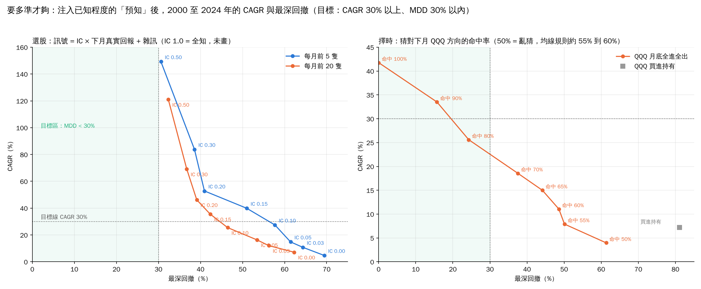
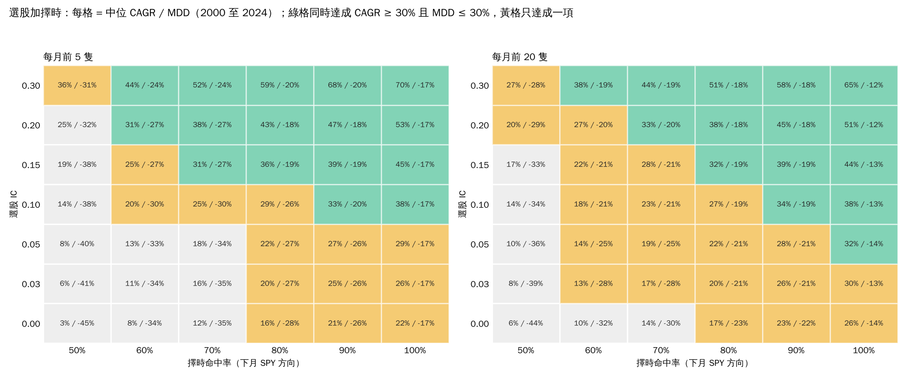

# 19. 從事後結果反推訊號，能不能找到「年回報 30% 以上、MDD 30% 以內」的策略

[回索引](../README.md) · [完整報告](./ANALYSIS.md) · [上一節](./18-verdict.md)

> 資料：S&P 500 成份股，Yahoo Finance 調整後收盤價。短期分析期間 2024-01-02 至 2026-10-16；長期回測 2000-01-03 至 2024-12-31。

問題：先看事後結果，反推出買賣訊號，再搜尋一個 CAGR 30% 以上、最深回撤 30% 以內的策略，可不可行？

方法上可以，第 17 節做的就是這件事；真正的問題是目標。這一節不再搜尋規則，而是反過來問：**要多準才夠？** 做法是把已知程度的「預知」注入訊號，看 2000 至 2024 年會得到什麼。腳本 `sp500_skill_needed.py`，宇宙、交易引擎與成本和第 15 節相同。

## 19.1 選股：訊號 = IC × 下月真實回報 + 雜訊

每月底對時點成份股計算 `IC × z(下月真實回報) + sqrt(1 − IC²) × 常態雜訊`，買訊號最高的 N 隻、等權、下一收盤執行、持有一個月，成本 0.1%。IC 是訊號與事後回報的橫截面等級相關係數：0 是亂猜，1 是全知；公開文獻裡好的量化因子月度 IC 約 0.02 到 0.05。每個 IC 跑 5 個種子取中位數。

| IC | 前 5 隻 CAGR / MDD | 前 20 隻 CAGR / MDD | 對照 |
|---|---|---|---|
| 0.00 | 4.7% / −69% | 7.1% / −62% | 亂猜，與第 15 節隨機對照一致 |
| 0.03 | 10.8% / −64% | 12.0% / −56% | 好的量化因子 |
| 0.05 | 14.8% / −61% | 16.3% / −53% | 頂級因子 |
| 0.10 | 27.4% / −58% | 25.5% / −46% | 文獻裡沒有長期做到的大型股因子 |
| 0.15 | 39.9% / −51% | 35.5% / −42% | |
| 0.20 | 52.8% / −41% | 46.2% / −39% | |
| 0.30 | 83.8% / −39% | 69.1% / −37% | |
| 0.50 | 149% / −31% | 121% / −32% | MDD 才首次接近 30% |
| 1.00 | 1296% / −36% | 504% / −24% | 全知，仍有月內回撤 |

- 年回報 30% 需要 IC 約 0.10 到 0.12，是頂級因子的兩到三倍。第 17 節實測的前兆訊號 IC 是 +0.005。
- MDD 壓到 30% 以內更難：純多頭等權選股即使 IC 0.3 仍跌近 40%，要到 IC 0.5 才碰到 30%。原因是最深回撤由 2000 至 2002 與 2008 的市場 beta 決定，選股準不準只影響一半。
- 兩個條件同時成立，在純選股路線上等同要求近乎全知。

## 19.2 擇時：猜對下月 QQQ 方向的命中率

QQQ 月底全進全出，每月以機率 `hit` 猜對下月方向（猜錯就做反），空倉拿 3 個月國庫券利率。20 個種子取中位數。

| 命中率 | CAGR / MDD | 對照 |
|---|---|---|
| 50% | 4.0% / −61% | 亂猜 |
| 55% | 7.9% / −50% | 第 13 節均線規則的實際水準 |
| 60% | 11.1% / −49% | |
| 65% | 15.0% / −44% | |
| 70% | 18.6% / −38% | |
| 80% | 25.6% / −24% | MDD 首次低於 30% |
| 90% | 33.5% / −16% | 兩個條件同時達成 |
| 100% | 41.8% / 0% | 全知 |
| 買進持有 | 7.2% / −81% | |

- 30% 年回報加 30% 以內 MDD，在擇時路線上需要每月方向命中率約 85%。趨勢規則樣本外做到的是 55% 到 60%，與亂猜的差距只有 5 到 10 個百分點。
- 選股與擇時相加可以互相降低門檻，見 19.3。

## 19.3 選股加擇時一起做，門檻降到多少

把兩種預知同時注入：每月底先以命中率 `hit` 猜下月 SPY 方向，猜「跌」就整月持有國庫券；猜「漲」就用 IC 訊號買前 N 隻。3 個種子取中位數，`sp500_skill_needed.py --combined-only`。每格為 CAGR / MDD：

**每月前 5 隻**

| 選股 IC ＼ 命中率 | 50% | 60% | 70% | 80% | 90% | 100% |
|---|---|---|---|---|---|---|
| 0.00 | 3% / −45% | 8% / −34% | 12% / −35% | 16% / −28% | 21% / −26% | 22% / −17% |
| 0.03 | 6% / −41% | 11% / −34% | 16% / −35% | 20% / −27% | 25% / −26% | 26% / −17% |
| 0.05 | 8% / −40% | 13% / −33% | 18% / −34% | 22% / −27% | 27% / −26% | 29% / −17% |
| 0.10 | 14% / −38% | 20% / −30% | 25% / −30% | 29% / −26% | **33% / −20%** | **38% / −17%** |
| 0.15 | 19% / −38% | 25% / −27% | **31% / −27%** | **36% / −19%** | **39% / −19%** | **45% / −17%** |
| 0.20 | 25% / −32% | **31% / −27%** | **38% / −27%** | **43% / −18%** | **47% / −18%** | **53% / −17%** |
| 0.30 | 36% / −31% | **44% / −24%** | **52% / −24%** | **59% / −20%** | **68% / −20%** | **70% / −17%** |

**每月前 20 隻**

| 選股 IC ＼ 命中率 | 50% | 60% | 70% | 80% | 90% | 100% |
|---|---|---|---|---|---|---|
| 0.00 | 6% / −44% | 10% / −32% | 14% / −30% | 17% / −23% | 23% / −22% | 26% / −14% |
| 0.03 | 8% / −39% | 13% / −28% | 17% / −28% | 20% / −21% | 26% / −21% | 30% / −14% |
| 0.05 | 10% / −36% | 14% / −25% | 19% / −25% | 22% / −21% | 28% / −21% | **32% / −14%** |
| 0.10 | 14% / −34% | 18% / −21% | 23% / −21% | 27% / −19% | **34% / −19%** | **38% / −13%** |
| 0.15 | 17% / −33% | 22% / −21% | 28% / −21% | **32% / −19%** | **39% / −19%** | **44% / −13%** |
| 0.20 | 20% / −29% | 27% / −20% | **33% / −20%** | **38% / −18%** | **45% / −18%** | **51% / −12%** |
| 0.30 | 27% / −28% | **38% / −19%** | **44% / −19%** | **51% / −18%** | **58% / −18%** | **65% / −12%** |

粗體 = 同時達成 CAGR 30% 以上且 MDD 30% 以內。

- **兩者相加確實互補，但是以「乘法」互補，不是「加法」**：擇時負責把 MDD 壓下來（命中 60% 就能把前 20 隻的回撤從 −44% 壓到 −32%，80% 壓到 −23%），選股負責把 CAGR 推上去；單靠任何一邊都要近乎全知，合起來就不必。
- **達標的最低組合**（前 5 隻）：IC 0.10 配命中 90%、IC 0.15 配 70%、IC 0.20 配 60%。前 20 隻：IC 0.05 配 100%、IC 0.10 配 90%、IC 0.15 配 80%、IC 0.20 配 70%、IC 0.30 配 60%。
- **折算成現實水準**：擇時用均線規則的 55% 到 60%，選股就還要 IC 0.20（前 5 隻）或 0.30（前 20 隻），仍是頂級因子的 4 到 6 倍；選股用頂級因子的 0.05，擇時就要 100% 命中。第 13、15、17 節量到的組合是 IC 0.005 加命中 55% 到 60%，落在左下角那格附近：CAGR 8% 到 11%，MDD −32% 到 −34%，正是第 15.6 節加濾網版本的實際數字。
- **50% 那欄比第 19.1 節低**：隨機擇時等於一半時間空倉，曝險減半，CAGR 和 MDD 一起縮小。這也說明第 15.6 節濾網的「改善」有一部分只是降低曝險，不是預測。
- 結論不變：門檻從「單邊近乎全知」降到「兩邊都要比現有最好訊號強好幾倍」，仍然不是反推歷史訊號找得到的東西。

## 19.4 反推訊號的正確做法

這就是第 17 節的流程，列在這裡是因為做錯任何一步都會「找到」一個漂亮但假的策略。

1. **先訂事後標籤**：例如「下月回報排名前 5」或「下月指數上漲」。先算全知策略的回報當上限（上表 IC 1.0 與命中 100%），知道自己離上限多遠。
2. **特徵只用 t 日以前的資料**：價格、成交量、EDGAR 在 t 日已申報的財報。任何用到 t 日之後的欄位都是作弊，而且通常不是故意的，例如用今日名單、用修正後財報、用月底才知道的月底價格做月初決策。
3. **訓練後逐年滾動**：每年只用之前的資料訓練，預測下一年。用 IC 或命中率評分，不要先看回測曲線；曲線會讓人想調參數。
4. **對照虛無分布**：拿亂數訊號跑同一套流程 200 次。自己的 IC 要落在分布之外才算有東西。第 15 節的隨機對照與第 13 節的配對蒙地卡羅就是這個用途。
5. **門檻先訂、後測**：例如「樣本外月度 IC 高於 0.03 且 12 年中 8 年為正」。達不到就停，不要改定義再試。

## 19.5 為什麼一「搜」就會找到 30% / 30%，而且一定是假的

- **多重比較**：第 13 節測了 118 組參數，第 15 節測了 5 種動能乘 4 種 N 乘 3 種均線長度。組合夠多，樣本內總有一組剛好漂亮。第 13 節量到的樣本內對樣本外差距就是這個效應。
- **存活者**：用今日成份股回測會自動挑出活下來的公司，第 7 節量過差距（2024 至 2026 年看到的 62% 到 83% CAGR，時點宇宙只剩 −0.6% 到 5.7%）。
- **單一多頭段**：只在 2009 至 2021 測，任何高 beta 的東西都像天才；第 15.6 節加濾網的優勢全來自 2000 年代。
- **反推本身**：在同一份歷史上先看答案再找理由，每多加一條規則，樣本內解釋力上升、樣本外預測力不變。第 17 節進榜預測 AUC 0.985，延續預測 0.53，就是這個差別。

## 19.6 其他能接近那個數字的途徑，各有代價

| 途徑 | 對 CAGR | 對 MDD | 備註 |
|---|---|---|---|
| 槓桿 | 放大 | 放大 | 兩倍 QQQ 在 2000 至 2002 年跌超過 90%，方向相反 |
| 期權尾端保護 | 每年約 −3 到 −6 點 | 壓低 | 用回報換回撤，不是兩者兼得 |
| 分析師預估修正、盈餘驚奇 | 未知 | 不變 | 第 18 節唯一留著的路；目標是把 IC 從 0.005 升到 0.03，離 0.10 仍遠 |
| 長期做到 30% / 30% 的 | | | 極少數對沖基金，靠高頻、多市場與非價格資料，不是反推大型股歷史訊號 |

## 19.7 結論

- 30% 年回報配 30% 以內 MDD，在 S&P 500 大型股月度換股的框架下，需要選股 IC 約 0.5 或擇時命中率約 85%；兩者合用最低也要 IC 0.15 配命中 70% 或 IC 0.20 配 60%。現有任何訊號，包括第 13 到 17 節測過的全部，都差一個數量級。
- 反推歷史訊號找得到這樣的策略，但只會在樣本內成立。
- 合理的順序是反過來：先找樣本外 IC 穩定為正的訊號，再看它值多少回報；不要先訂回報再回頭找訊號。

## 19.8 怎麼運用這張網格

網格最實用的地方，是把「這策略能不能用」變成兩個可量度的數字：選股 IC 與擇時命中率。

**1. 任何新訊號的放行門檻**

訊號做出來後不要先看回測曲線，先算樣本外的月度 IC（或命中率），再到 19.3 的網格查對應格子，那就是它合理的預期 CAGR / MDD。例如量到 IC 0.05、命中 60%：前 20 隻對應 14% / −25%。這個數字比回測曲線可信，因為它沒有經過參數挑選。

**2. 判斷別人的策略宣稱**

有人說一套方法年賺 30%、回撤 30% 以內，直接反查：這等於要 IC 0.15 配命中 70% 以上。要求對方出示樣本外的 IC 或命中率；拿不出來，就是樣本內曲線。

**3. 決定力氣花在哪邊**

- 目標是「少虧」：擇時最划算。命中率從 50% 到 60% 就把前 20 隻的回撤從 −44% 壓到 −32%，而且一條均線規則就有 55% 到 60%。
- 目標是「多賺」：只有選股 IC 有用，擇時推不動 CAGR。但 IC 從 0.005 升到 0.05 是第 17 節證明用價格與財報做不到的事，除非換資料來源。
- 兩邊各加一點比單邊加很多便宜，所以實務上是「簡單擇時開關 + 任何有 IC 的選股」，不追求任何一邊的極致。

**4. 哪一邊可以在有生之年驗證**

| 量什麼 | 每月觀測數 | 分辨「有」和「沒有」需要多久 |
|---|---|---|
| 選股 IC 0.03 對 0 | 約 450 隻 | 約 3 年（36 個月；月度 IC 標準誤約 1/√450 ≈ 0.047，36 個月平均後約 0.008） |
| 擇時命中率 60% 對 50% | 1 | 約 30 年（370 個月；二項分布 95% 區間半寬 5 個百分點） |

選股訊號每月有整個橫截面可以量，三年就能確認有沒有 IC。擇時每月只有一個觀測，60% 對 50% 的差距要三十年才分得清，等於永遠無法驗證。所以擇時只能當規則化保險用，接受它可能只是降低曝險（19.3 的 50% 欄），不要相信它有預測力；研究預算全部放在橫截面訊號。

**5. 買付費資料前的門檻**

第 18 節留的那條路（分析師預估修正）可以直接用網格訂收益門檻：要讓前 20 隻加均線開關到達 18% / −21%，需要 IC 0.10；到達 14% / −25%，需要 0.05。資料買來先在 2010 至 2024 量 IC，不到 0.03 就停，不進回測。

**6. 給自己訂合理目標**

把現有做得到的東西放進網格：IC 0.03 到 0.05、命中 55% 到 60%，對應前 20 隻約 13% 到 14%、MDD −25% 到 −28%。這比 SPY 的 7.9% / −55% 好，離 30% / 30% 遠，而且是有證據的數字。目標訂在這裡，操作方法就是第 16 節已經寫好的，不需要再找新規則。

---

[回索引](../README.md) · [完整報告](./ANALYSIS.md) · [上一節](./18-verdict.md)
