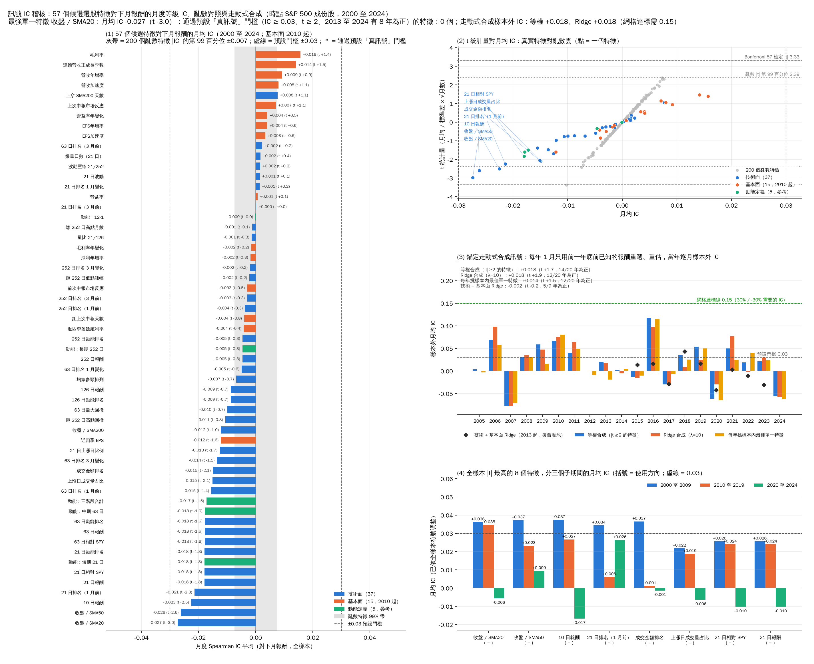
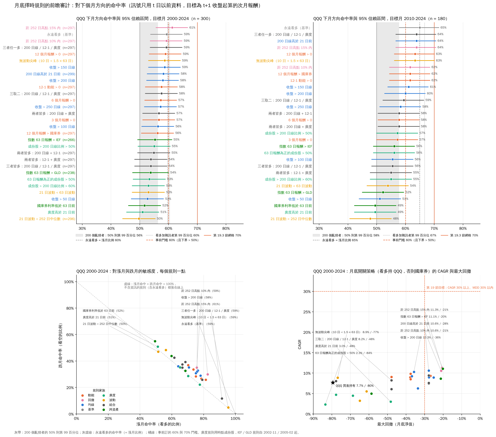
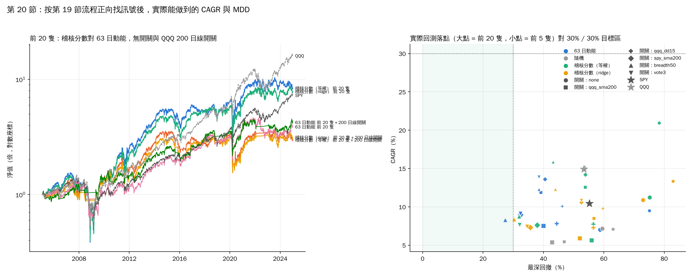

# 20. 按第 19 節流程正向找「年回報 30%、MDD 30% 以內」的策略

[回索引](../README.md) · [完整報告](./ANALYSIS.md) · [上一節](./19-skill-needed.md)

> 資料：S&P 500 成份股，Yahoo Finance 調整後收盤價。短期分析期間 2024-01-02 至 2026-10-16；長期回測 2000-01-03 至 2024-12-31。

第 19 節說反推不行，正確的順序是：先訂門檻、再量每個候選訊號的樣本外 IC 與命中率、對照亂數、最後才回測。這一節照做一遍，看現有免費資料裡能找到什麼。三支腳本：`sp500_signal_audit.py`（橫截面訊號 IC 稽核）、`sp500_timing_audit.py`（擇時命中率稽核）、`sp500_forward_search.py`（把稽核出來的分數配開關實際交易，放上第 19.3 節網格）。

## 20.1 事前登錄的門檻（跑任何東西之前就訂好）

| 層級 | 選股 | 擇時 | 來源 |
|---|---|---|---|
| 「真訊號」 | 月均 IC ≥ 0.03、t ≥ 2、2013 至 2024 年 12 年中 8 年為正 | 命中率 ≥ 60% 且 95% 信賴區間下界高於 50% | 第 18.4、19.8 節 |
| 「達標」 | 樣本外合成 IC ≥ 0.15 | 命中率 ≥ 70% | 第 19.3 節網格（前 5 隻 30% / −30% 的最低組合） |

兩層都不改、不加條件、不事後放寬。達不到「真訊號」就停，不進回測。

## 20.2 橫截面訊號稽核：57 個特徵對下月報酬的月度 IC

宇宙與第 15 節相同（時點成份股，每月中位數 338 隻可排名），2000 至 2024 年 298 個月。特徵：第 17 節的 37 個技術面、15 個 EDGAR 時點基本面（2010 年起）、5 種動能定義作參考。目標是執行日收盤到下月執行日收盤的報酬。亂數對照：200 個標準常態特徵走同一條管線。

| 項目 | 結果 |
|---|---|
| 最強單一特徵 | 收盤 / 20 日均線：IC −0.027，t −3.0（**反轉**：遠高於 20 日線的股票下月較差） |
| 其次 | 收盤 / 50 日線 −0.026（t −2.6）、10 日報酬 −0.023（t −2.5）、21 日排名（1 月前）−0.021、成交金額排名 −0.015、上漲日成交量占比 −0.015 |
| 五種動能定義 | 全為負，−0.000 到 −0.018，\|t\| < 1.9 |
| 最強基本面 | 近四季 EPS −0.012（t −1.6）；毛利率 +0.016（t 1.4）、連續營收正成長季數 +0.014（t 1.5） |
| 亂數對照 | \|IC\| 第 99 百分位 0.0074、\|t\| 第 99 百分位 2.39；Bonferroni 57 檢定 \|t\| 3.33 |
| 超過亂數第 99 百分位 | 3 個（上面前三個）；超過 Bonferroni 0 個 |
| **通過「真訊號」門檻** | **0 / 57** |

子期間：\|t\| 最高的 8 個特徵在 2000 至 2009 年 IC 約 +0.034 到 +0.037（已依方向調整），2010 至 2019 年 +0.02 到 +0.03，2020 至 2024 年約 0 或負。也就是最強的訊號在最近五年已經低於門檻。

**錨定走動式合成**（每年 1 月只用前一年底前的資料挑 \|t\| ≥ 2 的特徵，等權或 ridge 合成，當年逐月量樣本外 IC）：

| 合成方式 | 期間 | 樣本外月均 IC | t | 年份為正 |
|---|---|---|---|---|
| 等權 | 2005 至 2024 | +0.018 | 1.7 | 14 / 20 |
| Ridge（λ = 10） | 2005 至 2024 | +0.018 | 1.9 | 12 / 20 |
| 每年挑樣本內最佳單一特徵 | 2005 至 2024 | +0.014 | 1.5 | 12 / 20 |
| 技術 + 基本面 ridge（覆蓋股池） | 2013 至 2024 | −0.002 | −0.2 | 5 / 9 |

合成分數每年挑到的都是同一批反轉特徵（10 日報酬、收盤 / 均線、成交金額排名，全部負號），樣本外 IC 集中在 2006、2009 至 2011、2016 年（+0.10 到 +0.12），2007、2020、2024 年為負。**對 0.03：不過；對 0.15：不過，約為達標線的八分之一。**

## 20.3 擇時稽核：29 條月底規則猜下月方向的命中率

規則：收盤對 50 / 100 / 150 / 200 / 250 日線、200 日線斜率、3 / 6 / 12 個月絕對動能、12-1、12 個月報酬對國庫券、三種波動率狀態、距 252 日高點 10% / 15% 內、四種廣度（時點成份股）、三種跨資產（IEF、GLD、國庫券利率）、三種投票組合，加「永遠看多」作基準。目標 SPY 與 QQQ 各算，2000 至 2024 年 300 個月與 2010 至 2024 年 180 個月。亂數對照兩種：200 個擲硬幣者，與 200 個「永遠看多加雜訊」者（後者的第 99 百分位約等於永遠看多的命中率，是正確的對照）。

| 目標 / 期間 | 永遠看多 | 最佳規則 | 命中率 [95% 區間] | 漲月 / 跌月命中 | 對永遠看多的 p 值 | 看多加雜訊第 99 百分位 | 過 60% | 過 70% | 開關策略 CAGR / MDD 對買進持有 |
|---|---|---|---|---|---|---|---|---|---|
| QQQ 2000-24 | 59.6% | 距 252 日高點 15% 內 | 61.3% [55.6, 66.6] | 82% / 30% | 0.60 | 60.3% | 是 | 否 | 11.3% / −21% 對 7.4% / −79% |
| QQQ 2010-24 | 65.0% | 200 日線斜率向上 | 63.9% [56.6, 70.5] | 91% / 13% | 0.81 | 66.7% | 是 | 否 | 17.3% / −21% 對 18.4% / −34% |
| SPY 2000-24 | 61.7% | 距 252 日高點 10% 內 | 63.0% [57.4, 68.3] | 83% / 31% | 0.68 | 62.3% | 是 | 否 | 8.8% / −18% 對 7.6% / −53% |
| SPY 2010-24 | 68.9% | 距 252 日高點 10% 內 | 67.2% [60.1, 73.7] | 91% / 14% | 0.68 | 69.4% | 是 | 否 | 11.6% / −18% 對 13.6% / −24% |

- **沒有一條規則達到 70%**（0 / 29，四個格子都是）。
- 「60% 且下界高於 50%」在四個格子分別有 1、10、11、17 條通過，但「永遠看多」本身在其中三格也通過（59% 到 69%）。這個門檻量到的是多頭市場的基準率，不是技巧。對正確的對照（永遠看多加雜訊），全期間各只有一條規則超過第 99 百分位，2010 年後沒有；對永遠看多的 p 值全部 ≥ 0.6。
- **每條規則都落在「漲月命中 + 跌月命中 = 100%」那條線附近**：最佳規則猜對 82% 到 91% 的漲月，只猜對 13% 到 31% 的跌月。跌月命中超過 50% 的規則（國庫券利率下降、廣度上升、波動狀態）整體命中率只有 48% 到 53%。規則買到的是對某一方向的敏感度，不是資訊。
- 2010 年後沒有開關的 CAGR 勝過 QQQ 買進持有（18.4%），唯一的例外是波動尖峰規則（18.6%，MDD −35% 對 −34%，幾乎永遠在場）。
- 可驗證性：把最佳規則與 50% 分開要 32 到 75 個月，但與永遠看多分開要 3,400 到 5,400 個月，或根本不可能（它低於基準率）。擇時規則該比的是基準率，而那在有生之年無法驗證（第 19.8 節第 4 點）。

## 20.4 把稽核分數配開關實際交易（2005 至 2024 年，238 個月）

門檻兩邊都沒過，按規矩應該停。這裡仍把合成分數拿去交易，目的是示範「量到的 IC 與命中率落在網格哪一格」和實際回測是否一致。每月底買分數最高的 N 隻、等權、下一收盤執行、成本 0.1%，開關猜跌就整月持國庫券。

| 組合 | CAGR / MDD | 實測 IC | 開關命中 | 網格預期（最近格） |
|---|---|---|---|---|
| 稽核分數（等權）前 5 隻，無開關 | **21.0% / −78%** | +0.018（t 1.7） | 66%（永遠看多） | (0.03, 70%) → 16% / −35% |
| 同上 + 廣度 > 50% 開關 | 15.9% / −43% | | 61% | (0.03, 60%) → 11% / −34% |
| 稽核分數前 20 隻，無開關 | 11.2% / −75% | | 66% | (0.03, 70%) → 17% / −28% |
| 同上 + 廣度 > 50% 開關 | 8.8% / −32% | | 61% | (0.03, 60%) → 13% / −28% |
| Ridge 分數前 20 隻 + 廣度開關 | 8.4% / −30% | +0.018（t 1.9） | 61% | 13% / −28% |
| 63 日動能前 5 隻，無開關 | 9.5% / −75% | −0.011 | | (0, 70%) → 12% / −35% |
| 63 日動能前 20 隻 + 廣度開關 | 8.3% / −27% | | | 10% / −32% |
| 隨機 5 隻（中位數，第 90 百分位） | 7.1% / −63%（10.9%） | 0 | | |
| 隨機 20 隻 | 7.2% / −60% | 0 | | |
| SPY | 10.4% / −55% | | | |
| QQQ | 14.9% / −53% | | | |

看起來「稽核分數前 5 隻 21%」很亮眼，拆開之後：

| 稽核分數前 5 隻，無開關 | 2005 至 2009 | 2010 至 2019 | 2020 至 2024 |
|---|---|---|---|
| CAGR / MDD | 12.0% / −78% | 33.2% / −54% | 7.8% / −49% |
| 對照 SPY | 0.9% / −55% | 13.3% / −19% | 14.3% / −34% |

- 逐年：2009 年 +176%、2010 年 +138%、2011 年 +70%，2024 年 −22%。2009 至 2011 年 36 個月裡出現最多的持股是 Compuware（15 次）、紐約時報、El Paso、AIG、Goodyear、Huntington、MBIA、First Horizon、Zions：金融海嘯後的困境股反彈，買的是「跌最慘的 5 隻」。這就是第 7 節早就量到的「極端下跌後反轉」，不是新東西，而且在 2020 年後已失效（IC 轉負）。
- **換手率每月 88%**。成本 0.1% 時 21.1%，0.3% 時 16.0%，0.5% 時 11.1%（等於 SPY），1.0% 時 −0.3%。每月全部換成剛剛跌最慘的 5 隻大型股，實際成本不會是 0.1%。
- MDD −78% 無論加哪個開關都在 −32% 到 −54%，沒有一個組合進到目標區。前 20 隻加開關的 8% 到 9% / −30% 與第 15.6 節、第 19.3 節左下角格子一致：這就是 IC 0.02 配命中 60% 應有的樣子。
- 網格預期與實測大致對得上（前 20 隻 13% 對 8.8%、11% 對 15.9%）。前 5 隻無開關高於預期是因為反轉分數的前 5 名是波動最大的極端名字，網格用的是常態雜訊，低估了尾端；代價是 −78% 的回撤，也高於網格。

## 20.5 判定

| 步驟 | 事前門檻 | 結果 | 通過 |
|---|---|---|---|
| 選股真訊號 | IC ≥ 0.03、t ≥ 2、8 / 12 年 | 最佳 0.027（t 3.0），2013 至 2024 年最佳 0.021（t 1.5） | 否（0 / 57） |
| 選股達標 | 樣本外合成 IC ≥ 0.15 | +0.018 | 否 |
| 擇時真訊號 | ≥ 60% 且下界 > 50% | 61% 到 67%，但永遠看多 60% 到 69%，p ≥ 0.6 | 形式上是，實質上否 |
| 擇時達標 | ≥ 70% | 最高 67.2% | 否（0 / 29） |
| 合成回測 | 30% / −30% | 最佳 21% / −78%；加開關後 8% 到 16% / −30% 到 −43% | 否 |

正向流程在第一步就該停。免費可得的價格、成交量、EDGAR 財報裡，對 S&P 500 大型股下月報酬唯一量得到的橫截面訊號是 1 個月反轉，IC 0.02 到 0.03，2020 年後消失，而且要靠每月 88% 換手去實現；擇時規則與永遠看多無法區分。

## 20.6 結論

- 用正確的方法找，答案是「找不到」，而且是在第一步就知道，不必等回測。這比反推法好的地方是：它不會給出一條漂亮但假的曲線。
- 第 19.8 節的合理目標維持不變：前 20 隻加均線開關約 13% 到 14% / −25% 到 −28% 是 IC 0.03 到 0.05 的預期值；這次實測的 IC 只有 0.018，實際做出來是 8% 到 9% / −30%，低於預期，也低於 SPY。對大型股而言，持有指數仍是最好的答案。
- 要繼續找，剩下的只有第 18.4 節那條路：非價格、非財報的資料（分析師預估修正、盈餘驚奇）。拿到資料後第一件事是跑 `sp500_signal_audit.py` 同樣的流程，IC 不到 0.03 就停。

---

[回索引](../README.md) · [完整報告](./ANALYSIS.md) · [上一節](./19-skill-needed.md)
