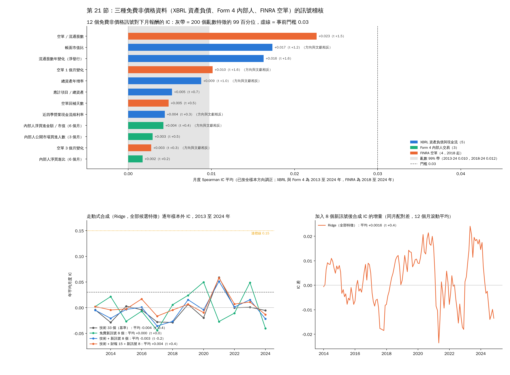

# 21. 剩下的三種免費資料：XBRL 資產負債、Form 4 內部人、FINRA 空單

[回索引](../README.md) · [完整報告](./ANALYSIS.md) · [上一節](./20-forward-search.md) · [下一節](./22-screens.md)

> 資料：S&P 500 成份股，Yahoo Finance 調整後收盤價。短期分析期間 2024-01-02 至 2026-10-16；長期回測 2000-01-03 至 2024-12-31。

第 20 節把價格、成交量與 EDGAR 損益表稽核完，結論是 0 / 57。這一節把免費資料裡還沒碰過的三種來源補進同一套稽核：SEC XBRL 的資產負債表與現金流量表、SEC Form 4 內部人交易、FINRA 集中空單餘額。門檻、目標、亂數對照與走動式合成都沿用第 20.1 節，不改。腳本 `sp500_free_signals.py`（下載與建特徵）、`sp500_free_signals_audit.py`（稽核），輸出 `free_signals_audit_*.csv` 與 `docs/free_signals_audit.png`。

## 21.1 資料與特徵（全部時點對齊）

| 來源 | 取得方式 | 範圍 | 特徵（文獻預期方向） |
|---|---|---|---|
| XBRL 資產負債與現金流 | `data.sec.gov` companyconcept API，與第 17.3 節同一快取與限速 | 608 家、168,646 筆期間值、2008 年起；2010 年後覆蓋可交易名單的 91% | 總資產年增率（−）、流通股數年變化即淨發行（−，已處理分割與千股單位切換）、應計項目 =（近四季淨利 − 近四季營業現金流）/ 總資產（−）、帳面市值比（+）、近四季營業現金流殖利率（+） |
| Form 4 內部人交易 | SEC「Insider Transactions Data Sets」季檔 76 個，2006Q1 至 2024Q4 | 701,746 筆公開市場買賣（代碼 P / S），其中買進 43,893 筆，754 家發行人 | 6 個月淨買進比 =（買進筆數 − 賣出筆數）/ 總筆數（+）、3 個月公開市場買進人數（+）、6 個月淨買進金額 / 市值（+）；只算高階主管、董事與 10% 股東，沒有交易的公司記 0 |
| FINRA 集中空單 | FINRA Query API，每月兩次結算日 | 132,342 筆、658 檔，2017-12-29 起 | 空單 / 流通股數（−）、回補天數（−）、空單 1 個月與 3 個月變化（−） |

時點規則：財報與 Form 4 用申報日，申報日在月底 t 之後的不用；年比用期末在 330 到 400 天前、且 t 時已申報的那一期。FINRA 結算日加 12 天才算公開。市值用申報股數乘當日調整後價格，股數先換到與調整後價格相同的基準。

## 21.2 單一特徵 IC（對下月報酬，月度 Spearman）

亂數對照同第 20.2 節：200 個亂數特徵走同一流程，按全樣本方向調正後，2010 至 2024 年平均 IC 的 99 百分位是 0.0080（|t| 2.21），2018 至 2024 年是 0.0117（|t| 2.32）；加上第 20 節共 69 次檢定，Bonferroni |t| 門檻 3.38。

| 特徵 | 文獻方向 | 實際方向 | 月數 | 平均 IC | t | 2013 至 2024 調正 IC | t | 12 年中為正 | 2010 至 2019 | 2020 至 2024 | 過亂數 99% | 過門檻 |
|---|---|---|---|---|---|---|---|---|---|---|---|---|
| 空單 / 流通股數 | − | − | 82 | −0.023 | −1.5 | 0.023 | 1.5 | 6 / 7 | −0.027 | −0.021 | 否 | 否 |
| 流通股數年變化（淨發行） | − | − | 177 | −0.014 | −1.5 | 0.016 | 1.6 | 8 | −0.006 | −0.029 | 否 | 否 |
| 帳面市值比 | + | − | 183 | −0.016 | −1.3 | 0.017 | 1.2 | 8 | −0.024 | −0.003 | 否 | 否（方向相反） |
| 空單 1 個月變化 | − | + | 81 | +0.010 | 1.6 | 0.010 | 1.6 | 5 / 7 | +0.015 | +0.008 | 否 | 否（方向相反） |
| 總資產年增率 | − | + | 180 | +0.002 | 0.2 | 0.009 | 1.0 | 7 | +0.006 | +0.001 | 否 | 否（方向相反） |
| 應計項目 / 總資產 | − | − | 177 | −0.006 | −0.8 | 0.005 | 0.7 | 8 | −0.007 | −0.002 | 否 | 否 |
| 空單回補天數 | − | − | 82 | −0.005 | −0.5 | 0.005 | 0.5 | 5 / 7 | +0.009 | −0.011 | 否 | 否 |
| 近四季營業現金流殖利率 | + | − | 177 | −0.007 | −0.6 | 0.004 | 0.3 | 6 | −0.016 | +0.012 | 否 | 否（方向相反） |
| 內部人淨買進金額 / 市值（6 個月） | + | − | 186 | −0.002 | −0.3 | 0.004 | 0.4 | 7 | −0.011 | +0.007 | 否 | 否（方向相反） |
| 內部人公開市場買進人數（3 個月） | + | + | 220 | +0.001 | 0.1 | 0.003 | 0.5 | 10 | +0.001 | +0.006 | 否 | 否 |
| 空單 3 個月變化 | − | + | 79 | +0.003 | 0.3 | 0.003 | 0.3 | 3 / 7 | +0.006 | +0.002 | 否 | 否（方向相反） |
| 內部人淨買進比（6 個月） | + | + | 220 | +0.001 | 0.2 | 0.002 | 0.2 | 5 | −0.004 | +0.009 | 否 | 否 |

- **0 / 12 達到門檻，0 / 12 超過亂數 99% 帶的 t 值**。最強的是空單比 IC −0.023（t −1.5，只有 82 個月）與淨發行 −0.014（t −1.5）。要把 0.023 的 IC 驗到 t 2 需要約 145 個月，等於 2030 年才知道它是不是真的。
- 12 個特徵只有 6 個方向與文獻相同，另外 6 個反向。帳面市值比反向（2010 至 2024 年成長股勝過價值股）、總資產年增率反向、空單 1 個月變化反向（空單增加的股票下月反而略漲，是空頭回補），這些都是已知的 2010 年後大型股現象，不是訊號。
- 內部人三個特徵全部接近 0（IC 0.001 到 0.004）。S&P 500 的內部人賣出九成是例行處分（657,853 筆賣對 43,893 筆買），買進每月只覆蓋幾十家，當橫截面排序沒有資訊。
- 空單類 2018 年起只有 7 年，是這批特徵裡唯一量到 0.02 的，但與第 20 節的 1 個月反轉一樣是「下跌後反彈」那一類，3 個月 IC −0.039 與 1 個月反轉的方向一致。

## 21.3 走動式合成：加進去有沒有讓合成 IC 變高

與第 20.2 節同一套：每年用之前的資料重估，Ridge λ = 10，測試 2013 至 2024 年；為了能比較，這裡全部在 XBRL 有覆蓋的名單上（每月中位數 380 檔）、訓練都從 2010 年起。|t| ≥ 2 的篩選在這個起點下多數年份一個特徵都選不到，所以報告全部候選特徵的 Ridge。

| 候選特徵 | 2013 至 2024 樣本外 IC | t | 12 年中為正 |
|---|---|---|---|
| 技術面 33 個（基準，同一名單同一起點） | −0.004 | −0.4 | 4 |
| 免費新訊號 8 個（XBRL 5 + Form 4 3） | +0.000 | 0.0 | 6 |
| 技術 33 + 新訊號 8 | −0.003 | −0.2 | 5 |
| 技術 33 + 財報 15 + 新訊號 8 | +0.004 | 0.4 | 6 |
| 空單 4 個（2021 至 2024 年，訓練只從 2018 起） | +0.012 | 1.0 | 3 / 4 |
| 技術 + 新訊號 + 空單（2021 至 2024 年） | +0.008 | 0.3 | 1 / 4 |

同月配對：加入 8 個新訊號後合成 IC 的增量 +0.0016（t 0.4，142 個月）。第 20 節技術面合成在同一段 2013 至 2024 年是 +0.010（訓練從 2000 年起），也就是說這裡的「基準」本身已經低於第 20 節，加新訊號後仍然在 0 附近。

## 21.4 判定

| 步驟 | 事前門檻 | 結果 | 通過 |
|---|---|---|---|
| 選股真訊號 | IC ≥ 0.03、t ≥ 2、8 / 12 年 | 最佳 0.023（t 1.5，82 個月）；12 個中 6 個方向與文獻相反 | 否（0 / 12） |
| 超過亂數對照 | |t| 高於 200 個亂數特徵的 99 百分位 | 0 / 12 | 否 |
| 選股達標 | 樣本外合成 IC ≥ 0.15 | 加進去後 −0.003 到 +0.004，增量 +0.002 | 否 |

流程在第一步就停，不進擇時、不進回測。

## 21.5 結論

- 免費資料到此全部稽核完畢：價格、成交量、EDGAR 損益表（第 20 節）、XBRL 資產負債與現金流、Form 4 內部人、FINRA 空單（本節），共 69 個特徵，沒有一個對 S&P 500 大型股下月報酬有 IC 0.03。上一則預估「最多把合成 IC 從 0.018 拉到 0.03 到 0.05」是文獻上限，實測是 0。
- 原因不是資料品質，是這些效應在 2010 年後的美國大型股裡已經被套利掉：帳面市值比、資產成長、應計項目、內部人買進在文獻裡的 IC 本來就只有 0.01 到 0.03，而且多半來自小型股與 2005 年以前。
- 第 19.8 節的合理目標（前 20 隻加均線開關 13% 到 14% / −25% 到 −28%）是「拿到 IC 0.03 到 0.05 的訊號」才有的數字，免費資料拿不到，所以對只用免費資料的人，答案就是持有指數加一個簡單開關。要再往前只剩付費資料（分析師預估修正、盈餘驚喜），拿到後第一件事仍是跑同一套稽核，IC 不到 0.03 就停。

---

[回索引](../README.md) · [完整報告](./ANALYSIS.md) · [上一節](./20-forward-search.md) · [下一節](./22-screens.md)
