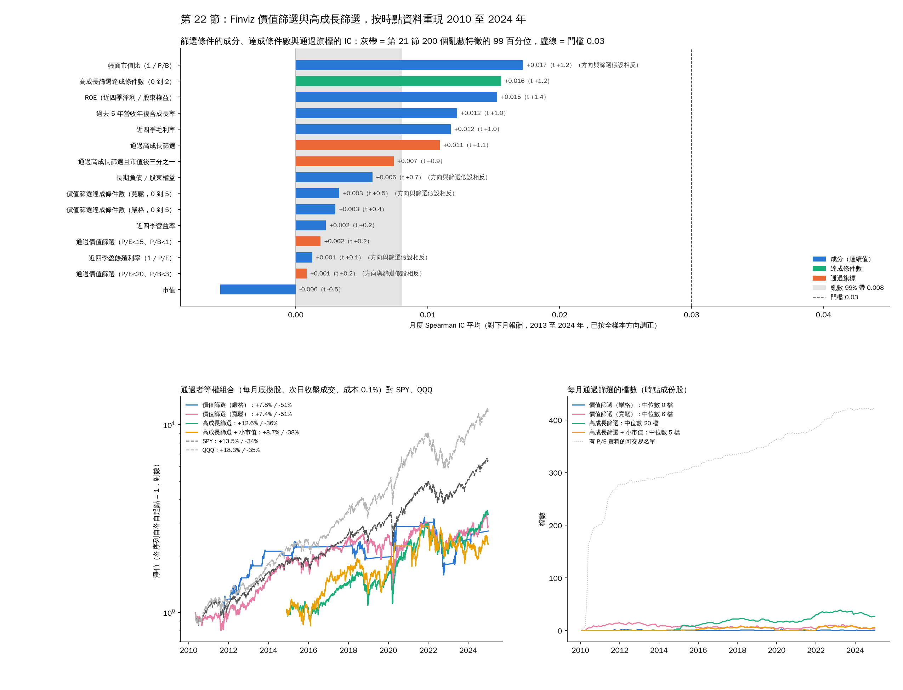

# 22. Finviz 的價值篩選與高成長篩選，按時點資料重現並稽核

[回索引](../README.md) · [完整報告](./ANALYSIS.md) · [上一節](./21-free-signals.md)

> 資料：S&P 500 成份股，Yahoo Finance 調整後收盤價。短期分析期間 2024-01-02 至 2026-10-16；長期回測 2000-01-03 至 2024-12-31。

常見的免費篩選器（Finviz）有兩張標準篩選：價值（P/E 低於 15 或 20、P/B 低於 1 或 3、ROE 高於 15%、長期負債 / 權益低於 0.5、營益率高於 10%）與高成長（EPS 未來年成長高於 15%、過去 5 年營收成長高於 15%、PEG 低於 1、毛利率高於 30%、偏小市值）。篩選器本身只有今天的數字，沒辦法回測；這一節用 SEC 申報日對齊的資料把兩張篩選在 2010 至 2024 年的時點成份股上每月重現，看它們的 IC 與實際組合。腳本 `sp500_screen_audit.py`，輸出 `screen_audit_*.csv` 與 `docs/screen_audit.png`。

## 22.1 重現方式

| 欄位 | 時點資料來源 | 備註 |
|---|---|---|
| P/E | 近四季 EPS（第 17.3 節季表加總）/ 當日調整後價格 | 負盈餘視為不通過，與 Finviz 空白欄位一致 |
| P/B | 市值（申報股數 × 價格）/ 最近申報股東權益 | 股數先換到與調整後價格相同的基準（第 21.1 節） |
| ROE | 近四季淨利 / 股東權益 | XBRL |
| 長期負債 / 權益 | XBRL `LongTermDebtNoncurrent` 等三個標籤，540 家；59 家任何申報都沒有長債標籤，視為無長債 | 本節新增下載 |
| 營益率、毛利率 | 近四季營業利益、毛利 / 近四季營收 | 161 家沒有毛利標籤，改用營收減近四季營業成本 |
| 過去 5 年營收成長 | 近四季營收對 20 季前近四季營收的年複合成長率 | 兩期都申報後才可用，所以 2014 年底起 |
| 小市值 | 當月可交易名單市值後三分之一 | S&P 500 裡的「小」 |
| EPS 未來成長、PEG | 需要分析師預估，免費資料沒有 | 未納入，高成長篩選只剩兩條 |

每個條件缺資料就不通過，與篩選器行為一致。2015 年後每月有 P/E 資料的可交易名單中位數 363 檔、有 5 年營收資料 304 檔、有毛利率 185 檔。通過檔數中位數：價值嚴格 0 檔（最多 3）、價值寬鬆 6 檔、高成長 20 檔、高成長加小市值 5 檔。

## 22.2 成分、達成條件數與通過旗標的 IC

亂數對照沿用第 21 節 2010 至 2024 年視窗：調正後平均 IC 99 百分位 0.008、|t| 2.21。

| 特徵 | 篩選假設方向 | 實際方向 | 月數 | 平均 IC | t | 2013 至 2024 調正 IC | t | 12 年中為正 |
|---|---|---|---|---|---|---|---|---|
| 近四季毛利率 | + | + | 175 | +0.014 | 1.4 | 0.012 | 1.0 | 8 |
| 帳面市值比（1 / P/B） | + | − | 183 | −0.016 | −1.3 | 0.017 | 1.2 | 8（反向） |
| ROE | + | + | 177 | +0.013 | 1.3 | 0.015 | 1.4 | 10 |
| 高成長篩選達成條件數（0 到 2） | + | + | 120 | +0.016 | 1.2 | 0.016 | 1.2 | 6 |
| 通過高成長篩選 | + | + | 120 | +0.011 | 1.1 | 0.011 | 1.1 | 7 |
| 過去 5 年營收年複合成長率 | + | + | 120 | +0.012 | 1.0 | 0.012 | 1.0 | 6 |
| 通過價值篩選（嚴格） | + | + | 42 | +0.009 | 1.0 | 0.002 | 0.2 | 5 |
| 通過高成長篩選且小市值 | + | + | 105 | +0.007 | 0.9 | 0.007 | 0.9 | 7 |
| 通過價值篩選（寬鬆） | + | − | 175 | −0.003 | −0.6 | 0.001 | 0.2 | 5（反向） |
| 市值 | − | − | 184 | −0.005 | −0.5 | 0.006 | 0.5 | 7 |
| 價值篩選達成條件數（嚴格，0 到 5） | + | + | 175 | +0.004 | 0.5 | 0.003 | 0.4 | 5 |
| 長期負債 / 權益 | − | + | 184 | +0.004 | 0.4 | 0.006 | 0.7 | 8（反向） |
| 近四季營益率 | + | + | 175 | +0.004 | 0.4 | 0.002 | 0.2 | 6 |
| 價值篩選達成條件數（寬鬆，0 到 5） | + | − | 175 | −0.002 | −0.3 | 0.003 | 0.5 | 6（反向） |
| 近四季盈餘殖利率（1 / P/E） | + | − | 175 | −0.001 | −0.1 | 0.001 | 0.1 | 6（反向） |

- 15 個特徵 0 個達到 0.03，0 個超過亂數 99% 帶的 t 值；5 個方向與篩選假設相反：P/E、P/B、長期負債 / 權益與兩個價值合成分數。2010 年後的 S&P 500 裡，便宜、低負債不是加分項，貴的和舉債的反而略好。
- 價值篩選的五個條件湊在一起，寬鬆版的達成條件數 IC −0.002，等於用五個沒有資訊的條件做 AND，結果還是沒有資訊。
- 高成長篩選的兩個條件（營收成長、毛利率）各有 0.012 到 0.014，合在一起 0.011 到 0.016，是全報告財報類最強的一組，仍只有門檻的一半，而且 2020 至 2024 年掉到 −0.014 到 +0.009。

## 22.3 通過者等權組合（每月底換股、次日收盤成交、成本 0.1%，沒有通過者時持國庫券）

隨機對照：每月從可交易名單抽同樣檔數，50 次。

| 篩選 | 期間 | 平均檔數 | 月換手 | CAGR / MDD | 隨機同檔數中位數 / 第 90 百分位 | 勝過隨機的比例 | SPY | QQQ |
|---|---|---|---|---|---|---|---|---|
| 價值嚴格 | 2011-10 至 2024-12 | 0.3（118 個月空倉） | 55% | 7.8% / −51% | 4.7% / 8.0% | 88% | 15.6% / −34% | 20.1% |
| 價值寬鬆 | 2010-05 至 2024-12 | 7.5 | 17% | 7.4% / −51% | 8.9% / 12.0% | 34% | 13.5% / −34% | 18.3% |
| 高成長 | 2014-12 至 2024-12 | 21.6 | 6% | **12.6% / −36%** | 8.1% / 9.8% | 100% | 12.9% / −34% | 18.0% |
| 高成長 + 小市值 | 2014-12 至 2024-12 | 4.1 | 22% | 8.7% / −38% | 5.0% / 11.0% | 76% | 12.9% / −34% | 18.0% |
| 高成長 + QQQ 200 日線開關 | 2014-12 至 2024-12 | 21.6 | 6% | 9.1% / −35% | 4.1% / 5.3% | 100% | 12.9% / −34% | 18.0% |

逐年（高成長，無開關）：2015 +3.6%、2016 +10.4%、2017 +24.0%、2018 −17.4%、2019 +35.6%、2020 +45.7%、2021 +27.0%、2022 −28.8%、2023 +25.9%、2024 +25.7%。

- **價值篩選在 S&P 500 裡幾乎沒有東西可買**：嚴格版 13 年中 118 個月一檔都沒有，P/B 低於 1 配 ROE 高於 15% 等於要求 P/E 低於 7，大型股不會有。寬鬆版平均 7.5 檔，7.4% / −51%，輸 SPY 6 個百分點，也輸隨機抽同樣檔數的中位數。
- **高成長篩選是這份報告裡唯一打平 SPY 的選股做法**：12.6% / −36% 對 SPY 12.9% / −34%，勝過 100% 的隨機同檔數組合（隨機中位數 8.1%，因為等權小樣本在 2015 至 2024 年遠輸市值加權指數）。它實際上是「持有 20 檔高毛利、高營收成長的大型股」，也就是 2015 至 2024 年領漲的那一類；它的超額是對等權隨機組合的，不是對指數的，而且輸 QQQ 5 個百分點、MDD 更深、2022 年 −29%。
- 加小市值條件更差（8.7%，4 檔，換手 22%）；加 QQQ 開關把高成長版砍到 9.1%，與第 15.6 節一致：2010 年後開關只會拿掉多頭年。
- 與第 19.3 節網格對照：IC 0.011 到 0.016、沒有擇時，對應前 20 隻 6% 到 10% / −44% 那格；高成長版 12.6% 高於格子，差額是 2015 至 2024 年單一多頭段給高毛利成長股的 beta，不是訊號。

## 22.4 判定

| 問題 | 答案 |
|---|---|
| 篩選器的欄位有沒有訊號 | 沒有。15 個成分、合成分數與旗標 0 個達 0.03；價值類五個條件裡三個方向相反 |
| 篩選器能不能當選股策略 | 價值篩選：不能，大型股裡沒有通過者，有的也輸指數與隨機。高成長篩選：打平 SPY、輸 QQQ、回撤更深，不比持有指數好 |
| 篩選器能不能用來驗證 | 不能，它只有今天的數字；本節是用申報日資料重現才能回測 |
| 篩選器的正確用途 | 等有通過稽核的規則之後拿來產生今天的名單；目前沒有這種規則 |

## 22.5 結論與付費工具的用法

- 兩張篩選在 S&P 500 時點宇宙 2010 至 2024 年的結果：價值篩選無效且幾乎無人通過，高成長篩選等於持有高毛利成長股，報酬與 SPY 相同、回撤更深。沒有一個欄位有 IC 0.03，第 21 節「免費資料 69 個特徵沒有一個可用」的結論擴大到 84 個。
- 高成長篩選缺的兩個欄位（EPS 未來成長、PEG）要分析師預估。但文獻上「預期成長率高」本身是已定價的，大型股裡對未來報酬的 IC 接近零；付費工具（Seeking Alpha、TradingView、TIKR、Finchat、Koyfin）值得買的是**共識修正**與**相對共識的盈餘驚喜**，不是未來成長率的水準。
- 買之前只問一件事：能不能匯出有日期的歷史共識（每個月底當時的預估值，不是事後修正過的最終值）。只有今天數字的工具不能稽核，照第 18.4 節的規則就不能拿來交易。拿到三年資料後做成月底特徵（修正 1 個月與 3 個月、驚喜幅度、修正廣度），接進 `sp500_free_signals_audit.py`，IC 不到 0.03 就退訂。
- 小市值那條路要換宇宙：S&P 500 裡的「小」不是小型股，第 19.3 節網格也不適用於 Russell 2000，需要另一套時點成份與價格資料。

---

[回索引](../README.md) · [完整報告](./ANALYSIS.md) · [上一節](./21-free-signals.md)
