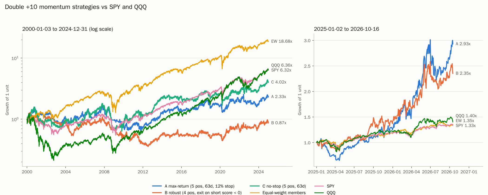
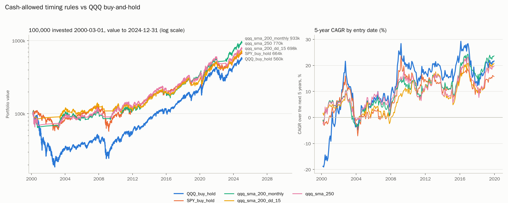
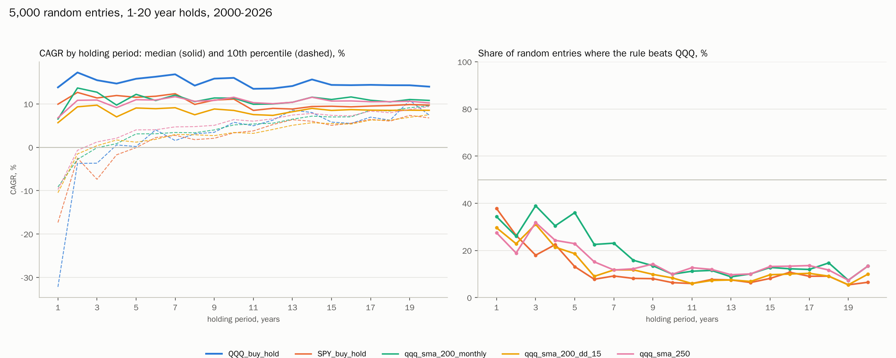
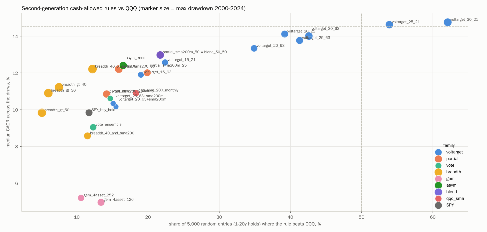
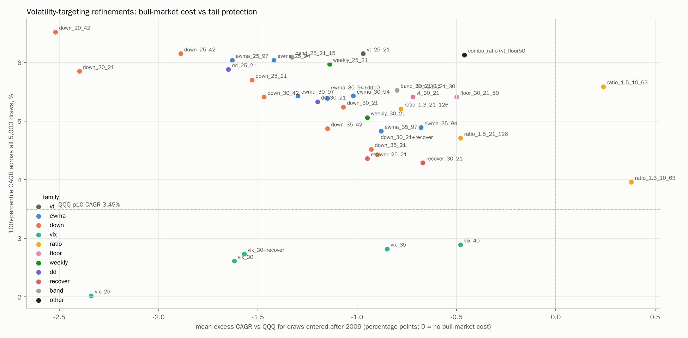
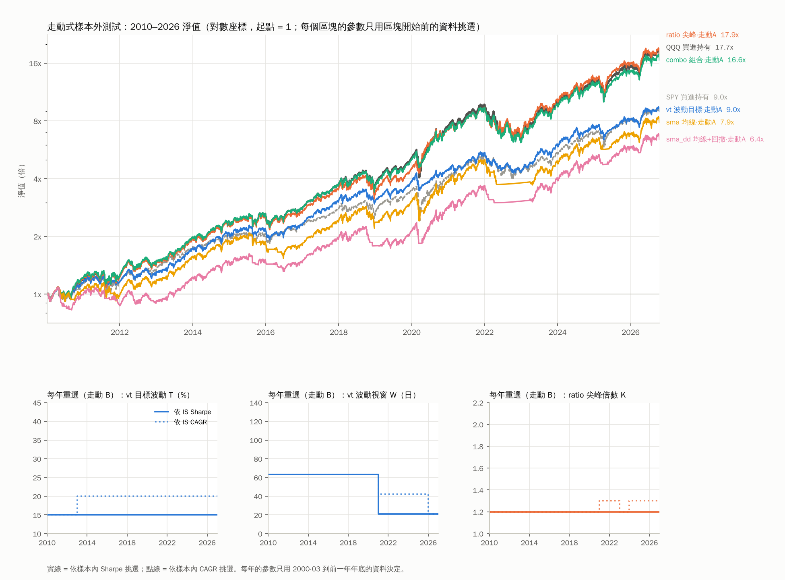
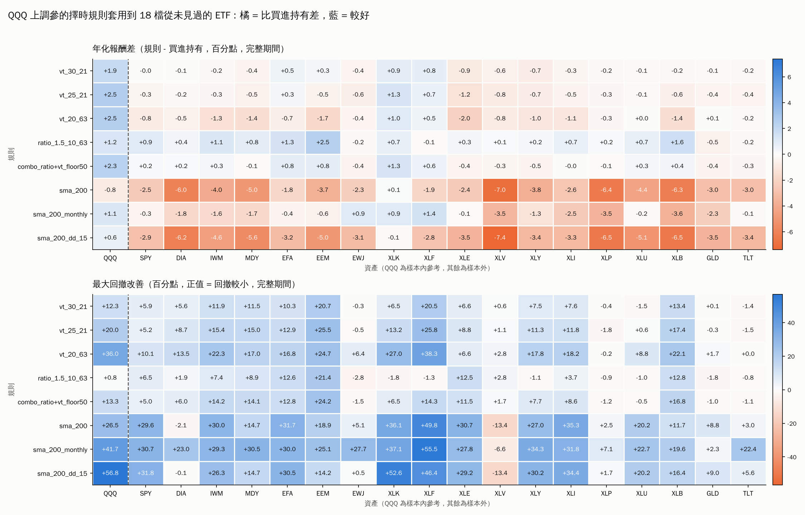
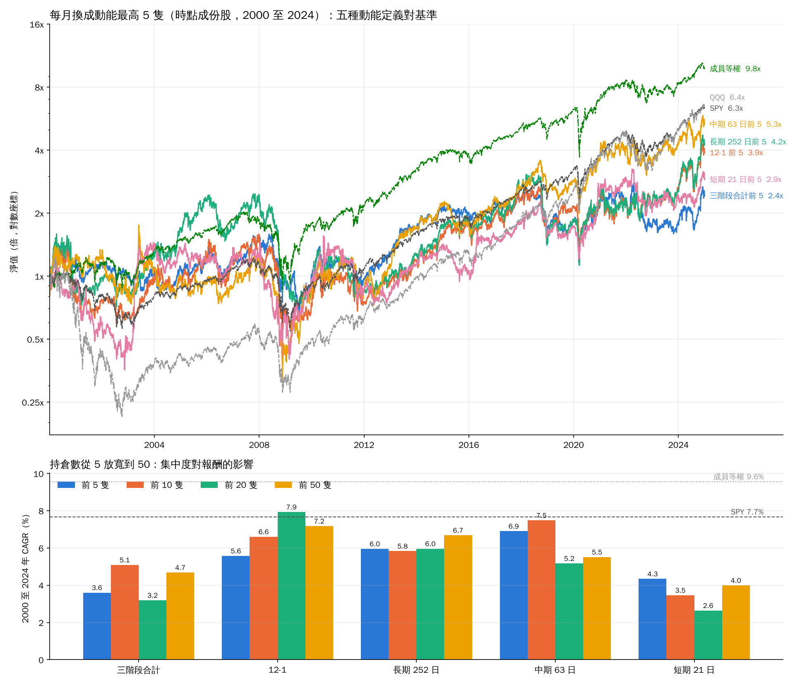

# S&P 500 動能分析報告（2024-01-02 至 2026-10-16，附 2000-2024 長期驗證）

[回索引](../README.md) · 分節版：[1 方法](./01-method.md) · [2 快照](./02-snapshot.md) · [3 接續性](./03-persistence-2024-2026.md) · [4 校準](./04-calibration.md) · [5 買入點](./05-entry-points.md) · [6 組合回測](./06-portfolio-backtest.md) · [7 2000-2024](./07-backtest-2000-2024.md) · [8 SPY/QQQ 比較](./08-benchmark-comparison.md) · [9 允許空倉對 QQQ](./09-beat-qqq.md) · [10 結論](./10-conclusions.md) · [11 重跑](./11-reproduce.md) · [12 策略總表](./12-strategy-table.md) · [13 走動式樣本外](./13-walk-forward.md) · [14 跨資產驗證](./14-cross-asset.md) · [15 每月前 5 隻](./15-top5-monthly.md)

資料：S&P 500 現行 503 隻成份股，Yahoo Finance 每日調整後收盤價，701 個交易日。
所有程式與輸出檔都在此 repo，重跑方式見文末。

## 目錄

1. 方法
2. 當前快照（2026-10-16）
3. 2024 至 2026 的接續性
4. 事後校準：分數對未來報酬
5. 從贏家反推買入點
6. 組合回測：最多 3 到 5 隻持倉
7. 2000 至 2024 年長期回測
8. 與 SPY、QQQ 的比較
9. 允許空倉：以 10 萬本金、任意時點進場，能否跑贏 QQQ
10. 結論與限制
11. 重跑方式與檔案清單
12. 全部策略總表
13. 走動式樣本外測試
14. 跨資產驗證
15. 每月換成動能最高 5 隻

---

## 1. 方法

### 1.1 動能分數

對每隻股票計算三個階段的動能，預設以區間報酬率衡量（`--method regression` 可改為對數價格回歸斜率乘 R²）：

| 階段 | 視窗 |
|---|---|
| 短期 | 最近 21 個交易日（約一個月） |
| 中期 | 最近 63 個交易日（約一季） |
| 長期 | 最近 252 個交易日（約一年） |

分數是**橫斷面十分位排名**，每天在全體成份股中各自排序：

- 上升的股票依速度快慢給 **+1（最慢）到 +10（最快）**
- 下降的股票依跌速給 **-1（最慢）到 -10（最快）**
- 持平為 0

因此 +10 代表「當天所有上漲股票中最快的 10%」，不是絕對報酬門檻。

### 1.2 事後反推

事後資料用在兩個地方：

1. **重建當時的動能**：對每個交易日只用該日以前的價格計算分數，得到每隻股票每天的分數序列，無前視偏差。
2. **用未來報酬當標準答案**：把每天的即時分數對上之後 21 日與 63 日的實際報酬，檢驗哪些分數真的有預測力（校準表、資訊係數），以及從贏家行情的低點反推哪些即時訊號最早且最準地抓到起漲。

---

## 2. 當前快照（2026-10-16）

### 2.1 上升與下降家數

| 階段 | 上升 | 下降 |
|---|---|---|
| 短期 | 289 | 214 |
| 中期 | 247 | 256 |
| 長期 | 332 | 171 |

趨勢標記：三階段全升 137 隻，全跌 68 隻，混合 298 隻。

### 2.2 綜合分數前十

| Symbol | Security | Sector | 短期 | 中期 | 長期 | 綜合 | 2024 | 2025 | 2026 YTD |
|---|---|---|---|---|---|---|---|---|---|
| MPC | Marathon Petroleum | Energy | 10 | 10 | 10 | 10.00 | -6.58 | 19.17 | 197.37 |
| MRNA | Moderna | Health Care | 10 | 10 | 10 | 10.00 | -63.04 | -29.08 | 639.27 |
| AMGN | Amgen | Health Care | 10 | 9 | 9 | 9.33 | -9.71 | 29.67 | 34.84 |
| APA | APA Corporation | Energy | 8 | 10 | 10 | 9.33 | -33.86 | 11.54 | 105.65 |
| VLO | Valero Energy | Energy | 8 | 10 | 10 | 9.33 | -3.45 | 36.97 | 177.22 |
| HAS | Hasbro | Consumer Discretionary | 10 | 9 | 8 | 9.00 | 17.43 | 52.52 | 23.18 |
| PSX | Phillips 66 | Energy | 7 | 10 | 10 | 9.00 | -12.38 | 17.51 | 131.95 |
| XOM | ExxonMobil | Energy | 9 | 9 | 9 | 9.00 | 8.67 | 15.98 | 51.71 |
| COP | ConocoPhillips | Energy | 9 | 9 | 9 | 9.00 | -13.30 | -2.34 | 59.96 |
| CRL | Charles River Laboratories | Health Care | 7 | 10 | 10 | 9.00 | -21.20 | 8.06 | 50.47 |

### 2.3 綜合分數後十

| Symbol | Security | Sector | 短期 | 中期 | 長期 | 綜合 | 2024 | 2025 | 2026 YTD |
|---|---|---|---|---|---|---|---|---|---|
| FSLR | First Solar | Information Technology | -9 | -9 | -8 | -8.67 | 2.37 | 48.22 | -33.91 |
| FDXF | FedEx Freight | Industrials | -8 | -10 | -8 | -8.67 | | | -25.03 |
| WYNN | Wynn Resorts | Consumer Discretionary | -8 | -10 | -9 | -9.00 | -7.92 | 41.02 | -36.72 |
| MOS | Mosaic Company | Materials | -10 | -8 | -9 | -9.00 | -30.60 | 1.10 | -19.74 |
| CHTR | Charter Communications | Communication Services | -10 | -8 | -10 | -9.33 | -12.45 | -39.10 | -47.25 |
| AXON | Axon Enterprise | Industrials | -9 | -10 | -9 | -9.33 | 136.19 | -4.44 | -31.28 |
| ARE | Alexandria Real Estate | Real Estate | -10 | -9 | -10 | -9.67 | -21.02 | -46.60 | -11.16 |
| SKYD | Skydance Corporation | Communication Services | -10 | -9 | -10 | -9.67 | -26.01 | 30.04 | -47.68 |
| APP | AppLovin | Communication Services | -10 | -10 | -10 | -10.00 | 735.04 | 108.08 | -60.50 |
| FICO | Fair Isaac | Information Technology | -10 | -10 | -10 | -10.00 | 76.01 | -15.08 | -54.38 |

FDXF 於 2026 年分拆上市，沒有 2024 與 2025 報酬。

### 2.4 產業（依平均綜合分數排序）

| Sector | 股票數 | 2024 中位數 | 2025 中位數 | 2026 YTD 中位數 | 平均綜合分數 | 全升 | 全跌 |
|---|---|---|---|---|---|---|---|
| Energy | 21 | 3.74 | 10.10 | 41.11 | 5.70 | 14 | 0 |
| Health Care | 60 | -2.02 | 8.28 | 18.76 | 4.33 | 32 | 1 |
| Consumer Staples | 34 | -0.92 | -5.39 | 13.72 | 2.48 | 17 | 4 |
| Information Technology | 75 | 17.24 | 10.88 | 26.19 | 1.19 | 14 | 4 |
| Materials | 24 | 2.46 | -1.58 | 13.78 | 0.96 | 8 | 4 |
| Industrials | 83 | 20.72 | 13.15 | 6.88 | -0.04 | 18 | 11 |
| Consumer Discretionary | 47 | 19.17 | 8.59 | -3.20 | -0.23 | 14 | 13 |
| Financials | 76 | 27.40 | 11.32 | 4.02 | -0.36 | 15 | 13 |
| Utilities | 31 | 16.69 | 15.31 | 5.55 | -0.67 | 2 | 4 |
| Real Estate | 30 | 9.91 | -5.44 | 5.27 | -1.74 | 2 | 7 |
| Communication Services | 22 | 37.92 | 13.54 | -11.18 | -2.05 | 1 | 7 |

能源與醫療保健是 2026 年的動能核心：能源 21 隻中 14 隻三階段全升，沒有一隻全跌。2024 年領漲的通訊服務、金融、工業在 2026 年明顯降速，通訊服務與非必需消費的 2026 中位數轉負。

---

## 3. 2024 至 2026 的接續性

2025 報酬與 2026 YTD 報酬的 Spearman 等級相關只有 **0.094**（Pearson 0.32，被少數極端值拉高）。去年的排名對今年幾乎沒有預測力：

| 2025 分組 | n | 2026 中位數報酬 % | 2026 上漲比例 % |
|---|---|---|---|
| 2025 最差四分位 | 125 | 5.28 | 57.6 |
| 2025 第二四分位 | 125 | 7.05 | 66.4 |
| 2025 第三四分位 | 125 | 8.07 | 76.0 |
| 2025 最佳四分位 | 125 | 10.27 | 68.0 |

- **大反轉**（2025 前四分之一掉到 2026 後四分之一）29 隻：APP（+97% 轉 -59%）、SKYD、ROL、LVS、WYNN、NRG、FSLR、ALB。賭場與 2025 的 AI 電力概念股集中在這裡。
- **大翻身**（2025 後四分之一升到 2026 前四分之一）33 隻：MRNA、MRVL、FTNT、NTAP、CNC、TGT、ZBRA。
- **兩年都在前四分之一**只有 39 隻，目前動能最強的是 VLO、AMGN、ADI、ABBV、TWLO，屬穩定複利型而非爆發型。

---

## 4. 事後校準：分數對未來報酬

每個交易日的即時分數對上之後實際報酬。「超額」是該分數組的平均未來報酬減去同一天全體成份股的平均，已扣除大盤方向。樣本為 2024-02-01 至 2026-10-16 共 680 個評分日、339,235 個（日期 × 股票）觀測值。

### 4.1 之後 21 個交易日

| 分數 | 短期超額% | 中期超額% | 長期超額% | 短期勝率% | 中期勝率% | 長期勝率% | 短期樣本 |
|---|---|---|---|---|---|---|---|
| 10 | 2.69 | 2.39 | 3.48 | 57.8 | 56.1 | 56.1 | 18748 |
| 9 | 0.67 | -0.04 | 0.30 | 55.8 | 52.6 | 53.9 | 18423 |
| 8 | 0.06 | -0.00 | -0.07 | 55.4 | 54.3 | 53.8 | 18485 |
| 7 | -0.09 | -0.42 | -0.18 | 55.5 | 53.3 | 53.0 | 18426 |
| 6 | -0.15 | -0.51 | -0.09 | 55.0 | 52.7 | 53.8 | 18331 |
| 5 | -0.22 | -0.47 | -0.24 | 53.8 | 53.3 | 53.5 | 18561 |
| 4 | -0.43 | -0.53 | -0.45 | 53.5 | 53.4 | 53.1 | 18484 |
| 3 | -0.39 | -0.57 | -0.62 | 53.3 | 53.5 | 52.2 | 18427 |
| 2 | -0.41 | -0.30 | -0.30 | 53.6 | 54.0 | 54.3 | 18481 |
| 1 | -0.49 | -0.15 | -0.41 | 53.2 | 55.0 | 52.3 | 18155 |
| -1 | -0.55 | -0.30 | -0.48 | 54.9 | 55.9 | 53.4 | 14103 |
| -2 | -0.53 | -0.17 | -0.47 | 55.3 | 57.3 | 53.7 | 14437 |
| -3 | -0.37 | -0.19 | -0.61 | 55.2 | 56.6 | 53.0 | 14372 |
| -4 | -0.39 | -0.22 | -0.71 | 55.6 | 55.9 | 53.6 | 14427 |
| -5 | -0.18 | -0.07 | -0.63 | 56.0 | 56.5 | 54.4 | 14504 |
| -6 | -0.09 | -0.05 | -0.39 | 56.3 | 56.6 | 54.0 | 14297 |
| -7 | -0.12 | -0.12 | -0.41 | 56.2 | 55.7 | 54.7 | 14365 |
| -8 | -0.19 | 0.14 | -0.48 | 56.2 | 56.3 | 54.0 | 14433 |
| -9 | 0.17 | 0.57 | 0.01 | 56.2 | 57.7 | 54.4 | 14375 |
| -10 | 0.57 | 1.20 | 0.45 | 55.2 | 57.9 | 55.4 | 14703 |

### 4.2 之後 63 個交易日

| 分數 | 短期超額% | 中期超額% | 長期超額% | 短期勝率% | 中期勝率% | 長期勝率% | 短期樣本 |
|---|---|---|---|---|---|---|---|
| 10 | 7.53 | 7.35 | 10.44 | 59.8 | 57.6 | 59.2 | 17601 |
| 9 | 0.46 | -0.58 | 1.28 | 56.0 | 53.0 | 58.1 | 17297 |
| 8 | -0.61 | -0.56 | -0.26 | 56.2 | 56.2 | 57.5 | 17355 |
| 7 | -0.83 | -1.37 | -0.65 | 57.1 | 56.6 | 57.6 | 17303 |
| 6 | -1.15 | -1.26 | -0.97 | 57.0 | 56.8 | 57.3 | 17210 |
| 5 | -1.11 | -1.50 | -0.89 | 56.9 | 56.4 | 58.8 | 17423 |
| 4 | -1.33 | -1.46 | -1.19 | 56.9 | 56.5 | 59.0 | 17358 |
| 3 | -1.43 | -1.44 | -1.78 | 56.9 | 57.2 | 55.1 | 17300 |
| 2 | -1.20 | -0.91 | -1.86 | 57.1 | 57.8 | 54.3 | 17352 |
| 1 | -1.19 | -0.78 | -2.04 | 57.6 | 59.0 | 54.5 | 17047 |
| -1 | -1.30 | -0.86 | -2.06 | 58.7 | 61.5 | 56.0 | 13140 |
| -2 | -1.10 | -0.43 | -2.12 | 59.6 | 62.1 | 54.8 | 13456 |
| -3 | -1.05 | -0.24 | -1.42 | 59.8 | 62.1 | 56.0 | 13393 |
| -4 | -0.57 | -0.28 | -1.59 | 60.6 | 61.1 | 57.0 | 13447 |
| -5 | -0.36 | 0.07 | -1.40 | 61.2 | 60.6 | 57.4 | 13519 |
| -6 | 0.26 | 0.32 | -0.95 | 61.2 | 60.2 | 57.2 | 13322 |
| -7 | 0.36 | 0.19 | -1.46 | 60.7 | 58.8 | 58.8 | 13389 |
| -8 | 0.35 | 0.42 | -1.59 | 59.4 | 58.9 | 56.9 | 13451 |
| -9 | 1.23 | 1.01 | 0.46 | 58.6 | 61.0 | 58.2 | 13398 |
| -10 | 3.05 | 2.96 | 2.49 | 60.3 | 61.0 | 59.4 | 13702 |

### 4.3 解讀

1. **只有 +10 有可用的正向預測力。** 三個階段的 +10 在之後 21 日超額 +2.4% 到 +3.5%，63 日擴大到 +7% 到 +10%。+9 以下幾乎沒有超額，分數 1 到 8 之間的排序沒有意義。
2. **跌最快的股票平均會反彈。** 短期與中期 -10 的 21 日超額為正，63 日達 +3%。三年中都出現，不是 2025 年 4 月崩盤的單一事件。在 S&P 500 內做空 -10 是負期望。
3. **中期動能對下一季為負。** 三個月漲幅大的股票之後一季傾向落後（中期動能對 63 日報酬的 IC 為 -0.029，t 值 -3.9）。
4. **三階段全升（UP_ALL）沒有篩選力**：21 日超額只有 +0.08%，全跌為 -0.31%。
5. **雙重條件最強**：短期 +10 且長期 +10 同時成立時，21 日超額 +6.07%、勝率 60.1%（樣本 3,728）。只有短期 +10 而長期未達 10 的超額只有 +1.22%。

### 4.4 逐年穩定度（21 日超額 %）

| 年份 | 短期+10 | 短期-10 | 中期+10 | 中期-10 | 長期+10 | 長期-10 |
|---|---|---|---|---|---|---|
| 2024 | 2.08 | -0.15 | 1.59 | 0.66 | | |
| 2025 | 2.79 | 0.55 | 2.66 | 1.55 | 2.39 | 1.29 |
| 2026 | 3.42 | 1.45 | 2.99 | 1.13 | 4.95 | -0.83 |

+10 的效應三年連續為正且逐年增強。-10 的反彈在 2024 幾乎為零，2025 與 2026 才明顯，可靠度較低。長期分數需要一年資料，2024 年沒有值。

### 4.5 資訊係數（每日 Spearman 等級相關的平均）

| 未來視窗 | 指標 | 天數 | 平均 IC | 標準差 | t 值 | 正向日 % |
|---|---|---|---|---|---|---|
| 21 日 | 短期動能 | 659 | 0.0227 | 0.1639 | 3.55 | 54.6 |
| 21 日 | 中期動能 | 617 | -0.0102 | 0.1868 | -1.36 | 52.8 |
| 21 日 | 長期動能 | 428 | 0.0249 | 0.1961 | 2.63 | 55.8 |
| 21 日 | 綜合分數 | 428 | 0.0073 | 0.1867 | 0.81 | 55.4 |
| 63 日 | 短期動能 | 617 | -0.0114 | 0.1774 | -1.60 | 50.1 |
| 63 日 | 中期動能 | 575 | -0.0293 | 0.1819 | -3.87 | 47.5 |
| 63 日 | 長期動能 | 386 | 0.0275 | 0.1460 | 3.70 | 60.6 |
| 63 日 | 綜合分數 | 386 | -0.0106 | 0.1728 | -1.20 | 57.8 |

逐年平均 IC：

| 未來視窗 | 指標 | 2024 | 2025 | 2026 |
|---|---|---|---|---|
| 21 日 | 短期動能 | 0.035 | 0.025 | 0.003 |
| 21 日 | 中期動能 | 0.015 | -0.006 | -0.043 |
| 21 日 | 長期動能 | | 0.008 | 0.049 |
| 63 日 | 短期動能 | -0.001 | -0.005 | -0.041 |
| 63 日 | 中期動能 | -0.033 | -0.017 | -0.047 |
| 63 日 | 長期動能 | | 0.026 | 0.031 |

整體 IC 很弱。短期動能對 21 日、長期動能對 63 日是唯二穩定為正的組合。把三個分數平均成綜合分數會互相抵消，接近零。

### 4.6 分數持續性

| 階段 | 分數 ≥ 8 的股票，21 日後仍 ≥ 8 | 21 日後轉為負分 |
|---|---|---|
| 短期 | 21.4% | 43.6% |
| 長期 | 78.2% | 0.7% |

短期分數適合當時點訊號，長期分數適合當狀態標記。

---

## 5. 從贏家反推買入點

### 5.1 定義贏家行情

用 10% 反轉的 zigzag 把每隻股票的走勢切成波段，低點到高點漲幅 ≥ 30% 的算一次「贏家行情」。

| 項目 | 值 |
|---|---|
| 行情數 | 1,458（43 次仍在進行） |
| 中位數漲幅 | 44.8% |
| 中位數長度 | 68 個交易日 |
| 行情最多的產業 | IT 391、工業 233、金融 199、醫療 146、非必需消費 139 |

低點是事後才知道的真正起點。基準：隨機一天落在某段行情內的機率 36.3%，落在行情頭 20 天內的機率 7.9%。

### 5.2 贏家在起漲時長什麼樣子（中位數）

| 低點後天數 | n | 20 日報酬 % | 相對 20 日線 % | 相對 50 日線 % | 相對 200 日線 % | 距 52 週高 % | 離 52 週低 % | 短期分數 | 中期分數 | 站上 20 日線 % | 站上 50 日線 % |
|---|---|---|---|---|---|---|---|---|---|---|---|
| 0 | 1458 | -10.1 | -7.9 | -9.5 | -10.5 | -25.4 | 14.6 | -8 | -6 | 2.5 | 7.8 |
| 5 | 1448 | -3.1 | -0.2 | -3.0 | -3.0 | -19.3 | 24.1 | -4 | -4 | 44.3 | 28.0 |
| 10 | 1413 | 0.1 | 2.9 | 0.1 | -0.7 | -17.1 | 27.4 | -1 | -2 | 70.1 | 43.6 |
| 20 | 1284 | 14.9 | 4.8 | 4.7 | 4.5 | -12.1 | 31.0 | 8 | 1 | 90.9 | 70.6 |

典型的贏家起點是一隻剛跌到短期分數 -8、距 52 週高點四分之一、在 200 日線下方的股票，不是正在創新高的強勢股。第 10 天左右回到 50 日線，第 20 天短期分數到 +8，此時動能系統才會把它標為強勢。

### 5.3 即時訊號排名

對每一天只用當天以前的資料測試 15 種進場訊號，每種只在條件首次成立那天觸發。欄位說明：涵蓋率 = 完成的行情中該訊號在高點前觸發過的比例；中位延遲 = 低點後第幾天觸發；抓到比例 = 觸發價買入能拿到該行情剩餘漲幅的比例；頭 20 天命中 = 所有觸發中落在某段行情頭 20 天內的比例；倍數 = 相對 7.9% 基準；63 日超額、勝率、大賺（≥ +15%）、大虧（≤ -10%）以所有觸發計算。

| 訊號 | 每股每年觸發 | 涵蓋率 % | 20 天內涵蓋 % | 中位延遲（天） | 抓到比例 % | 頭 20 天命中 % | 倍數 | 63 日超額 % | 勝率 % | 大賺 % | 大虧 % |
|---|---|---|---|---|---|---|---|---|---|---|---|
| thrust_after_fall（10 日 +8% 且前一日短期分數 ≤ -6） | 0.7 | 24.5 | 24.1 | 9 | 66.8 | 42.0 | 5.3 | 7.0 | 64.3 | 40.8 | 21.3 |
| turn_up（10 日 +8% 且距高 ≤ -15% 且 5 天前在 50 日線下） | 1.2 | 33.9 | 32.3 | 10 | 65.7 | 39.1 | 5.0 | 4.6 | 63.1 | 36.8 | 20.4 |
| ret10_gt_8（10 日 +8%） | 6.2 | 98.5 | 79.5 | 10 | 62.6 | 20.2 | 2.6 | 2.2 | 58.1 | 25.7 | 20.7 |
| deep_dd_cross_sma50（距高 ≤ -25% 後站上 50 日線） | 1.4 | 25.4 | 21.4 | 10 | 60.0 | 20.8 | 2.6 | 2.9 | 56.9 | 28.9 | 24.5 |
| short_score_flip_pos（短期分數由負轉 ≥ 3） | 3.4 | 75.1 | 53.9 | 15 | 63.2 | 18.2 | 2.3 | 0.9 | 59.5 | 24.4 | 19.4 |
| short_score_ge8（短期分數 ≥ 8） | 6.4 | 96.6 | 65.2 | 18 | 56.3 | 13.7 | 1.7 | 0.5 | 56.9 | 21.6 | 19.1 |
| breakout_20d_high（突破 20 日高） | 16.1 | 98.7 | 87.8 | 12 | 63.9 | 11.3 | 1.4 | 0.2 | 56.7 | 18.9 | 17.8 |
| rebound_from_52w_low（離 52 週低 ≤ 20% 且 10 日 +8%） | 1.3 | 30.7 | 24.0 | 10 | 65.2 | 28.2 | 3.6 | -0.2 | 58.1 | 24.7 | 19.6 |
| cross_sma20（站上 20 日線） | 13.5 | 97.6 | 97.2 | 6 | 76.2 | 10.5 | 1.3 | -0.2 | 58.4 | 20.7 | 17.4 |
| cross_sma50（站上 50 日線） | 7.9 | 89.8 | 70.3 | 11 | 67.5 | 12.5 | 1.6 | -0.4 | 57.4 | 19.5 | 18.4 |
| sma20_over_sma50（20 日線上穿 50 日線） | 2.5 | 78.3 | 30.6 | 23 | 54.3 | 12.1 | 1.5 | -0.1 | 57.2 | 18.6 | 18.1 |
| breakout_50d_high（突破 50 日高） | 10.5 | 93.6 | 41.1 | 23 | 48.5 | 7.3 | 0.9 | 0.4 | 56.4 | 18.7 | 17.4 |
| breakout_52w_high（突破 52 週高） | 5.8 | 67.7 | 18.9 | 42.5 | 35.7 | 6.1 | 0.8 | 0.6 | 56.2 | 18.3 | 17.4 |
| trend_confirm（價 > 20 日線 > 50 日線且均線上揚） | 7.5 | 91.2 | 43.3 | 21 | 55.8 | 6.8 | 0.9 | -0.4 | 57.4 | 18.9 | 17.5 |
| pullback_resume（多頭排列中回測 20 日線後收復） | 6.2 | 73.3 | 18.5 | 35 | 58.4 | 4.0 | 0.5 | -0.6 | 57.0 | 19.3 | 17.7 |

### 5.4 解讀

1. **最早的訊號不是最好的訊號。** 站上 20 日線最快（6 天）且幾乎每次行情都會觸發，但每年每股觸發 13 次，絕大多數是雜訊，超額報酬為零。
2. **「從下跌狀態急拉」是最有效的買入點。** 10 日漲 8% 本身只是普通訊號；若前一天這隻股票還在最快下跌的那一群（短期分數 ≤ -6），之後 63 日超額 +7.0%、勝率 64%、四成以上大賺 15%。它每年每股只觸發 0.7 次，涵蓋約四分之一的贏家行情，但觸發時有 42% 機率正處於一段大行情的頭 20 天，是基準的 5.3 倍。
3. **逐年都成立。** thrust_after_fall 的 63 日超額：2024 +6.0%、2025 +8.7%、2026 +4.7%。排除 2025 年 4 至 5 月崩盤反彈後仍有 +5.3%、勝率 56.6%。
4. **代價是波動大。** 該訊號 63 日報酬分布為 p10 -19.5%、p25 -6.6%、中位數 +9.6%、p75 +26.9%、p90 +49.5%，約 21% 會跌超過 10%。它是高期望值而非高確定性的進場點，必須配合停損。
5. **突破 52 週新高是最晚的進場。** 中位延遲 42 天，只抓到剩餘 36% 的漲幅，而且觸發時只有 6% 機率在行情早期。

### 5.5 目前候選（最近 10 個交易日，截至 2026-10-16）

三個頂級訊號（thrust_after_fall、turn_up、ret10_gt_8）至少一個觸發的共 165 隻，其中三個同時觸發 15 隻、兩個 44 隻。三個同時觸發的名單：

| Symbol | Security | Sector | 收盤 | 觸發 | 20 日報酬 % | 相對 50 日線 % | 距 52 週高 % | 短期分數 | 中期分數 |
|---|---|---|---|---|---|---|---|---|---|
| CCI | Crown Castle | Real Estate | 82.3 | thrust 10-09, turn_up 10-13, ret10 10-09 | 12.6 | 12.3 | -12.5 | 10 | 4 |
| INTU | Intuit | Information Technology | 325.1 | thrust 10-14, turn_up 10-08, ret10 10-08 | 7.7 | 1.7 | -51.8 | 5 | 6 |
| EXE | Expand Energy | Energy | 93.4 | thrust 10-13, turn_up 10-16, ret10 10-16 | 6.8 | 1.0 | -22.6 | 6 | 5 |
| SBAC | SBA Communications | Real Estate | 187.1 | thrust 10-09, turn_up 10-09, ret10 10-09 | 4.7 | 4.4 | -15.3 | 4 | 3 |
| LYB | LyondellBasell | Materials | 64.0 | thrust 10-15, turn_up 10-15, ret10 10-15 | 3.4 | 2.9 | -20.7 | -1 | 4 |
| ROL | Rollins | Industrials | 33.5 | thrust 10-14, turn_up 10-14, ret10 10-14 | 3.1 | -1.7 | -48.4 | 2 | -10 |
| ERIE | Erie Indemnity | Financials | 243.7 | thrust 10-15, turn_up 10-15, ret10 10-15 | 2.6 | 0.9 | -24.4 | 1 | 5 |
| EFX | Equifax | Industrials | 161.2 | thrust 10-14, turn_up 10-14, ret10 10-14 | 1.5 | -3.7 | -30.2 | 1 | -7 |
| NRG | NRG Energy | Utilities | 103.8 | thrust 10-16, turn_up 10-16, ret10 10-16 | 0.1 | -5.0 | -43.2 | -4 | -10 |
| PCG | PG&E | Utilities | 13.1 | thrust 10-12, turn_up 10-12, ret10 10-12 | -0.4 | -9.8 | -30.8 | -3 | -10 |
| AON | Aon | Financials | 292.6 | thrust 10-16, turn_up 10-16, ret10 10-16 | -1.1 | -6.1 | -23.1 | -2 | -10 |
| JKHY | Jack Henry & Associates | Financials | 153.2 | thrust 10-14, turn_up 10-14, ret10 10-14 | -1.1 | -1.9 | -19.5 | -3 | 1 |
| NOC | Northrop Grumman | Industrials | 519.9 | thrust 10-16, turn_up 10-16, ret10 10-16 | -1.4 | -1.1 | -31.7 | -1 | -1 |
| GEN | Gen Digital | Information Technology | 24.2 | thrust 10-12, turn_up 10-12, ret10 10-12 | -16.7 | -11.0 | -23.1 | -10 | -6 |
| FICO | Fair Isaac | Information Technology | 771.2 | thrust 10-13, turn_up 10-13, ret10 10-13 | -18.8 | -17.8 | -58.2 | -10 | -10 |

共同點是距 52 週高點 -12% 到 -58%、短期分數剛從深負值回升。FICO 與 GEN 的 20 日報酬仍為負，屬剛觸底的最早期；CCI 與 INTU 已確認站上 50 日線。完整名單在 `sp500_entry_candidates.csv`。這是訊號清單，不是買入建議。

---

## 6. 組合回測：最多 3 到 5 隻持倉

### 6.1 回測規則

- 期間 2025-01-02 至 2026-10-16（長期分數需要一年資料，2024 年只用來計算指標）。樣本內 2025，樣本外 2026。
- 訊號在 t-1 日收盤出現，t 日收盤買入，無前視。每個新倉位分配 NAV ÷ 最大持倉數，現金不足則縮小。
- 出場在每日收盤檢查：時間停損、從進場後最高收盤回落的移動停利、固定停損、規則出場（短期分數轉負或跌破 20 日線，進場 5 天後才啟用）。
- 候選超過空位時依優先序挑選：10 日漲幅最大、距 52 週高點最深、長期分數最高三種。
- 單邊交易成本 0.10%。基準：全體成份股等權（CAGR 18.5%、最大回撤 -17.0%）與 SPY（CAGR 17.4%、最大回撤 -18.8%）。

網格分兩階段：第一階段 11 種進場訊號 × 持倉 3/4/5 × 持有 21/42/63/126 日 × 3 種優先序，共 396 組；第二階段對前 12 組加上停損停利與規則出場，共 960 組。完整結果在 `sp500_backtest_grid.csv`。

### 6.2 第一印象會誤導

網格第一名是「突破 52 週新高、3 隻、持有 126 日、依 10 日漲幅排序」：總報酬 +730%、CAGR 227%、12 筆交易、勝率 92%。這不是策略，是運氣：

- 3 個倉位每 126 天同步換一次，1.8 年只有 4 個決策點。12 筆交易中 SNDK（+442%）、ECHO（+248%）、MU（+189%）三筆貢獻幾乎全部。
- 把起始日往後移 4 到 36 天，同一設定的 CAGR 在 -11% 到 +178% 之間跳動。
- 把候選排序改成隨機（50 次），中位數 CAGR 只剩 35%。

因此判斷策略不能看網格第一名，要看同一進場規則在所有變體下的分布。

### 6.3 進場規則的穩健度（第一階段 36 個變體）

| 進場規則 | 中位數 CAGR % | 最小 | 最大 | 中位數最大回撤 % | 樣本內中位數 | 樣本外中位數 | 勝過基準的變體 % |
|---|---|---|---|---|---|---|---|
| breakout_52w_high（突破 52 週高） | 59.8 | -1.9 | 227.4 | -20.6 | 40.1 | 49.0 | 89 |
| double_10（短期 10 且長期 10） | 41.2 | 8.6 | 80.4 | -43.0 | 28.2 | 51.7 | 83 |
| thrust_after_fall（下跌後急拉） | 31.5 | -7.3 | 50.5 | -32.9 | 19.8 | 34.0 | 75 |
| long10_short_turn（長期 10 且短期由負轉正） | 26.6 | -12.7 | 172.1 | -43.5 | 16.0 | 59.0 | 72 |
| short_score_flip_pos | 23.8 | -3.6 | 92.0 | -25.4 | 21.1 | 24.0 | 61 |
| short_score_ge8 | 22.0 | 4.4 | 58.0 | -27.9 | 28.2 | 20.2 | 58 |
| short10_long_pos | 21.8 | -11.4 | 60.9 | -39.4 | 33.0 | 5.6 | 56 |
| turn_up | 20.1 | -9.1 | 50.1 | -29.6 | 2.2 | 19.2 | 56 |
| deep_dd_cross_sma50 | 10.1 | -24.7 | 41.5 | -32.4 | 17.0 | 4.0 | 28 |
| ret10_gt_8 | 7.2 | -17.7 | 109.0 | -34.0 | -5.2 | 31.7 | 33 |
| rebound_from_52w_low | -1.8 | -12.6 | 32.4 | -29.6 | -6.7 | 12.7 | 8 |

隨機進場基準（訊號頻率與 thrust_after_fall 相同，150 次）：5 隻持有 63 日的中位數 CAGR 15.1%，第 95 百分位 37.8%，最大 62.8%。只有前兩個規則的中位數明顯高於隨機的第 95 百分位。

第五節中單筆最準的 thrust_after_fall 在組合層面只排第三。原因是它每年每股只觸發 0.7 次，3 到 5 個倉位常常空著或被迫買進次佳候選，而且它買的是剛觸底的股票，等待期長。

### 6.4 壓力測試

| 測試 | breakout_52w_high 3 隻/42 日 | breakout_52w_high 5 隻/63 日 | double_10 5 隻/63 日 | double_10 3 隻/42 日 |
|---|---|---|---|---|
| 依 10 日漲幅排序的原始 CAGR | 177.6 | 74.2 | 80.4 | 56.8 |
| 隨機排序 50 次：p10 / 中位數 / p90 | 15.6 / 35.2 / 59.0 | 7.9 / 18.4 / 35.7 | 68.7 / 75.6 / 95.8 | 24.0 / 42.8 / 74.1 |
| 起始日平移 10 次：最小 / 中位數 / 最大 | -11.0 / 31.5 / 177.6 | -16.8 / 25.8 / 75.3 | 38.1 / 66.9 / 108.3 | 48.3 / 63.8 / 130.4 |
| 剔除 SNDK 與 ECHO | 50.5 | 60.6 | 80.4 | 58.9 |
| 剔除期間漲幅前十的股票 | 151.1 | 80.1 | 52.9 | 37.1 |

突破 52 週高的結果幾乎全靠排序運氣與起始日。double_10 在隨機排序與起始日平移下的分布都很窄，剔除 SNDK 與 ECHO 完全不受影響（它沒有買到它們），剔除前十大贏家後仍有 53%。它是這批訊號中唯一同時高報酬且穩健的進場規則。

### 6.5 double_10 的出場網格

對 double_10 進一步搜尋持倉 3/4/5 × 持有 42/63/126 日 × 移動停利（無、15%、25%）× 固定停損（無、12%）× 規則出場（無、短期分數轉負），共 108 組，並對前幾名做起始日平移：

| 設定 | CAGR % | 最大回撤 % | Sharpe | Calmar | 樣本內 | 樣本外 | 交易數 | 勝率 % | 獲利因子 | 起始日平移 CAGR 最小 / 中位數 / 最大 | 平移最差回撤 |
|---|---|---|---|---|---|---|---|---|---|---|---|
| 5 隻、63 日、12% 停損 | 82.6 | -39.5 | 1.57 | 2.09 | 24.8 | 194.6 | 54 | 44.4 | 2.90 | 49.1 / 88.2 / 105.5 | -39.5 |
| 5 隻、63 日、無出場規則 | 80.4 | -43.0 | 1.60 | 1.87 | 52.7 | 122.3 | 35 | 65.7 | 4.33 | 38.1 / 66.9 / 108.3 | -43.0 |
| 5 隻、126 日、25% 移動停利、12% 停損 | 78.4 | -39.5 | 1.63 | 1.98 | 27.7 | 171.5 | 39 | 41.0 | 3.74 | 50.9 / 67.3 / 111.5 | -39.5 |
| 3 隻、126 日、25% 移動停利 | 76.7 | -26.4 | 1.90 | 2.91 | 47.5 | 121.7 | 15 | 73.3 | 8.26 | -9.4 / 61.8 / 108.5 | -41.5 |
| 4 隻、126 日上限、短期分數轉負出場 | 61.5 | -20.8 | 1.37 | 2.96 | 37.4 | 97.9 | 80 | 37.5 | 2.19 | 54.7 / 62.4 / 74.2 | -29.4 |
| 4 隻、126 日上限、25% 移動停利、短期分數轉負出場 | 57.1 | -21.9 | 1.32 | 2.61 | 37.4 | 86.0 | 81 | 38.3 | 2.07 | 46.7 / 59.0 / 69.2 | -28.4 |

### 6.6 最佳策略

**最大化報酬：double_10，5 隻，持有 63 日，12% 固定停損，候選依 10 日漲幅排序。**

| 項目 | 值 |
|---|---|
| 總報酬 | +193%（基準等權 +35%、SPY +33%） |
| CAGR | 82.6% |
| 2025 / 2026 | +24.6% / +129.6% |
| 最大回撤 | -39.5%（2025 年 1 至 4 月，連續 11 筆停損） |
| 交易 | 54 筆，勝率 44%，停損 25 筆平均 -14.7%，到期 24 筆平均 +38.9%，獲利因子 2.9 |
| 起始日平移 | CAGR 49% 到 106%，中位數 88% |

這是一個低勝率、高賠率的策略：四成多的交易賺錢，但贏的平均 +39%，輸的被停損鎖在 -15%。2025 年初的 11 連敗把淨值打掉近四成，之後 4 月觸發的 CVNA、GEV、PLTR、TSLA 與下半年的 MU、WDC、LRCX 把全年拉回正。2026 年靠 TER、STX、LITE、GLW、SNDK、DELL 翻倍。目前持有 MPC（+57%）、VLO（+42%）、MRNA（+64%）、NUE、CRL。

**穩健版：double_10，4 隻，短期分數轉負即出場，最長 126 日。**

| 項目 | 值 |
|---|---|
| 總報酬 | +135% |
| CAGR | 61.5% |
| 2025 / 2026 | +37.1% / +65.0% |
| 最大回撤 | -20.8%，起始日平移後最差 -29.4% |
| 交易 | 80 筆，勝率 37.5%，中位數 -1.4%，平均 +5.1%，平均持有 21 日 |
| 起始日平移 | CAGR 55% 到 74%，中位數 62% |

報酬低兩成，但回撤減半，而且對起始日幾乎不敏感。它用短期分數轉負作為出場，等於「動能一消失就走」，大部分交易小虧小賺，報酬來自 DELL（+143%）、TER（+63%）、MPC（+57%）、LITE（+50%）等少數持續上升的持倉。

**關於持倉數**：三個訊號在 3 隻時的起始日敏感度都明顯高於 4 到 5 隻。3 隻持倉等於每筆交易佔三分之一淨值，單一股票決定全局。以 4 到 5 隻為宜。

**關於停損**：固定 12% 停損對 double_10 有利（把 -43% 回撤壓到 -39.5%，CAGR 不變），但對突破 52 週高策略嚴重有害（CAGR 從 178% 跌到 33% 以下），因為新高股的大行情中間常有超過 12% 的回檔。短期分數轉負的規則出場是最能控制回撤的方法，代價是更多小額交易。

### 6.7 回測的限制

- 期間只有 1.8 年，是 AI 硬體與能源的強勢多頭。double_10 的 2026 年報酬大半來自記憶體與儲存股。這類集中期不會每年都有。
- 存活偏差與第五節相同。被剔除的成份股不在樣本中。
- 進場規則、持有期、停損參數都在同一批資料上選出；起始日平移與隨機排序只能排除最明顯的運氣，不能替代真正的樣本外。合理預期是回測數字的一半以下。
- 50 到 80 筆交易的統計力有限。勝率 44% 與 37% 的策略，連敗 10 次以上是常態，需要能承受 -40% 的資金。

---

## 7. 2000 至 2024 年長期回測

第六節的策略只在 2025 至 2026 年測過。這一節把同樣的規則放到 2000-01-03 至 2024-12-31 共 25 年。

### 7.1 資料與宇宙

- 歷史成份股名單來自公開資料集 fja05680/sp500（1996 年起每日成員快照）。每一天只有當天在指數內的股票才參與評分與進場，這是**時點宇宙**，不是今日名單。
- 1999 至 2024 年共出現 1,122 個代碼，Yahoo 只保有其中 672 個的價格；另外 450 個已下市（被併購或破產），無法取得。因此每天可用的成員中位數 331 隻，而非 500 隻。這比用今日名單好得多，但仍非無偏：消失的公司裡既有被高價併購的贏家，也有破產的輸家。
- 為了量化存活偏差，同樣的策略也用「今日 503 隻成份股」再跑一次。
- 基準：SPY（含股息）與時點宇宙成員等權。

### 7.2 結果

| 策略 | CAGR % | 最大回撤 % | 回撤發生 | Sharpe | 最差年份 % | 正報酬年份 % | 交易數 | 勝率 % | 獲利因子 | 起始日平移 CAGR 最小 / 中位數 / 最大 |
|---|---|---|---|---|---|---|---|---|---|---|
| A 最大報酬版（5 隻、63 日、12% 停損） | 3.44 | -59.8 | 2007-10 至 2011-10，2015-08 才回到高點 | 0.26 | -35.4 | 60 | 590 | 49.0 | 1.22 | 3.0 / 3.5 / 4.2 |
| B 穩健版（4 隻、短期分數轉負出場） | -0.57 | -72.4 | 2012-07 觸底 | 0.09 | -29.9 | 60 | 937 | 41.5 | 1.10 | -1.1 / -0.6 / -0.3 |
| C 無停損版（5 隻、63 日） | 5.73 | -64.7 | 2007-10 至 2009-10 | 0.34 | -57.5 | 76 | 474 | 55.7 | 1.42 | 5.1 / 5.8 / 6.8 |
| 成員等權 | 12.43 | -56.0 | 2009-03 | 0.67 | -33.6 | 80 | | | | |
| SPY | 7.66 | -55.2 | 2009-03 | 0.48 | -36.2 | 76 | | | | |

25 年下來，A 的 1 元變 2.33 元，C 變 4.02 元，SPY 變 6.32 元，成員等權變 18.68 元。三個版本全部輸給兩個基準，B 甚至虧損。起始日平移後的範圍很窄，表示這不是運氣差，是規則本身在這 25 年沒有優勢。

隨機進場基準（同一宇宙、同樣觸發頻率與出場規則、40 次）：

| 出場規則 | 隨機進場 CAGR p10 / 中位數 / p90 | 隨機最大回撤中位數 | double_10 實際 CAGR |
|---|---|---|---|
| 5 隻、63 日、12% 停損 | 5.5 / 9.2 / 12.0 | -57.8 | 3.44 |
| 5 隻、63 日、無停損 | 6.1 / 9.4 / 12.2 | -62.0 | 5.73 |
| 4 隻、短期分數轉負出場 | 1.0 / 5.1 / 8.1 | -61.5 | -0.57 |

三個版本都落在隨機進場分布的第 10 百分位以下。在這 25 年裡，用「短期與長期分數同時為 10」挑股，比閉著眼睛挑還差。

分期 CAGR（%）：

| 期間 | A | B | C | 成員等權 | SPY |
|---|---|---|---|---|---|
| 2000-2002 | -3.9 | -4.1 | -8.6 | 4.6 | -14.3 |
| 2003-2007 | 10.2 | 1.5 | 15.9 | 17.7 | 11.9 |
| 2008-2009 | -27.5 | -25.8 | -29.8 | -0.1 | -10.3 |
| 2010-2019 | 7.4 | 0.2 | 12.2 | 15.1 | 13.3 |
| 2020-2024 | 7.0 | 9.5 | 8.8 | 11.6 | 14.3 |
| 2000-2024 | 3.4 | -0.6 | 5.7 | 12.4 | 7.7 |

只有 2000 至 2002 年的網路泡沫破裂期間 A 與 B 勝過 SPY。2008 至 2009 年策略虧損是基準的兩到三倍：動能股在崩盤時跌得最深，而 2009 年 3 月以後的反彈由前一年跌最深的股票領漲，動能策略在反轉期間一再被停損。

逐年報酬（%）：

| 年 | A | B | C | 成員等權 | SPY |
|---|---|---|---|---|---|
| 2000 | 35.6 | 20.3 | 33.7 | 21.8 | -8.8 |
| 2001 | -6.9 | -8.8 | -25.6 | 9.2 | -10.1 |
| 2002 | -27.3 | -14.7 | -17.3 | -12.3 | -22.4 |
| 2003 | 9.8 | 0.1 | 23.1 | 38.0 | 24.2 |
| 2004 | 11.7 | -23.5 | 4.6 | 21.3 | 10.7 |
| 2005 | 6.4 | 23.6 | 3.1 | 12.5 | 5.3 |
| 2006 | -10.4 | 3.9 | 21.8 | 17.5 | 13.8 |
| 2007 | 32.4 | 9.9 | 29.6 | 2.2 | 5.3 |
| 2008 | -35.4 | -29.9 | -57.5 | -33.6 | -36.2 |
| 2009 | -18.6 | -21.3 | 16.1 | 44.7 | 22.7 |
| 2010 | 2.6 | -1.3 | 34.7 | 22.9 | 13.1 |
| 2011 | -13.3 | -23.7 | 1.2 | 2.7 | 0.9 |
| 2012 | 31.1 | 3.2 | 16.2 | 17.8 | 14.2 |
| 2013 | 25.9 | 28.9 | 62.3 | 33.9 | 29.0 |
| 2014 | 12.5 | -2.6 | 0.8 | 16.1 | 14.6 |
| 2015 | -0.7 | 3.6 | 4.5 | -1.4 | 1.3 |
| 2016 | 5.6 | -4.9 | -9.0 | 18.0 | 13.6 |
| 2017 | 18.8 | 14.5 | 24.4 | 19.8 | 20.8 |
| 2018 | -10.4 | -19.7 | -12.0 | -7.7 | -5.2 |
| 2019 | 6.2 | 11.9 | 14.7 | 30.9 | 31.1 |
| 2020 | 13.3 | 19.3 | -6.2 | 14.0 | 17.2 |
| 2021 | 5.2 | 2.7 | 11.0 | 32.6 | 30.5 |
| 2022 | -4.1 | 7.0 | 10.1 | -10.6 | -18.6 |
| 2023 | -3.7 | 8.7 | 1.7 | 15.6 | 26.7 |
| 2024 | 34.2 | 15.7 | 37.0 | 12.8 | 25.6 |

### 7.3 存活偏差有多大

同樣三個策略只用今日 503 隻成份股回測 2000 至 2024 年：

| 策略 | 時點宇宙 CAGR % | 今日名單 CAGR % | 差距 |
|---|---|---|---|
| A | 3.44 | 12.22 | +8.8 |
| B | -0.57 | 16.10 | +16.7 |
| C | 5.73 | 25.21 | +19.5 |

只因為知道哪些公司活到 2026 年，CAGR 就憑空多出 9 到 20 個百分點。任何用今日名單做的長期動能回測都應該先打這個折扣。第二到第六節使用今日名單，期間只有 2.8 年，偏差較小但同樣存在。

### 7.4 訊號本身在 25 年中的表現

拿掉組合與路徑的影響，直接看每個分數在時點宇宙中之後 21 與 63 個交易日相對全體的超額報酬：

| 期間 | double_10 首次成立 21 日 / 63 日 | 短期 10 | 長期 10 | 短期 -10 | 長期 ≤ -8 |
|---|---|---|---|---|---|
| 2000-2004 | -0.02 / -0.91 | -0.18 / +0.27 | +0.07 / -0.38 | +1.35 / +3.05 | +1.09 / +3.09 |
| 2005-2009 | +0.74 / +1.44 | +0.66 / +0.83 | +0.05 / +0.33 | +0.96 / +5.11 | +1.42 / +3.29 |
| 2010-2014 | 0.00 / -0.41 | -0.11 / +0.29 | +0.16 / -0.54 | +0.27 / +0.15 | +0.31 / -0.25 |
| 2015-2019 | -0.18 / -0.05 | -0.40 / -0.59 | -0.19 / -0.26 | +0.26 / +0.18 | +0.16 / -0.41 |
| 2020-2024 | +0.09 / +0.38 | -0.25 / +0.24 | +0.55 / +1.31 | +0.04 / +1.15 | +0.46 / +0.97 |
| 2000-2024 | +0.10 / +0.09 | -0.10 / +0.16 | +0.15 / +0.12 | +0.49 / +1.74 | +0.70 / +1.42 |

數字為超額報酬百分比。double_10 在 25 年中 5,641 次觸發的平均超額是 +0.10%，等於零。第四節在 2024 至 2026 年看到的「+10 有 +2.4% 到 +3.5% 超額」在五個五年區段中沒有一段重現，長期動能排名與 63 日報酬的 IC 在 2000 年後每段都在 -0.035 到 +0.006 之間。反而是跌最快的股票（短期 -10、長期 ≤ -8）在每一段都有正超額，63 日平均 +1.4% 到 +1.7%，這是學術文獻早已記錄的大型股短期反轉效應。

### 7.5 結論

- 2024 至 2026 年找出的最佳策略在 2000 至 2024 年不成立。它的優勢來自 AI 硬體與能源的集中多頭，加上少數幾隻在這期間剛納入指數的股票，是單一市場階段的產物。
- 在 S&P 500 內部，跨越 25 年穩定存在的不是動能延續，而是極端下跌後的反轉。買最強的 10% 沒有超額，買跌最快的 10% 反而有。
- 3 到 5 隻的集中持倉放大了路徑依賴。第六節已顯示隨機剔除 36 隻股票就能讓 CAGR 在 17% 到 99% 之間跳動；25 年的結果則顯示，當底層訊號沒有優勢時，集中持倉只是把運氣放大。
- 以今日名單回測會憑空多出 9 到 20 個百分點的年化報酬。任何長期回測都必須用時點成份名單，並承認下市股票缺失帶來的殘餘偏差。


### 7.6 搜尋：有沒有 CAGR 30% 以上的策略

目標是在 2000 至 2024 年的時點宇宙中找出任何 CAGR ≥ 30% 的 3 到 5 隻持倉策略。搜尋範圍：24 種進場規則（第五節的 15 種訊號、三種動能分數規則、六種由橫斷面分數建立的反轉規則）× 持倉 3 / 5 × 持有 21 / 63 / 126 / 252 日 × 三種排序，共 576 組；再對前 10 組加上停損、移動停利與規則出場，共 646 組。另外跑 200 組觸發頻率相同的隨機進場策略作為多重測試對照。腳本 `sp500_strategy_search.py`，結果 `sp500_strategy_search_grid.csv`。

**第 0 階段：25 年訊號校準**（觸發後相對全體的超額報酬，%）

| 訊號 | 觸發數 | 21 日超額 | t 值 | 63 日超額 | t 值 |
|---|---|---|---|---|---|
| rev_double_m8（短期 ≤ -8 且長期 ≤ -8） | 12,865 | +0.53 | 4.1 | +1.40 | 6.5 |
| rev_long_le_m8_short_turn（長期 ≤ -8 且短期由負轉 ≥ 3） | 4,438 | +1.06 | 4.6 | +1.33 | 3.2 |
| rev_short_m10_medium_neg（短期 -10 且中期為負） | 18,644 | +0.40 | 4.3 | +0.98 | 6.0 |
| rev_short_m10（短期 -10） | 22,142 | +0.37 | 4.3 | +0.87 | 5.9 |
| double_10 | 5,768 | +0.25 | 1.9 | +0.66 | 2.8 |
| thrust_after_fall | 7,398 | -0.03 | -0.2 | +0.64 | 2.1 |
| breakout_52w_high | 69,308 | -0.11 | -4.5 | -0.10 | -2.1 |
| short_score_ge8 | 71,738 | -0.22 | -6.9 | -0.35 | -6.0 |
| breakout_20d_high | 168,263 | -0.19 | -10.5 | -0.30 | -9.3 |
| breakout_50d_high | 117,103 | -0.25 | -12.3 | -0.34 | -9.1 |
| ret10_gt_8 | 58,388 | -0.30 | -7.0 | -0.38 | -5.3 |
| rebound_from_52w_low | 12,668 | -0.25 | -3.0 | -0.73 | -5.3 |

完整 24 行在 `sp500_strategy_search_calibration.csv`。25 年中唯一顯著為正的是反轉類訊號，且幅度只有每季 +1% 左右；所有突破與順勢訊號都是顯著負值。

**第 1 到 2 階段：646 組網格**

| 門檻 | 達到的組數 |
|---|---|
| CAGR ≥ 30% | **0** |
| CAGR ≥ 20% | 2 |
| CAGR ≥ 15% | 27 |

前幾名與其穩健度：

| 進場 | 持倉 / 持有 | 排序 | CAGR % | 最大回撤 % | 交易數 | 起始日平移 10 次 CAGR 最小 / 中位數 / 最大 | 隨機排序 20 次中位數 |
|---|---|---|---|---|---|---|---|
| breakout_20d_high | 3 / 126 日 | 10 日漲幅 | 22.4 | -61.1 | 150 | 4.8 / 6.2 / 22.4 | 13.7 |
| rev_short_m10 | 3 / 63 日 | 長期分數 | 21.2 | -66.6 | 300 | 5.2 / 12.3 / 21.1 | 12.5 |
| rev_long_le_m8_short_turn | 3 / 252 日 | 10 日漲幅 | 19.9 | -83.2 | 75 | | |
| rev_short_m10 | 5 / 63 日 | 長期分數 | 19.9 | -70.0 | 500 | 5.0 / 10.7 / 19.9 | |
| breakout_20d_high | 5 / 126 日 | 10 日漲幅 | 19.7 | -57.0 | 250 | 4.3 / 7.5 / 19.7 | |
| short_score_ge8 | 3 / 126 日 | 10 日漲幅 | 18.8 | -45.2 | 150 | 3.5 / 9.8 / 18.8 | |
| rev_double_m8 | 5 / 126 日 | 距高點深度 | 16.5 | -69.1 | 250 | 6.3 / 10.5 / 16.5 | |

每一組的網格 CAGR 都剛好是 10 個起始日中的最大值，中位數只有 6% 到 12%。第一名 breakout_20d_high 的訊號校準是顯著負值（t 值 -9），它的 22.4% 純粹是 3 個倉位每 126 天同步換手的路徑運氣，起始日移動幾天就剩 6%。

**第 3 階段：隨機對照**（200 組，觸發頻率與真實訊號相同）

| | CAGR |
|---|---|
| 隨機中位數 | 8.7% |
| 隨機第 90 百分位 | 13.1% |
| 隨機第 99 百分位 | 16.0% |
| 隨機最大值 | 17.1% |
| 真實 576 組中超過隨機第 99 百分位的 | 17 組 |

576 組真實策略中有 17 組超過隨機的第 99 百分位，期望值約 6 組，略多於純運氣，但這 17 組經起始日平移後全部退回 6% 到 12%。

**結論**

- 在這批訊號、3 到 5 隻持倉、2000 至 2024 年的時點宇宙裡，**不存在 CAGR 30% 以上的策略**。網格最高 22.4%，而且是起始日運氣；穩健的上限約 12% 到 14%，與成員等權基準的 12.4% 相同，但最大回撤 60% 到 70%，是基準的風險換同樣的報酬。
- 2025 至 2026 年網格裡 273 組 ≥ 30%（其中 66 組連樣本內外與交易數門檻都通過）全是單一多頭階段的產物。同一批規則放到 25 年，一組都不剩。
- 若一定要在 S&P 500 內部找長期有效的訊號，方向是反轉而不是動能：跌最深的一群之後一季平均 +1% 到 +1.4% 超額，t 值 6。但這只夠讓等權組合略勝基準，撐不起 30% 的年化。
- 30% 的 25 年 CAGR 等於 1 元變 700 元。在 500 隻大型股、只做多、只用價格資料的條件下，這不是調參能達到的目標。

---

## 8. 與 SPY、QQQ 的比較

把第六節與第七節的策略淨值曲線拿來和 SPY（S&P 500 ETF）、QQQ（Nasdaq-100 ETF）對照，兩者皆為含股息的調整後價格。腳本 `sp500_benchmark_compare.py`，數據在 `benchmark_compare_*.csv`。



### 8.1 2000 至 2024 年（時點宇宙）

| 序列 | 1 元變成 | CAGR % | 年化波動 % | Sharpe | 最大回撤 % | Calmar | 最差年 % | 最佳年 % | 正報酬年 % |
|---|---|---|---|---|---|---|---|---|---|
| A 最大報酬版 | 2.33 | 3.44 | 24.5 | 0.26 | -59.8 | 0.06 | -35.4 | 35.6 | 60 |
| B 穩健版 | 0.87 | -0.57 | 23.5 | 0.09 | -72.4 | -0.01 | -29.9 | 28.9 | 60 |
| C 無停損版 | 4.02 | 5.73 | 28.1 | 0.34 | -64.7 | 0.09 | -57.5 | 62.3 | 76 |
| 成員等權 | 18.68 | 12.43 | 20.6 | 0.67 | -56.0 | 0.22 | -33.6 | 44.7 | 80 |
| SPY | 6.32 | 7.66 | 19.4 | 0.48 | -55.2 | 0.14 | -36.2 | 31.1 | 76 |
| QQQ | 6.36 | 7.68 | 27.0 | 0.41 | -83.0 | 0.09 | -40.8 | 55.9 | 76 |

分期 CAGR（%）：

| 期間 | A | B | C | 成員等權 | SPY | QQQ |
|---|---|---|---|---|---|---|
| 2000-2002 | -3.9 | -4.1 | -8.6 | 4.6 | -14.3 | -36.5 |
| 2003-2007 | 10.2 | 1.5 | 15.9 | 17.7 | 11.9 | 15.5 |
| 2008-2009 | -27.5 | -25.8 | -29.8 | -0.1 | -10.3 | -4.3 |
| 2010-2019 | 7.4 | 0.2 | 12.2 | 15.1 | 13.3 | 17.7 |
| 2020-2024 | 7.0 | 9.5 | 8.8 | 11.6 | 14.3 | 19.5 |
| 2000-2024 | 3.4 | -0.6 | 5.7 | 12.4 | 7.7 | 7.7 |

逐年勝負與滾動三年：

| 序列 | 25 年中勝過 SPY 的年數 | 勝過 QQQ 的年數 | 滾動三年 CAGR 勝過 SPY 的比例 | 勝過 QQQ 的比例 | 滾動三年 CAGR 中位數 |
|---|---|---|---|---|---|
| A 最大報酬版 | 9 | 10 | 23% | 20% | 4.3% |
| B 穩健版 | | | 13% | 12% | 0.4% |
| C 無停損版 | 12 | 11 | 36% | 35% | 6.2% |
| 成員等權 | | | 78% | 50% | 12.6% |
| SPY | | | | | 11.0% |
| QQQ | | | | | 14.8% |

與基準的每日報酬相關係數：A 對 SPY 0.52、對 QQQ 0.50；C 對 SPY 0.60。策略與市場半相關，但沒有把市場的報酬帶回來。

讀法：

- 三個版本全部輸給 SPY 與 QQQ。SPY 與 QQQ 在這 25 年剛好同為 7.7% CAGR（QQQ 的 2000 至 2002 年 -83% 回撤抵銷了之後的優勢），策略 A 的 3.4% 連一半都不到，B 虧損。
- 唯一勝過兩個 ETF 的期間是 2000 至 2002 年泡沫破裂，策略 -4% 對 SPY -14%、QQQ -37%。但 2008 至 2009 年策略年化 -26% 到 -30%，是 SPY 的三倍、QQQ 的六倍，把這點優勢全部還回去。
- 策略的波動（24% 到 28%）與 QQQ 相當，回撤（60% 到 72%）介於 SPY 與 QQQ 之間，卻只拿到 SPY 一半以下的報酬。以 Sharpe 看，A 0.26、C 0.34 對 SPY 0.48、QQQ 0.41。
- 滾動三年視窗中，A 只有 23% 的時間勝過 SPY。這不是幾個壞年份造成的，是持續落後。
- 成員等權（12.4%）勝過兩個 ETF，但它是存活者等權，不可直接投資，參考價值在於說明「選股」本身在這個宇宙裡沒有為策略加分。

### 8.2 2025-01-02 至 2026-10-16（今日名單）

| 序列 | 1 元變成 | CAGR % | 年化波動 % | Sharpe | 最大回撤 % | Calmar | 2025 | 2026 YTD |
|---|---|---|---|---|---|---|---|---|
| A 最大報酬版 | 2.93 | 82.6 | 45.1 | 1.57 | -39.5 | 2.09 | 24.6 | 129.6 |
| B 穩健版 | 2.35 | 61.5 | 41.7 | 1.37 | -20.8 | 2.96 | 37.1 | 65.0 |
| 成份股等權 | 1.35 | 18.5 | 15.6 | 1.17 | -17.0 | 1.09 | 17.3 | 14.4 |
| SPY | 1.33 | 17.4 | 16.9 | 1.04 | -18.8 | 0.93 | 18.0 | 12.6 |
| QQQ | 1.40 | 20.9 | 22.3 | 0.97 | -22.8 | 0.92 | 21.0 | 16.2 |

每日報酬相關：A 對 QQQ 0.61、對 SPY 0.51；B 對 QQQ 0.52。這段期間策略的持倉偏向 QQQ 型的科技硬體股。

讀法：

- 這 1.8 年策略大幅領先：A 的 2.93 倍對 QQQ 的 1.40 倍。但 2025 年 A 只有 +24.6%，和 QQQ 的 +21.0% 相近，領先幾乎全部來自 2026 年的 +129.6%，也就是第六節指出的記憶體與儲存股集中行情。
- A 的年化波動 45%，是 QQQ 的兩倍；2025 年 1 至 4 月回撤 -39.5%，同期 SPY -18.8%。
- 圖右側可見策略在 2025 年前四個月跑輸兩個 ETF，4 月以後才脫離。

### 8.3 結論

| | 2000-2024 | 2025-2026 |
|---|---|---|
| 策略 A 對 SPY | 3.4% 對 7.7%，輸 | 82.6% 對 17.4%，贏 |
| 策略 A 對 QQQ | 3.4% 對 7.7%，輸 | 82.6% 對 20.9%，贏 |
| 風險 | 波動與 QQQ 相當，回撤 60% | 波動為 QQQ 兩倍，回撤 40% |

同一策略在 25 年裡輸給被動持有 SPY 或 QQQ，在最近 1.8 年大勝。兩個結果都是真的，而後者是單一階段的產物。以長期證據為準，持有 SPY 或 QQQ 比這套 3 到 5 隻的動能策略報酬更高、回撤更小、不需要交易。若要承受 QQQ 等級的波動，QQQ 本身在 2010 年以後的年化 17% 到 20% 已經高於任何穩健的策略版本。

---

## 9. 允許空倉：以 10 萬本金、任意時點進場，能否跑贏 QQQ

第八節顯示只做多的選股策略 25 年輸給 QQQ。這一節改變問題：如果策略可以在需要時全部換成現金，有沒有辦法不論何時進場都跑贏 QQQ？腳本 `sp500_beat_qqq.py`，結果在 `sp500_beat_qqq_*.csv`。

### 9.1 設定

- 本金 100,000，評估期 2000-03-01 至 2024-12-31（QQQ 的 200 日均線從 2000 年 3 月起可用）。
- 訊號在 t-1 收盤決定、t 收盤執行，單邊成本 0.1%。空倉時現金賺 13 週國庫券利率（^IRX，期間平均 1.76%）。
- 候選策略 27 組，全部允許空倉：
  - QQQ 均線濾網：收盤高於 50 / 100 / 150 / 200 / 250 日均線時持有，否則現金；另有 ±3% 緩衝帶版本與「只在月底評估」版本。
  - QQQ 絕對動能：63 / 126 / 189 / 252 日報酬高於同期國庫券時持有。
  - SPY / QQQ / 現金雙動能：126 或 252 日報酬較高者，且需高於國庫券。
  - QQQ 均線加回撤出場：高於 200 日線且距 252 日高點不超過 15% 或 20%。
  - 以 SPY 的 200 日線作為 QQQ 的多空濾網。
  - 第六、七節的選股策略加上「QQQ 低於 200 日線時全部出清、不進場」的濾網。
- **任意時點進場的檢驗**：每隔 21 個交易日取一個進場日，計算之後 3 / 5 / 10 年策略與 QQQ 的報酬，統計策略勝出的比例、最差結果與虧損視窗比例。

### 9.2 結果



全期（2000-03-01 進場，持有至 2024-12-31）：

| 策略 | CAGR % | 最大回撤 % | Sharpe | 最差年 % | 空倉時間 % | 10 萬變成 | 5 年視窗勝 QQQ % | 10 年視窗勝 QQQ % | 10 年視窗最差 CAGR % |
|---|---|---|---|---|---|---|---|---|---|
| QQQ 買進持有 | 7.18 | -83.0 | 0.39 | -45.8 | 0 | 559,555 | | | -7.7 |
| SPY 買進持有 | 7.92 | -55.2 | 0.49 | -36.2 | 0 | 664,252 | 13.0 | 7.9 | |
| QQQ 高於 200 日線（月底評估） | 9.41 | -41.3 | 0.60 | -34.1 | 26.5 | 932,777 | 26.9 | 11.8 | +1.7 |
| QQQ 高於 250 日線 | 8.56 | -38.0 | 0.58 | -30.1 | 24.7 | 769,511 | 23.9 | 13.5 | +1.6 |
| QQQ 高於 200 日線且距高點 15% 內 | 8.14 | -26.2 | 0.61 | -16.8 | 30.2 | 698,219 | 13.9 | 9.6 | +2.0 |
| QQQ 高於 200 日線（±3% 緩衝） | 8.36 | -44.7 | 0.57 | -30.5 | 27.0 | 735,170 | 23.9 | 13.5 | +1.8 |
| QQQ 189 日絕對動能 | 7.79 | -40.1 | 0.52 | -25.6 | 26.6 | 644,278 | 24.4 | 12.9 | +4.0 |
| QQQ 高於 150 日線（±3% 緩衝） | 7.63 | -59.2 | 0.54 | -39.2 | 26.8 | 620,867 | 34.5 | 10.1 | |
| SPY / QQQ 雙動能 252 日 | 5.59 | -42.7 | 0.39 | -39.0 | 20.6 | 386,494 | 16.4 | 12.4 | |
| 選股 rev_short_m10 5 隻 + 濾網 | 5.78 | -48.4 | 0.37 | -24.7 | 27.2 | 403,717 | 32.8 | 27.0 | -3.7 |
| 選股 double_10 5 隻 + 濾網 | 4.73 | -59.4 | 0.34 | -24.1 | 27.2 | 315,031 | 20.6 | 6.7 | |
| 選股 double_10 5 隻，無濾網 | 3.37 | -59.6 | 0.26 | -35.2 | 0 | 227,894 | 11.8 | 3.9 | |

完整 27 組在 `sp500_beat_qqq_summary.csv`。

10 萬元在不同日期進場、持有至 2024-12-31 的終值：

| 進場日 | QQQ 200 日線月底評估 | QQQ 250 日線 | QQQ 買進持有 | SPY 買進持有 |
|---|---|---|---|---|
| 2000-03-01（泡沫頂） | 932,777 | 769,511 | 559,555 | 664,252 |
| 2003-01-02 | 1,347,309 | 約 1,300,000 | 2,370,947 | 971,220 |
| 2007-10-01（金融海嘯前） | 859,274 | 約 800,000 | 1,137,054 | 527,074 |
| 2009-03-02（底部） | 1,086,741 | 約 990,000 | 2,209,188 | 1,118,934 |
| 2012-01-03 | 841,386 | 約 700,000 | 1,009,708 | 581,701 |
| 2015-01-02 | 476,170 | 約 456,000 | 536,639 | 339,574 |
| 2020-02-19（疫情前高點） | 241,305 | 約 229,000 | 222,438 | 186,838 |
| 2022-01-03（熊市前高點） | 162,288 | 約 148,000 | 129,864 | 128,194 |

QQQ 200 日線月底評估規則的 5 年視窗勝率依進場年份：2000 年 100%、2001 年 91%、2002 年 33%、2005 年 42%、2006 至 2016 年全部 0%、2017 年 58%、2018 與 2019 年 100%。

### 9.3 解讀

1. **沒有任何允許空倉的策略能在多數進場時點跑贏 QQQ。** 最好的 5 年視窗勝率 34.5%，10 年視窗最高 27%（且那一個的 CAGR 只有 5.8%）。原因是 2009 至 2024 年近乎單邊的多頭：任何出場規則都會在 2010、2011、2015、2016、2018 的回檔中被洗出場，然後以較高的價格買回，每次損失幾個百分點。QQQ 買進持有的 5 年視窗中位數 CAGR 是 15.6%，擇時規則只有 8% 到 11%。
2. **擇時贏的是「進場在高點」的情境。** 2000 年 3 月、2007 年 10 月、2020 年 2 月、2022 年 1 月進場，200 日線規則的終值都高於或接近 QQQ；2003、2009、2012、2015 這些低點或多頭中段進場，QQQ 買進持有領先一倍。使用者無法事先知道自己是哪一種。
3. **擇時換到的是下檔保護，不是報酬。** 200 日線月底評估規則的最大回撤 -41%（QQQ -83%），最差年 -34%（QQQ -46%），10 年視窗最差 +1.7%（QQQ -7.7%），沒有任何 10 年視窗虧損。「高於 200 日線且距高點 15% 內」的版本最大回撤只有 -26%，代價是 CAGR 降到 8.1%、5 年視窗勝率 14%。
4. **選股策略加濾網仍然不行。** double_10 加濾網從 3.4% 升到 4.7%，反轉規則 5.8%，都遠低於 QQQ，且 5 年視窗有 22% 到 25% 的機率虧損。問題在選股本身沒有超額，濾網救不了。
5. **從 2000 年 3 月算起的全期數字會誤導。** 那一天是網路泡沫頂點，是 QQQ 25 年來最差的進場日，也是擇時規則最有利的起點。同樣規則從 2003 年起算，QQQ 的 2,371k 對規則的 1,347k。

### 9.4 回答

以 10 萬本金、任意時點進場、只允許做多與空倉，**不存在穩定跑贏 QQQ 的策略**。可以給出的最接近答案是：

- **若要報酬與 QQQ 相當但能承受的回撤減半**：QQQ 高於 200 日均線時持有、低於時換成國庫券，只在每月底評估一次。2000 至 2024 年 CAGR 9.4% 對 QQQ 7.2%，最大回撤 -41% 對 -83%，任何 10 年視窗都不虧損。代價是在多頭中段進場時，5 年報酬比 QQQ 少 3 到 6 個百分點。
- **若要最小回撤**：同一規則加上「距 252 日高點 15% 以內」的條件，最大回撤 -26%、最差年 -17%，CAGR 8.1%。
- **若目標純粹是最高報酬且能承受 -83%**：買進持有 QQQ，不要擇時。

這些規則的參數（200 日、月底評估）是 1990 年代起就廣泛使用的設定，不是在這批資料上挑出來的，過度擬合的風險低於前幾節的選股策略。但 2000 至 2024 年只包含兩次大熊市，擇時的優勢全部來自這兩次，未來若熊市更淺或更頻繁，結果會不同。


### 9.5 5,000 次隨機進場、持有 1 到 20 年

上面的進場視窗是每 21 天一個固定格點、固定 3 / 5 / 10 年。這裡改為蒙地卡羅：隨機抽 5,000 組（進場日、持有年數），持有年數在 1 到 20 之間均勻抽，進場日在整段持有期能放進資料的範圍內均勻抽，所有策略用同一組抽樣（配對比較）。ETF 規則與 QQQ 用 2000-03 至 2026-10 的曲線，選股策略只到 2024-12，所以在自己的範圍內另抽。腳本 `sp500_random_entry_mc.py`，每一筆抽樣在 `sp500_random_entry_mc_draws.csv`。



整體（5,000 次）：

| 策略 | 勝過 QQQ % | CAGR 中位數 % | CAGR p10 % | CAGR p90 % | 最差 CAGR % | 虧損機率 % | 10 萬終值中位數 | 終值 p10 | 最差終值 | 視窗內最大回撤中位數 % |
|---|---|---|---|---|---|---|---|---|---|---|
| QQQ 買進持有 | | 14.52 | 3.49 | 20.99 | -62.7 | 6.0 | 361,367 | 116,249 | 21,878 | -30.8 |
| SPY 買進持有 | 11.7 | 9.84 | 2.92 | 15.33 | -43.6 | 5.7 | 255,958 | 114,168 | 56,368 | |
| QQQ 高於 200 日線，月底評估 | 18.3 | 10.91 | 4.41 | 18.04 | -28.3 | 3.5 | 282,432 | 121,399 | 64,843 | |
| QQQ 高於 250 日線 | 15.4 | 10.55 | 5.16 | 15.42 | -24.5 | 2.7 | 278,652 | 123,117 | 68,985 | |
| QQQ 高於 200 日線 ±3% 緩衝 | 17.2 | 10.05 | 4.79 | 15.91 | -24.4 | 2.7 | 260,442 | 123,733 | 58,001 | |
| QQQ 189 日絕對動能 | 16.8 | 8.74 | 4.61 | 13.09 | -27.5 | 2.9 | 242,432 | 119,941 | 72,424 | |
| QQQ 高於 200 日線且距高點 15% 內 | 12.9 | 8.48 | 2.95 | 14.80 | -22.0 | 3.5 | 227,488 | 114,363 | 78,043 | |
| 選股反轉 5 隻 + 濾網（至 2024-12） | 24.7 | 6.01 | -0.39 | 13.30 | -33.2 | 11.2 | 178,367 | 98,165 | 65,130 | |

依持有年數分組：

| 持有年數 | 抽樣數的比例 | QQQ CAGR 中位數 % | QQQ 虧損機率 % | 200 日線月底評估：勝 QQQ % | CAGR 中位數 % | 虧損機率 % | 250 日線：勝 QQQ % | 虧損機率 % |
|---|---|---|---|---|---|---|---|---|
| 1-2 | 10% | 15.4 | 17.7 | 30.0 | 11.2 | 21.6 | 23.0 | 21.4 |
| 3-5 | 15% | 15.3 | 12.1 | 35.0 | 11.4 | 8.0 | 26.4 | 3.2 |
| 6-10 | 25% | 16.3 | 6.5 | 17.0 | 11.3 | 0.6 | 12.7 | 0.5 |
| 11-15 | 25% | 14.1 | 3.1 | 10.9 | 10.4 | 0.0 | 11.6 | 0.0 |
| 16-20 | 25% | 14.2 | 0.0 | 11.9 | 10.9 | 0.0 | 11.9 | 0.0 |

讀法：

- **QQQ 買進持有在 82% 到 88% 的隨機情境中勝過所有擇時規則。** 持有越久差距越大：持有 6 年以上，擇時規則只有 10% 到 17% 的機率勝出，CAGR 中位數落後 3 到 6 個百分點。
- **擇時規則的價值集中在 3 到 10 年的虧損機率。** 持有 3 到 5 年，QQQ 有 12% 的機率虧損，250 日線規則只有 3%；持有 6 到 10 年，QQQ 6.5%，擇時規則 0.6% 以下。10 萬本金的最差終值：QQQ 21,878（2000 年頂點進場持有 1 年），擇時規則 58,000 到 78,000。
- **持有 1 到 2 年，擇時規則反而更常虧損**（22% 到 26% 對 QQQ 的 18%），因為短期內出場後錯過反彈的機會成本最大。
- **p10 幾乎相同。** QQQ 的第 10 百分位 CAGR 是 3.5%，擇時規則 3.0% 到 5.2%。擇時改善的是最尾端（最差 -62.7% 對 -22% 到 -28%），不是整個下尾。
- 選股策略加濾網在隨機情境中 CAGR 中位數只有 6.0%、虧損機率 11.2%，比 SPY 還差。

這組抽樣中長持有期的進場日必然落在 2000 至 2010 年（包含兩次大熊市），對擇時規則有利；即便如此，QQQ 仍在八成以上情境勝出。原因不變：2009 年以後的多頭太長，擇時的每一次出場都是成本。


### 9.6 第二代規則：按比例調整曝險，而不是全進全出

9.2 到 9.5 的規則都是 0 或 100%。這一節測試按比例調整的做法：波動率目標（高波動時減碼）、跌破均線只減半、多規則投票、慢出快進的不對稱趨勢、S&P 500 寬度濾網、QQQ / SPY / TLT / GLD 四資產動能、買進持有與擇時各半。評估方式與前面相同：2000-03 至 2024-12 的全期指標、進場視窗，以及同一組 5,000 次隨機抽樣（種子相同，可與 9.5 配對比較）。腳本 `sp500_optimize_qqq.py`。



| 規則 | 全期 CAGR % | 最大回撤 % | Sharpe | 平均現金 % | 5 年視窗勝 QQQ % | 10 年視窗勝 QQQ % | 蒙地卡羅勝 QQQ % | 蒙地卡羅 CAGR 中位數 % | p10 % | 最差 % | 虧損機率 % |
|---|---|---|---|---|---|---|---|---|---|---|---|
| QQQ 買進持有 | 7.18 | -83.0 | 0.39 | 0 | | | | 14.52 | 3.49 | -62.7 | 6.0 |
| 波動率目標 30% / 21 日 | 9.26 | -70.7 | 0.52 | 5.7 | 40.8 | 59.0 | 62.1 | 14.76 | 5.41 | -41.9 | 4.4 |
| 波動率目標 25% / 21 日 | 10.02 | -63.0 | 0.59 | 8.7 | 44.1 | 57.3 | 53.9 | 14.63 | 6.15 | -35.8 | 3.8 |
| 波動率目標 25% / 63 日 | 9.98 | -56.5 | 0.58 | 9.0 | 38.2 | 56.2 | 41.3 | 13.77 | 6.00 | -38.9 | 3.4 |
| 波動率目標 20% / 63 日 | 10.23 | -47.0 | 0.64 | 14.4 | 37.8 | 48.3 | 34.9 | 13.34 | 6.51 | -33.3 | 2.8 |
| 波動率目標 15% / 21 日 | 9.66 | -41.8 | 0.70 | 23.7 | 33.2 | 16.3 | 22.4 | 12.57 | 6.12 | -24.5 | 2.7 |
| 跌破 200 日線（月底）減至 50% | 8.83 | -64.8 | 0.52 | 13.3 | 31.9 | 14.6 | 21.7 | 12.99 | 4.61 | -46.6 | 4.2 |
| 五規則投票（月底） | 8.80 | -31.2 | 0.60 | 27.5 | 14.3 | 11.8 | 14.7 | 10.61 | 4.26 | -24.6 | 3.7 |
| 不對稱趨勢（慢出快進） | 8.29 | -59.5 | 0.50 | 16.1 | 29.4 | 9.6 | 16.5 | 12.42 | 2.27 | -28.7 | 6.9 |
| 波動率目標 20% / 63 日 + 200 日線月底 | 9.62 | -24.9 | 0.71 | 30.9 | 13.9 | 11.8 | 15.5 | 10.16 | 4.33 | -21.5 | 3.1 |
| 寬度 > 40% | 2.76 | -84.3 | 0.23 | 14.7 | 21.4 | 1.1 | 7.5 | 11.22 | 1.49 | -64.8 | 7.7 |
| 四資產動能 252 日 | 2.94 | -42.7 | 0.25 | 13.0 | 15.5 | 10.1 | 10.6 | 5.19 | 1.76 | -31.4 | 5.8 |
| 200 日線月底評估（9.4 的參考） | 9.41 | -41.3 | 0.60 | 26.5 | 26.9 | 11.8 | 18.3 | 10.91 | 4.41 | -28.3 | 3.5 |

完整 29 組在 `sp500_optimize_qqq_summary.csv`。寬度濾網、四資產動能、投票法全部不如簡單的 200 日線；「買進持有與擇時各半」在數學上等於「跌破均線減至 50%」，兩者結果相同。

**波動率目標是唯一能與 QQQ 打平的做法。** 權重 = min(1, 目標波動 ÷ 最近 N 日年化已實現波動)，波動低於目標時滿倉、高於目標時按比例減碼。以 30% / 21 日為例，平均只有 5.7% 的時間在現金，年換手率 1.2 倍，全期 CAGR 9.3% 對 QQQ 7.2%，蒙地卡羅 CAGR 中位數 14.8% 對 14.5%、第 10 百分位 5.4% 對 3.5%、最差 -41.9% 對 -62.7%，勝過 QQQ 的抽樣 62%。參數敏感度：目標 25% 到 50%、視窗 10 到 63 日的 20 組，全部 CAGR 中位數在 13.8% 到 15.4% 之間，第 10 百分位全部高於 QQQ，不是單一參數的運氣。

逐年看它在做什麼（QQQ 對 30% / 21 日）：

| 年 | 2000 | 2001 | 2002 | 2008 | 2009 | 2019 | 2020 | 2022 | 2023 | 其他年份 |
|---|---|---|---|---|---|---|---|---|---|---|
| QQQ | -45.8 | -27.2 | -39.2 | -40.8 | 48.3 | 38.4 | 46.0 | -33.2 | 55.9 | 相同 |
| 波動率目標 30% / 21 日 | -27.9 | -25.6 | -33.4 | -31.5 | 42.4 | 36.7 | 38.5 | -32.2 | 55.9 | 相同 |

2003 至 2007、2010 至 2018、2021、2023 至 2024 的報酬與 QQQ 完全一樣（權重全年接近 1）。它只在波動飆升的那幾年減碼：崩盤年少跌 7 到 18 個百分點，崩盤後反彈年少賺 2 到 8 個百分點。

**但它的優勢完全來自是否遇到崩盤。** 把 5,000 次抽樣依進場年份拆開：

| 30% / 21 日 | 勝 QQQ % | 超額 CAGR 中位數（百分點） |
|---|---|---|
| 2000 至 2008 年進場 | 96 | +0.75 |
| 2009 年以後進場 | 8 | -0.64 |
| 視窗內 QQQ 曾回撤 ≥ 30%（佔抽樣 74%） | 78 | +0.54 |
| 視窗內沒有 ≥ 30% 回撤 | 17 | -0.32 |
| 2009 年以後進場、持有 6 到 10 年 | 2 | -0.77 |

在沒有崩盤的視窗裡，它每年固定輸 QQQ 約 0.3 到 0.8 個百分點（減碼時錯過的反彈加上成本）；在有崩盤的視窗裡贏 0.5 到 3 個百分點。整體蒙地卡羅的 62% 勝率是因為長持有期的抽樣必然從 2000 至 2010 年起算，包含兩次崩盤。另外目標 40% 到 50% 配 10 日視窗的「88% 到 90% 勝率」是假象：它們幾乎永遠滿倉，無崩盤的視窗與 QQQ 完全相同（算平手不算勝），有崩盤的視窗略勝，勝率數字因此虛高。

### 9.7 這一節的答案

在只做多、可空倉、不用槓桿的限制下，能找到的最佳改良是**波動率目標**，目標 25% 到 30%、以 21 日已實現波動計算、每日調整：

- 期望報酬與 QQQ 相同（蒙地卡羅中位數 14.6% 到 14.8% 對 14.5%，平均超額 +0.45 到 +0.50 個百分點）。
- 尾部明顯改善：第 10 百分位 5.4% 到 6.2% 對 3.5%，最差 -36% 到 -42% 對 -63%，虧損機率 3.8% 到 4.4% 對 6.0%，最大回撤 -63% 到 -71% 對 -83%。
- 代價：在沒有崩盤的持有期每年落後 QQQ 約 0.3 到 0.8 個百分點，平均 94% 的時間滿倉，幾乎感覺不到它存在，直到波動飆升。

它仍然不是「跑贏 QQQ 的策略」：對 2009 年以後進場的人，它在 92% 的情境輸給 QQQ，只是輸得很少。它是一個用極低成本買到的崩盤保險，而且這套做法（volatility-managed portfolios）在學術文獻中有獨立於本資料的證據，過度擬合的風險低。若要再往上，必須放寬限制：槓桿、個股、選擇權或其他資產類別，都超出本研究的範圍。


### 9.8 第三次優化：改良波動率目標

針對 9.6 的兩個弱點（反彈年少賺、無崩盤時每年落後 0.3 到 0.8 點），測試 39 組改良：EWMA 平滑波動、只看下跌波動、VIX 隱含波動、波動擴張比率、權重下限、每週調整、只在回撤超過 10% 時啟用、深跌後波動回落即回補、交易門檻帶、以及組合。評估加入兩個關鍵切面：2009 年以後進場的抽樣、視窗內沒有 ≥ 30% 回撤的抽樣。腳本 `sp500_optimize_qqq2.py`。



| 規則 | 全期 CAGR % | 最大回撤 % | 平均現金 % | 蒙地卡羅勝 QQQ % | CAGR 中位數 % | p10 % | 最差 % | 平均超額（點） | 2009 後進場勝 % | 2009 後平均超額 | 無崩盤視窗超額中位數 | 有崩盤視窗超額中位數 |
|---|---|---|---|---|---|---|---|---|---|---|---|---|
| QQQ 買進持有 | 7.18 | -83.0 | 0 | | 14.52 | 3.49 | -62.7 | 0 | | 0 | 0 | 0 |
| 波動率目標 30% / 21 日（9.6 基準） | 9.26 | -70.7 | 5.7 | 62.1 | 14.76 | 5.41 | -41.9 | +0.45 | 7.9 | -0.72 | -0.32 | +0.54 |
| 波動擴張：10 日波動 > 1.5 × 63 日才減碼 | 8.47 | -82.2 | 1.2 | 83.4 | 16.04 | 5.59 | -59.7 | +1.44 | 65.4 | +0.24 | 0.00 | +1.69 |
| 組合：擴張規則 + 波動率目標（下限 0.5） | 9.78 | -69.7 | 5.9 | 62.9 | 15.25 | 6.13 | -40.8 | +0.96 | 9.9 | -0.46 | -0.41 | +1.35 |
| 權重下限 0.5 | 9.43 | -70.0 | 5.4 | 62.2 | 14.84 | 5.41 | -42.1 | +0.55 | 8.1 | -0.50 | -0.31 | +0.52 |
| EWMA λ 0.94、目標 35% | 8.57 | -74.9 | 3.8 | 58.9 | 14.63 | 4.89 | -45.9 | +0.23 | 12.8 | -0.68 | -0.15 | +0.17 |
| 只看下跌波動 30% / 21 日 | 8.59 | -74.3 | 5.8 | 48.1 | 14.50 | 5.24 | -44.8 | +0.13 | 4.7 | -1.07 | -0.77 | +0.28 |
| 每週調整 30% / 21 日 | 9.01 | -71.4 | 5.6 | 44.3 | 14.47 | 5.06 | -41.6 | +0.14 | 14.2 | -0.95 | -0.23 | +0.26 |
| VIX 目標 30% | 5.96 | -83.3 | 1.8 | 2.8 | 13.22 | 2.61 | -63.6 | -1.30 | 1.9 | -1.62 | -1.27 | -1.24 |

完整 39 組在 `sp500_optimize_qqq2_summary.csv`。VIX 隱含波動全部失敗（VIX 平時就偏高，導致長期減碼）；只看下跌波動、EWMA、每週調整都不如基準。

**波動擴張規則看起來最好，但它的優勢來自兩個事件。** 這條規則平常滿倉，只在 10 日波動突然超過 63 日波動的 1.5 倍時減碼，25 年只有 69 次、平均 5.7 天。參數掃描 252 組中 83% 的平均超額為正，家族層面成立。但拆開看：

| 波動擴張規則 | 抽樣數 | 勝 QQQ % | 平均超額（點） |
|---|---|---|---|
| 2009 後進場、視窗包含 2020 年 3 月 | 1,049 | 100 | +0.52 |
| 2009 後進場、視窗不含 2020 年 3 月 | 858 | 23 | -0.12 |
| 2009 前進場 | 3,093 | 94 | +2.18 |
| 視窗包含 2008 年 10 月 | 2,591 | 100 | +2.40 |

逐年差異：2008 年 -26.0% 對 QQQ -40.8%，2020 年 +54.3% 對 +46.0%，其他年份幾乎相同或略差（2018 年 -3.0% 對 -1.8%，2025 年 4 月的急跌急漲讓它先減碼再錯過反彈）。它只對「急跌後急漲」的 V 型崩盤有效，對 2000 至 2002 與 2022 這種慢跌完全沒有幫助，最大回撤仍是 -82%。2009 年以後的正超額，整個來自 2020 年 3 月那一次。69 次減碼中只有 23% 淨賺錢，其餘是小額洗盤損失。

**組合規則是目前的最佳版本。** 取「波動擴張規則」與「波動率目標 30% / 21 日、權重下限 0.5」兩者中較低的權重：全期 CAGR 9.8%（基準 9.3%、QQQ 7.2%），最大回撤 -69.7%，蒙地卡羅 CAGR 中位數 15.3%、p10 6.1%、最差 -40.8%，平均超額 +0.96 點；2008 年 -27.9%、2020 年 +44.8%、2000 年 -28.4%，三種崩盤都有改善。無崩盤時每年落後 QQQ 約 0.4 點（基準 0.3 點），2009 年後進場仍有 90% 的情境小輸。

### 9.9 優化的終點

三輪優化的結論：

| | QQQ 買進持有 | 全進全出擇時（9.4 最佳） | 波動率目標（9.6） | 組合規則（9.8） |
|---|---|---|---|---|
| 蒙地卡羅 CAGR 中位數 | 14.5% | 10.9% | 14.8% | 15.3% |
| CAGR 第 10 百分位 | 3.5% | 4.4% | 5.4% | 6.1% |
| 最差 CAGR | -62.7% | -28.3% | -41.9% | -40.8% |
| 勝過 QQQ 的抽樣 | | 18% | 62% | 63% |
| 2009 年後進場勝過 QQQ | | 約 5% | 8% | 10% |
| 無崩盤時每年成本 | 0 | 3 到 6 點 | 0.3 點 | 0.4 點 |
| 平均現金比例 | 0 | 26% | 5.7% | 5.9% |

在只做多、可空倉、不用槓桿、只用 QQQ 價格資料的限制下，能做到的是：**期望報酬與 QQQ 相同或略高（+0.5 到 +1 點）、尾部明顯改善、無崩盤時每年付出不到半個百分點**。再往上調參數，得到的規則會把優勢集中到一兩次歷史事件（2008 年 10 月、2020 年 3 月），表面數字更好，實際是過度擬合。本研究的優化到此為止。

---

## 10. 結論與限制

**結論**

- 動能在 S&P 500 內部只在尾端有效。+10 是唯一有正向預測力的分數，1 到 8 之間的排序沒有意義，-10 平均會反彈。
- 最強的持有條件是長期 +10 作為狀態、短期 +10 作為時點的雙重條件（21 日超額 +6.1%）。
- 最強的進場條件是從下跌狀態的 10 日急拉（thrust_after_fall），平均在真正低點後 9 天觸發，抓到三分之二的行情，63 日超額 +7%，但約五分之一會虧超過 10%。
- 等到突破 52 週新高或三階段全升才進場，已經錯過大部分漲幅，而且沒有超額報酬。
- 以 3 到 5 隻持倉的組合回測，2025 至 2026 年最穩健且報酬最高的進場規則是短期與長期分數同時為 10（CAGR 62% 到 83%）。網格第一名的突破 52 週高策略（+730%）經壓力測試證實是運氣。
- **但同一策略放到 2000 至 2024 年的時點成份股宇宙，CAGR 只有 -0.6% 到 5.7%，全部輸給 SPY（7.7%）與成員等權（12.4%），2008 至 2009 年回撤 60% 到 72%。** 訊號本身在 25 年中的超額報酬為零；跨期穩定的反而是跌最快股票的反轉。2024 至 2026 年的結果是單一多頭階段的產物，不應作為策略依據。
- 用今日成份股名單回測 25 年會憑空多出 9 到 20 個百分點的 CAGR，長期回測必須用時點名單。
- 與 SPY、QQQ 相比：2000 至 2024 年三個策略版本（3.4%、-0.6%、5.7%）全部輸給兩個 ETF 的 7.7%，波動相當、回撤更深；只有 2025 至 2026 年大勝（82.6% 對 17.4% 與 20.9%），且領先全部來自 2026 年。長期而言被動持有 SPY 或 QQQ 優於這套策略。
- 允許空倉也無法穩定跑贏 QQQ：27 組擇時與濾網策略在 5 年進場視窗中勝過 QQQ 的比例最高 34.5%，10 年視窗最高 27%。擇時換到的是回撤減半與「任何 10 年視窗不虧損」，不是更高報酬。5,000 次隨機進場、持有 1 到 20 年的蒙地卡羅中，QQQ 買進持有在 82% 到 88% 的情境勝過每一個全進全出的擇時規則，CAGR 中位數 14.5% 對 10.9%。第二代按比例調整的規則中，只有波動率目標（權重 = min(1, 30% ÷ 21 日已實現波動)）能與 QQQ 打平：中位數 14.8%、第 10 百分位 5.4% 對 3.5%、最差 -42% 對 -63%，但它的優勢全部來自崩盤視窗，2009 年以後進場仍有 92% 的情境小輸 QQQ。第三輪改良（波動擴張規則與波動率目標組合）把 CAGR 中位數推到 15.3%、p10 到 6.1%，仍無法改變 2009 年後進場約九成小輸的事實；再調參數只會把優勢集中到 2008 年 10 月與 2020 年 3 月兩個事件，是過度擬合。最接近的答案是 QQQ 高於 200 日均線時持有、低於時持有國庫券、每月底評估：2000 至 2024 年 CAGR 9.4% 對 QQQ 7.2%，最大回撤 -41% 對 -83%。
- **最直接的「每月換成動能最高 5 隻」（第 15 節）同樣無效**：五種動能定義在 2000 至 2024 年時點宇宙的 CAGR 3.6% 到 6.9%，低於 SPY 7.7% 與每月隨機抽 5 隻的中位數 6.5%，回撤 -59% 到 -82%；2020 至 2024 年只有長期 252 日定義勝 SPY（17.9% 對 14.3%，靠 2024 年單年 65.5%），仍輸 QQQ 19.5%。放寬到 10 到 50 隻最好也只追平 SPY。
- **樣本外與跨資產驗證（第 13、14 節）修正上述可空倉規則的排名。** 走動式重選參數後，2010 至 2026 年沒有任何規則家族的 CAGR 或第 10 百分位贏過 QQQ：波動率目標只有 14.0% 到 14.3%（QQQ 18.7%），均線 11.7% 到 13.1%；只有波動擴張規則打平（18.8%）且回撤略小。把同樣參數套到 18 檔從未調參的 ETF，波動率目標與均線在報酬面顯著落後（分別 3 到 4 檔與 0 到 3 檔不輸），只有波動擴張規則 14 / 18 為正，但平均只多 0.6 點。QQQ 是離群值，先前的優勢是 2000 到 2002 年 -83% 那段歷史的產物。
- 在 2000 至 2024 年的時點宇宙中對 24 種進場規則、持倉數、持有期、排序與出場做 646 組搜尋，沒有任何一組 CAGR 達到 30%。最高 22.4% 是起始日運氣，起始日平移後中位數 6% 到 12%，與成員等權基準相同但回撤 60% 到 70%。

**限制**

- 樣本只有 2.8 年，且大部分時間是多頭市場。
- 存活偏差：用的是今日成份股名單，期間被剔除的公司不在裡面，歷史表現偏樂觀。
- 訊號參數（+8%、-6、-15%、30%、10%）是在同一批資料上選出來的，實際表現應預期比表中數字打折。
- 校準表是平均數，個股分布很寬；所有結果都未計交易成本。

---

## 11. 重跑方式與檔案清單

```bash
pip install -r requirements.txt
python sp500_momentum.py --mode both     # 快照 + 每日歷史 + 校準表 + IC（會建立 prices_cache.csv）
python sp500_momentum.py --asof 2026-04-08   # 任一天的快照，只用該日以前的價格
python sp500_entry_points.py             # 贏家行情、訊號排名、低點剖面、目前候選
python sp500_backtest.py --grid          # 組合回測網格（960 組）
python sp500_backtest.py --run double_10 5 63 none 0.12 none ret10 --out sp500_backtest_maxreturn
python sp500_backtest.py --run double_10 4 126 none none short_neg ret10 --out sp500_backtest_robust
python sp500_backtest_long.py --build    # 2000-2024 時點宇宙回測（首次會下載歷史名單與 26 年股價）
python sp500_strategy_search.py --random-runs 200   # 2000-2024 策略搜尋與隨機對照（約 45 分鐘）
python sp500_benchmark_compare.py         # 與 SPY、QQQ 比較，輸出表格與圖
python sp500_beat_qqq.py                  # 允許空倉的擇時策略對 QQQ（含選股加濾網，約 10 分鐘；--no-stocks 只跑 ETF 規則）
python sp500_beat_qqq.py --chart-only qqq_sma_200_monthly qqq_sma_200_dd_15 qqq_sma_250
python sp500_random_entry_mc.py --n 5000 --min-years 1 --max-years 20   # 隨機進場蒙地卡羅
python sp500_optimize_qqq.py              # 第二代規則（波動率目標、部分減碼、投票、寬度、四資產、混合）
python sp500_optimize_qqq2.py             # 第三輪：波動率目標的改良與組合
python sp500_strategy_table.py            # 全部策略總表
python sp500_walk_forward.py              # 走動式樣本外測試（約 5 秒）
python sp500_cross_asset.py               # 跨資產驗證（首次下載 18 檔 ETF，約 30 秒）
python sp500_top5_monthly.py              # 每月換成動能最高 N 隻（含 800 組隨機對照，約 4 分鐘）
```

| 檔案 | 內容 |
|---|---|
| `sp500_momentum.py` | 成份股、股價下載與快取、三階段動能評分、歷史模式、校準與 IC |
| `sp500_entry_points.py` | zigzag 贏家行情、即時訊號事件研究、候選名單 |
| `sp500_momentum.csv` | 當前快照，503 隻 |
| `sp500_momentum_2026.csv` | 2026 YTD 快照（長期 = YTD） |
| `sp500_momentum_calibration.csv` | 分數對未來 21 / 63 日報酬的校準表 |
| `sp500_momentum_ic.csv`、`sp500_momentum_ic_daily.csv` | 資訊係數摘要與每日序列 |
| `sp500_momentum_history.csv` | 每日每股的即時分數與未來報酬（339,235 行，未提交，重跑即得） |
| `sp500_entry_runs.csv` | 1,458 次贏家行情與各訊號的首次觸發 |
| `sp500_entry_signals.csv` | 訊號排名表 |
| `sp500_entry_trough_profile.csv` | 低點後 0 / 5 / 10 / 20 天的剖面 |
| `sp500_entry_candidates.csv` | 最近 10 個交易日的候選 |
| `sp500_backtest.py` | 3 到 5 隻持倉的組合回測引擎與網格搜尋 |
| `sp500_backtest_grid.csv` | 960 組回測結果 |
| `sp500_backtest_maxreturn_best_trades.csv`、`_equity.csv` | 最大報酬策略的交易紀錄與淨值曲線 |
| `sp500_backtest_robust_best_trades.csv`、`_equity.csv` | 穩健策略的交易紀錄與淨值曲線 |
| `sp500_backtest_long.py` | 2000-2024 時點成份股宇宙的長期回測 |
| `sp500_backtest_long_summary.csv`、`_yearly.csv`、`_equity.csv`、`_trades_A.csv`、`_trades_B.csv` | 長期回測的摘要、逐年報酬、淨值曲線與交易紀錄 |
| `sp500_strategy_search.py` | 2000-2024 時點宇宙的策略搜尋（24 種進場 × 持倉 × 持有期 × 排序 × 出場，含隨機對照） |
| `sp500_strategy_search_calibration.csv`、`_grid.csv`、`_random.csv`、`_best_trades.csv` | 25 年訊號校準、646 組網格、200 組隨機對照、網格第一名交易紀錄 |
| `sp500_benchmark_compare.py` | 策略與 SPY、QQQ 的比較表與淨值曲線圖 |
| `benchmark_compare_long_*.csv`、`benchmark_compare_short_*.csv`、`docs/benchmark_comparison.png` | 兩個期間的淨值、指標、逐年、分期與圖 |
| `sp500_beat_qqq.py` | 允許空倉的擇時規則與加濾網的選股策略對 QQQ，含任意進場時點檢驗 |
| `sp500_beat_qqq_summary.csv`、`_entry_windows.csv`、`_yearly.csv`、`_equity.csv`、`_examples_100k.csv`、`docs/beat_qqq.png` | 27 組策略的摘要、進場視窗統計、逐年、淨值、10 萬本金範例與圖 |
| `sp500_random_entry_mc.py` | 5,000 次隨機進場、持有 1 到 20 年的蒙地卡羅 |
| `sp500_random_entry_mc_summary.csv`、`_by_hold.csv`、`_by_entry_year.csv`、`_draws.csv`、`docs/random_entry_mc.png` | 整體、依持有年數、依進場年份的統計，每筆抽樣，與圖 |
| `sp500_optimize_qqq.py` | 第二代可空倉規則：波動率目標、部分減碼、投票、不對稱趨勢、寬度濾網、四資產動能、混合 |
| `sp500_optimize_qqq_summary.csv`、`_entry_windows.csv`、`_mc_summary.csv`、`_mc_by_hold.csv`、`_equity.csv`、`docs/optimize_qqq.png` | 29 組規則的全期指標、進場視窗、配對蒙地卡羅與圖 |
| `sp500_optimize_qqq2.py` | 第三輪：EWMA、下跌波動、VIX、波動擴張、權重下限、每週、回補、門檻帶、組合 |
| `sp500_optimize_qqq2_summary.csv`、`_equity.csv`、`docs/optimize_qqq2.png` | 39 組改良規則的指標、配對蒙地卡羅、2009 後與無崩盤切面，與圖 |
| `sp500_strategy_table.py` | 把所有階段的策略放到同一比較表 |
| `strategy_table_2000_2024.csv`、`strategy_table_2025_2026.csv`、`docs/12-strategy-table.md` | 103 條曲線的共同期間指標與蒙地卡羅、2025-26 表、策略總表頁 |
| `sp500_walk_forward.py` | 走動式樣本外測試：五個規則家族、118 組參數、三段展開式與逐年重選 |
| `sp500_walk_forward_params.csv`、`_equity.csv`、`_summary.csv`、`docs/walk_forward.png` | 每次重選的參數、拼接的樣本外淨值、指標與折價、配對蒙地卡羅，與圖 |
| `sp500_cross_asset.py` | 跨資產驗證：凍結參數的 8 條規則套到 18 檔 ETF |
| `sp500_cross_asset_metrics.csv`、`_mc.csv`、`_summary.csv`、`_equity_post2009.csv`、`docs/cross_asset.png` | 資產 × 規則 × 期間指標、配對蒙地卡羅、彙總與符號檢定、2010 後淨值，與熱圖 |
| `sp500_top5_monthly.py` | 每月換成動能最高 N 隻：五種動能定義 × N = 5 / 10 / 20 / 50，隨機對照，2025-26 今日名單 |
| `sp500_top5_monthly_summary.csv`、`_yearly.csv`、`_equity.csv`、`_equity_2025_2026.csv`、`_random.csv`、`docs/top5_monthly.png` | 指標與分期 CAGR、逐年、淨值、2025-26 淨值、800 組隨機組合，與圖 |
| `prices_long_cache.csv`、`membership_long.pkl`、`spy_long_cache.csv` | 26 年股價、歷史成員矩陣與 SPY 快取（未提交，`--build` 重建） |

---

## 12. 全部策略總表

所有階段的策略放在同一個比較表。共同期間 2000-03-01 至 2024-12-31（選股策略從 2000-01 起算，這裡統一截到 2000-03 以與 QQQ 擇時規則對齊）。指標定義相同：CAGR、年化波動、Sharpe（無風險利率 0）、最大回撤、Calmar、最差年份、正報酬年份比例、10 萬本金終值。蒙地卡羅為同一組 5,000 次（進場日、1 到 20 年持有）抽樣，曲線延伸到 2026-10-16，只有有完整曲線的規則才有此欄。腳本 `sp500_strategy_table.py`，全部 103 條曲線在 `strategy_table_2000_2024.csv`。

### 12.1 2000-03 至 2024-12 共同期間

| 名稱 | 類別 | CAGR % | 年化波動 % | Sharpe | 最大回撤 % | Calmar | 最差年 % | 正報酬年 % | 10 萬終值 | 評價 |
|---|---|---|---|---|---|---|---|---|---|---|
| QQQ 買進持有 | 基準 | 7.18 | 26.7 | 0.39 | -83.0 | 0.09 | -45.8 | 76.0 | 559,555 | 基準 |
| SPY 買進持有 | 基準 | 7.92 | 19.3 | 0.49 | -55.2 | 0.14 | -36.2 | 76.0 | 664,252 | 基準 |
| S&P 500 成員等權（存活者） | 基準 | 12.88 | 20.6 | 0.69 | -56.0 | 0.23 | -33.6 | 80.0 | 2,024,794 | 不可投資，存活偏差 |
| 選股 A：double_10，5 隻，63 日，12% 停損 | 選股（第六、七節） | 2.91 | 24.3 | 0.24 | -59.8 | 0.05 | -35.4 | 60.0 | 203,670 | 輸基準，比隨機差 |
| 選股 B：double_10，4 隻，短期分數轉負出場 | 選股（第六、七節） | -1.12 | 23.3 | 0.07 | -72.4 | -0.02 | -29.9 | 60.0 | 75,506 | 輸基準，虧損 |
| 選股 C：double_10，5 隻，63 日，無停損 | 選股（第六、七節） | 5.21 | 28.0 | 0.32 | -64.7 | 0.08 | -57.5 | 76.0 | 352,625 | 輸基準 |
| 選股：短期 -10 反轉，5 隻 + QQQ 200 日線濾網 | 選股 + 濾網（9.2） | 5.78 | 21.8 | 0.37 | -48.4 | 0.12 | -24.7 | 56.0 | 403,717 | 輸基準 |
| 選股 A + QQQ 200 日線濾網 | 選股 + 濾網（9.2） | 4.73 | 19.3 | 0.34 | -59.4 | 0.08 | -24.1 | 64.0 | 315,031 | 輸基準 |
| QQQ > 200 日線，月底評估，否則國庫券 | 全進全出擇時（9.2） | 9.41 | 17.5 | 0.6 | -41.3 | 0.23 | -34.1 | 68.0 | 932,777 | 回撤減半，多頭中段輸 QQQ |
| QQQ > 250 日線 | 全進全出擇時（9.2） | 8.56 | 16.7 | 0.58 | -38.0 | 0.23 | -30.1 | 72.0 | 769,511 | 同上 |
| QQQ > 200 日線且距高點 15% 內 | 全進全出擇時（9.2） | 8.14 | 14.5 | 0.61 | -26.2 | 0.31 | -16.8 | 72.0 | 698,219 | 回撤最小，報酬較低 |
| QQQ 189 日絕對動能 | 全進全出擇時（9.2） | 7.79 | 17.2 | 0.52 | -40.1 | 0.19 | -25.6 | 68.0 | 644,278 | 同上 |
| QQQ > 200 日線（每日） | 全進全出擇時（9.2） | 6.73 | 16.4 | 0.48 | -56.5 | 0.12 | -32.1 | 64.0 | 503,679 | 洗盤多 |
| SPY / QQQ / 現金雙動能 252 日 | 全進全出擇時（9.2） | 5.59 | 18.0 | 0.39 | -42.7 | 0.13 | -39.0 | 72.0 | 386,494 | 輸 SPY |
| 波動率目標 30% / 21 日 | 按比例調整（9.6） | 9.26 | 21.3 | 0.52 | -70.7 | 0.13 | -33.4 | 76.0 | 901,639 | 與 QQQ 打平，尾部改善 |
| 波動率目標 25% / 21 日 | 按比例調整（9.6） | 10.02 | 19.6 | 0.59 | -63.0 | 0.16 | -29.9 | 72.0 | 1,070,782 | 同上 |
| 波動率目標 20% / 63 日 | 按比例調整（9.6） | 10.23 | 17.7 | 0.64 | -47.0 | 0.22 | -28.3 | 72.0 | 1,122,512 | 回撤較小，報酬略低 |
| 跌破 200 日線（月底）減至 50% | 按比例調整（9.6） | 8.83 | 20.2 | 0.52 | -64.8 | 0.14 | -39.2 | 72.0 | 818,105 | 介於兩者之間 |
| 五規則投票（月底） | 按比例調整（9.6） | 8.8 | 16.3 | 0.6 | -31.2 | 0.28 | -24.6 | 68.0 | 811,465 | 不如 200 日線 |
| 不對稱趨勢（慢出快進） | 按比例調整（9.6） | 8.29 | 19.8 | 0.5 | -59.5 | 0.14 | -26.5 | 64.0 | 723,265 | 不如 200 日線 |
| S&P 500 寬度 > 40% | 按比例調整（9.6） | 2.76 | 21.6 | 0.23 | -84.3 | 0.03 | -49.4 | 72.0 | 196,804 | 失敗 |
| QQQ / SPY / TLT / GLD 四資產動能 252 日 | 按比例調整（9.6） | 2.94 | 18.9 | 0.25 | -42.7 | 0.07 | -39.0 | 60.0 | 205,395 | 失敗 |
| 波動擴張：10 日波動 > 1.5 × 63 日才減碼 | 波動率目標改良（9.8） | 8.47 | 25.7 | 0.45 | -82.2 | 0.1 | -44.9 | 76.0 | 752,366 | 優勢集中在 2008 與 2020 |
| 組合：擴張規則 + 波動率目標（下限 0.5） | 波動率目標改良（9.8） | 9.78 | 21.2 | 0.55 | -69.7 | 0.14 | -33.3 | 76.0 | 1,015,795 | 最佳誠實版本 |
| 波動率目標 30% / 21 日，權重下限 0.5 | 波動率目標改良（9.8） | 9.43 | 21.5 | 0.53 | -70.0 | 0.13 | -33.4 | 76.0 | 938,093 | 略優於基準 |
| EWMA 波動（λ 0.94）目標 35% | 波動率目標改良（9.8） | 8.57 | 22.4 | 0.48 | -74.9 | 0.11 | -37.5 | 76.0 | 770,781 | 不如基準 |
| 只看下跌波動 30% / 21 日 | 波動率目標改良（9.8） | 8.59 | 20.9 | 0.5 | -74.3 | 0.12 | -33.4 | 72.0 | 773,360 | 不如基準 |
| VIX 隱含波動目標 30% | 波動率目標改良（9.8） | 5.96 | 25.0 | 0.36 | -83.3 | 0.07 | -46.5 | 72.0 | 421,094 | 失敗 |
| 搜尋第一名：breakout_20d_high，3 隻，126 日（2000-01 起） | 選股搜尋（7.6） | 22.41 |  | 0.79 | -61.1 |  | -34.2 | 76.0 |  | 起始日運氣，平移後中位數 6% 到 12% |
| 搜尋第一名：rev_short_m10，3 隻，63 日（2000-01 起） | 選股搜尋（7.6） | 21.15 |  | 0.69 | -66.6 |  | -31.5 | 72.0 |  | 起始日運氣，平移後中位數 6% 到 12% |

搜尋第一名的兩列來自 646 組網格（2000-01 起算、時點宇宙），沒有保存淨值曲線，其餘欄位空白；它們的 CAGR 在起始日平移後中位數只有 6% 到 12%。

### 12.2 同一組 5,000 次隨機進場（1 到 20 年持有，2000-03 至 2026-10）

| 名稱 | 勝 QQQ % | CAGR 中位數 % | CAGR p10 % | 最差 CAGR % | 虧損機率 % | 2025-26 CAGR % |
|---|---|---|---|---|---|---|
| QQQ 買進持有 | 0.0 | 14.52 | 3.49 | -62.7 | 6.0 | 20.89 |
| SPY 買進持有 | 11.7 | 9.84 | 2.92 | -43.6 | 5.7 | 17.38 |
| QQQ > 200 日線，月底評估，否則國庫券 | 18.3 | 10.91 | 4.41 | -28.3 | 3.5 | 5.6 |
| QQQ > 250 日線 | 15.4 | 10.55 | 5.16 | -24.5 | 2.7 | 13.39 |
| QQQ > 200 日線且距高點 15% 內 | 12.9 | 8.48 | 2.95 | -22.0 | 3.5 | 14.43 |
| QQQ 189 日絕對動能 | 16.8 | 8.74 | 4.61 | -27.4 | 2.9 | 17.76 |
| QQQ > 200 日線（每日） | 12.5 | 9.36 | 2.33 | -26.1 | 5.2 | 14.43 |
| SPY / QQQ / 現金雙動能 252 日 | 13.0 | 8.32 | 2.93 | -32.5 | 4.9 | 12.88 |
| 波動率目標 30% / 21 日 | 62.2 | 14.76 | 5.41 | -41.9 | 4.4 | 18.91 |
| 波動率目標 25% / 21 日 | 53.8 | 14.63 | 6.15 | -35.8 | 3.8 | 18.81 |
| 波動率目標 20% / 63 日 | 34.9 | 13.34 | 6.51 | -33.3 | 2.8 | 15.07 |
| 跌破 200 日線（月底）減至 50% | 21.7 | 12.99 | 4.61 | -46.6 | 4.2 | 13.24 |
| 五規則投票（月底） | 14.7 | 10.61 | 4.26 | -24.6 | 3.7 | 12.17 |
| 不對稱趨勢（慢出快進） | 16.4 | 12.42 | 2.27 | -28.7 | 6.9 | 17.26 |
| S&P 500 寬度 > 40% | 7.5 | 11.22 | 1.49 | -64.7 | 7.7 | 13.94 |
| QQQ / SPY / TLT / GLD 四資產動能 252 日 | 10.6 | 5.19 | 1.76 | -31.4 | 5.8 | 41.85 |
| 波動擴張：10 日波動 > 1.5 × 63 日才減碼 | 83.3 | 16.04 | 5.59 | -59.7 | 4.7 | 20.89 |
| 組合：擴張規則 + 波動率目標（下限 0.5） | 62.9 | 15.25 | 6.13 | -40.8 | 4.1 | 18.92 |
| 波動率目標 30% / 21 日，權重下限 0.5 | 62.2 | 14.84 | 5.41 | -42.1 | 4.4 | 18.91 |
| EWMA 波動（λ 0.94）目標 35% | 59.0 | 14.63 | 4.89 | -45.9 | 5.0 | 19.86 |
| 只看下跌波動 30% / 21 日 | 48.1 | 14.5 | 5.24 | -44.8 | 4.6 | 18.72 |
| VIX 隱含波動目標 30% | 2.8 | 13.22 | 2.61 | -63.6 | 6.7 | 17.73 |

### 12.3 2025-01-02 至 2026-10-16

| 名稱 | 類別 | CAGR % | 年化波動 % | Sharpe | 最大回撤 % | 最差年 % | 10 萬終值 |
|---|---|---|---|---|---|---|---|
| 選股 A：double_10，5 隻，63 日，12% 停損 | 選股（第六節） | 82.62 | 45.1 | 1.57 | -39.5 | 24.6 | 293,009 |
| 選股 B：double_10，4 隻，短期分數轉負出場 | 選股（第六節） | 61.5 | 41.7 | 1.37 | -20.8 | 37.1 | 235,297 |
| QQQ 買進持有 | 基準 | 20.89 | 22.3 | 0.97 | -22.8 | 16.2 | 140,295 |
| 波動擴張：10 日波動 > 1.5 × 63 日才減碼 | QQQ 擇時 / 波動率目標 | 20.89 | 21.5 | 0.99 | -22.5 | 15.6 | 140,301 |
| 組合：擴張規則 + 波動率目標（下限 0.5） | QQQ 擇時 / 波動率目標 | 18.92 | 20.9 | 0.94 | -22.2 | 15.8 | 136,251 |
| 波動率目標 30% / 21 日 | QQQ 擇時 / 波動率目標 | 18.91 | 21.1 | 0.93 | -22.3 | 16.3 | 136,226 |
| S&P 500 成份股等權（今日名單） | 基準 | 18.47 | 15.6 | 1.17 | -17.0 | 14.4 | 135,329 |
| SPY 買進持有 | 基準 | 17.38 | 16.9 | 1.04 | -18.8 | 12.6 | 133,115 |
| QQQ > 200 日線且距高點 15% 內 | QQQ 擇時 / 波動率目標 | 14.43 | 16.9 | 0.89 | -11.2 | 11.4 | 127,196 |
| QQQ > 200 日線，月底評估，否則國庫券 | QQQ 擇時 / 波動率目標 | 5.6 | 17.5 | 0.4 | -13.2 | 0.5 | 110,207 |

選股 A 與 B 用今日成份股名單，這段期間的 62% 到 83% CAGR 全部來自 2026 年的記憶體與儲存股行情，第六節已證明隨機剔除 36 隻股票就會讓它在 17% 到 102% 之間跳動。

### 12.4 怎麼讀這張表

- **報酬**：2000 至 2024 年最高的是成員等權（12.4%），但它是存活者等權，不可投資。可投資的最高是組合規則 9.8%、波動率目標 10.0%、200 日線月底評估 9.4%，QQQ 與 SPY 各 7.2% 到 7.9%。所有選股策略都在 6% 以下。
- **回撤**：QQQ -83%、SPY -55%、選股 -48% 到 -72%、全進全出擇時 -26% 到 -41%、波動率目標 -47% 到 -71%。回撤最小的是「200 日線且距高點 15% 內」（-26%）與「波動率目標 20% / 63 日 + 200 日線」（-25%）。
- **任意時點進場**：只有波動率目標家族的 CAGR 中位數不低於 QQQ（14.5% 到 15.3% 對 14.5%），同時第 10 百分位與最差情境改善。全進全出擇時的中位數低 3 到 6 點，選股低 8 點以上。
- **全期 CAGR 與蒙地卡羅中位數的落差**：全期從 2000 年 3 月泡沫頂點起算，是 QQQ 最差的進場日，因此全期數字對擇時有利；蒙地卡羅把進場日平均掉，才是「隨時進場」的期望值。
- 第 9.8 節已說明波動擴張規則與組合規則的優勢集中在 2008 年 10 月與 2020 年 3 月兩個事件。

## 13. 走動式樣本外測試：參數不是事後挑的，還剩多少

第 9 節所有可空倉規則的參數（波動率目標的 30% / 21 日、波動擴張的 1.5 倍、200 日線）都是在 2000 到 2026 全樣本上試過幾十組後挑出來的，屬於樣本內數字。這一節模擬「當年的人只能用當時看得到的資料挑參數」，量化過度擬合的折價，並看參數選擇是否穩定。腳本 `sp500_walk_forward.py`。

### 13.1 方法

- 五個規則家族，共 118 組候選參數：波動率目標（T 15% 到 40% × 視窗 10 到 126 日，30 組）、波動擴張尖峰規則（K 1.2 到 2.0 × 三組短長視窗 × 尖峰目標 20% 或 30%，30 組）、組合規則（尖峰規則 × 下限 0.3 / 0.5 / 0.7，45 組）、均線全進全出（100 到 300 日 × 每日或月底評估，10 組）、均線加回撤帶（10% / 15% / 20%，3 組）。
- 走動 A（三段展開式）：用 2000-03 至 2009-12 挑參數，鎖定後跑 2010 至 2014；再用 2000-03 至 2014-12 挑，跑 2015 至 2019；再用 2000-03 至 2019-12 挑，跑 2020-01 至 2026-10。
- 走動 B（逐年）：2010 到 2026 每年年初用 2000-03 到前一年年底的資料重挑，共 17 次。
- 挑選準則有兩種：樣本內 Sharpe（主）與樣本內 CAGR（副）。三段或 17 段的樣本外淨值拼接成 2010-01-04 到 2026-10-16 的一條曲線，區塊間切換參數的換手成本有計入。程式內 assert 每個區塊的參數只用區塊開始前的資料決定。
- 對照：同期 QQQ 與 SPY 買進持有、各家族用全樣本（2000 到 2026）挑出的最佳參數（即事後作弊版）、以及第 9 節文件採用的固定參數。折價 = 全樣本最佳的 2010-2026 CAGR 減走動樣本外 CAGR。
- 同一組 3,000 次隨機進場（2010 到 2026 內，持有 1 到 10 年，seed 42）配對比較。



### 13.2 2010-01-04 至 2026-10-16 結果

| 曲線 | CAGR | Sharpe | 最大回撤 | 最差年 | 勝 QQQ（MC） | MC 中位數 | MC p10 |
|---|---|---|---|---|---|---|---|
| QQQ 買進持有 | 18.7% | 0.93 | -35.1% | -33.2% | | 18.7% | 14.0% |
| SPY 買進持有 | 14.0% | 0.86 | -33.7% | -18.6% | 4.9% | 13.7% | 10.1% |
| 波動率目標：全樣本最佳（15% / 21 日） | 15.1% | 1.04 | -21.1% | -18.9% | 4.9% | 15.3% | 11.6% |
| 波動率目標：走動 A | 14.0% | 0.95 | -22.3% | -20.0% | 3.7% | 14.3% | 10.2% |
| 波動率目標：走動 B | 14.3% | 0.97 | -21.1% | -18.9% | 4.7% | 14.5% | 10.5% |
| 波動率目標：固定 30% / 21 日（第 9 節） | 18.0% | 0.96 | -34.1% | -32.2% | 9.8% | 18.1% | 13.5% |
| 波動率目標：固定 25% / 21 日 | 17.8% | 0.99 | -31.8% | -29.9% | 17.3% | 18.0% | 13.4% |
| 波動擴張：全樣本最佳（1.2 倍，5 / 42 日，20%） | 18.8% | 1.04 | -30.2% | -28.2% | 49.4% | 19.0% | 13.5% |
| 波動擴張：走動 A = 走動 B | 18.8% | 1.04 | -30.2% | -28.2% | 49.4% | 19.0% | 13.5% |
| 波動擴張：固定 1.5 倍，10 / 63 日（第 9 節） | 18.8% | 0.98 | -35.8% | -34.0% | 54.9% | 18.9% | 13.9% |
| 組合：全樣本最佳 | 18.5% | 1.01 | -32.3% | -30.3% | 43.6% | 18.6% | 13.7% |
| 組合：走動 A | 18.2% | 0.98 | -34.4% | -32.6% | 7.2% | 18.3% | 13.7% |
| 組合：走動 B | 18.5% | 1.01 | -32.2% | -30.3% | 32.9% | 18.6% | 13.9% |
| 均線：全樣本最佳（300 日，月底）= 走動 A | 13.1% | 0.77 | -28.6% | -24.2% | 3.5% | 13.3% | 8.2% |
| 均線：走動 B | 12.0% | 0.72 | -28.6% | -24.2% | 3.0% | 12.8% | 7.1% |
| 均線：固定 200 日月底（第 9 節） | 13.8% | 0.83 | -28.6% | -7.9% | 19.3% | 16.1% | 9.4% |
| 均線加回撤帶：全樣本最佳（15%） | 12.3% | 0.82 | -24.4% | -16.8% | 8.3% | 13.3% | 7.6% |
| 均線加回撤帶：走動 A = 走動 B | 11.7% | 0.79 | -23.9% | -16.8% | 8.7% | 12.8% | 6.5% |

走動 A 與走動 B 的差別只在重選頻率；兩者數字接近，代表結果不依賴切割方式。

### 13.3 過度擬合折價與參數穩定性

| 家族 | 折價（CAGR 百分點，Sharpe 準則） | 走動 B 17 次重選的參數 |
|---|---|---|
| 波動率目標 | 1.1（A）/ 0.7（B） | 2010 到 2020 都選 15% / 63 日，2021 起改 15% / 21 日，變 1 次 |
| 波動擴張 | 0 / 0 | 17 次全選 1.2 倍、5 / 42 日、20%，與全樣本最佳相同 |
| 組合 | 0.3 / 0.0 | 2010 到 2021 選 1.5 倍 10 / 63 日下限 0.5（即第 9 節固定值），2022 起改 1.3 倍 5 / 42 日，變 1 次 |
| 均線 | 0 / 1.1 | 幾乎全選 300 日月底，從未選到 200 日，變 2 次 |
| 均線加回撤帶 | 0.6 / 0.6 | 10% 與 15% 之間來回 5 次 |

折價都在 1.7 個百分點以內，因為網格粗、選到的參數穩定。真正的問題不是過度擬合，而是這些家族樣本外本來就沒有贏過 QQQ。

### 13.4 解讀

- **沒有任何家族在樣本外的 CAGR 或 p10 贏過 QQQ**。最接近的是波動擴張規則：樣本外 CAGR 18.8% 對 QQQ 18.7%，統計上是零；MC 勝率 49.4%、中位數 19.0% 對 18.7%，但 p10 13.5% 低於 QQQ 的 14.0%。它的真實價值在風險：波動 18.2% 對 20.6%、最大回撤 -30% 對 -35%、最差年 -28% 對 -33%。2010 年後它只有約 17% 的交易日減碼，平均權重 0.95，本質是「幾乎一直滿倉、尖峰時略減的 QQQ」。
- **波動率目標樣本外明顯輸**。用樣本內 Sharpe 挑參數時，每次都選到最低的 15%，因為 2000 到 2009 有兩次崩盤加高利率現金，低曝險在樣本內最好看；但 2010 年後牛市，曝險不足的代價是 CAGR 只有 14.0% 到 14.3%，落後 QQQ 4.3 到 4.7 點，MC 勝率不到 5%。第 9 節採用的固定 30% / 21 日反而比走動挑選好（18.0%），表示「挑樣本內 Sharpe 最佳」這個程序本身把規則挑壞了。
- **均線家族樣本外最差**。CAGR 11.7% 到 13.1%，連 SPY（14.0%）都沒贏，p10 只有 6.5% 到 8.2%。優勢只剩最大回撤（-24% 到 -29%）與最差年份。
- 第 9 節「波動率目標能與 QQQ 打平」的結論，在樣本外只對波動擴張與組合規則成立，且成立的方式是「報酬相同、回撤略小」，不是跑贏。

## 14. 跨資產驗證：把 QQQ 上調好的規則套到 18 檔從未見過的 ETF

第 9 節到第 13 節的規則全部只在 QQQ 一個標的上調參。QQQ 有 2000 到 2002 年跌 83% 這段極端歷史，波動率目標的優勢可能只是這段歷史的產物。這一節把規則與參數完全凍結，直接套到 18 檔規則從未見過的 ETF 上，看效果是否泛化。腳本 `sp500_cross_asset.py`。

### 14.1 設定

- 資產：SPY、DIA、IWM、MDY（美國大中小型）、EFA、EEM、EWJ（已開發、新興、日本）、XLK、XLF、XLE、XLV、XLY、XLI、XLP、XLU、XLB（九個 S&P 行業）、GLD、TLT（黃金、長債）。QQQ 另列為樣本內參考。各自對現金交易，現金賺三個月國庫券利率，0.1% 單邊成本。
- 規則與參數原封不動：波動率目標 30% / 21 日、25% / 21 日、20% / 63 日；波動擴張 1.5 倍 10 / 63 日；組合規則；200 日線每日、月底、加 15% 回撤帶。
- 兩個期間：完整期間（各資產上市加 260 日暖身起，最早 SPY 1995 年，最晚 GLD 2005 年，到 2026-10-16）；2010-01-04 至 2026-10-16（內含 2020 與 2022 但沒有 2000 到 2002 與 2008 的大崩盤）。
- 每檔資產 2,000 次隨機進場（1 到 10 年持有），同一資產所有規則用同一組抽樣，與該資產的買進持有配對。彙總時以「超額 CAGR 不小於 0 的資產數」做雙尾符號檢定。



### 14.2 彙總：18 檔樣本外資產中，規則改善的檔數

完整期間：

| 規則 | CAGR 改善 | 回撤改善 | MC 中位數改善 | MC p10 改善 | MC 勝率過半 | 平均超額 CAGR | 平均回撤改善 | 符號檢定 p |
|---|---|---|---|---|---|---|---|---|
| 波動率目標 30% / 21 日 | 4 / 18 | 14 | 6 | 12 | 3 | -0.12 | +6.9 點 | 0.031 |
| 波動率目標 25% / 21 日 | 3 / 18 | 14 | 5 | 11 | 2 | -0.28 | +9.4 | 0.008 |
| 波動率目標 20% / 63 日 | 4 / 18 | 16 | 1 | 11 | 0 | -0.66 | +14.1 | 0.031 |
| 波動擴張 1.5 倍 10 / 63 日 | **14 / 18** | 10 | 13 | 14 | 13 | **+0.60** | +4.4 | 0.031 |
| 組合規則 | 9 / 18 | 13 | 11 | 14 | 9 | +0.12 | +7.7 | 1.00 |
| 200 日線每日 | 1 / 18 | 16 | 0 | 6 | 0 | -3.67 | +18.9 | 0.0001 |
| 200 日線月底 | 3 / 18 | 17 | 2 | 12 | 1 | -1.12 | +25.0 | 0.008 |
| 200 日線加 15% 回撤帶 | 0 / 18 | 16 | 0 | 6 | 0 | -4.22 | +19.5 | <0.0001 |

2010-01-04 至 2026-10-16：

| 規則 | CAGR 改善 | 回撤改善 | MC 中位數改善 | MC p10 改善 | MC 勝率過半 | 平均超額 CAGR | 平均回撤改善 | 符號檢定 p |
|---|---|---|---|---|---|---|---|---|
| 波動率目標 30% / 21 日 | 2 / 18 | 16 | 3 | 2 | 2 | -0.43 | +6.2 點 | 0.001 |
| 波動率目標 25% / 21 日 | 1 / 18 | 14 | 2 | 2 | 2 | -0.63 | +7.5 | 0.0001 |
| 波動率目標 20% / 63 日 | 1 / 18 | 15 | 1 | 1 | 0 | -1.66 | +6.5 | 0.0001 |
| 波動擴張 1.5 倍 10 / 63 日 | **15 / 18** | 13 | 15 | 14 | 14 | **+0.37** | +7.0 | 0.008 |
| 組合規則 | 8 / 18 | 14 | 7 | 9 | 7 | -0.15 | +7.4 | 0.81 |
| 200 日線每日 | 0 / 18 | 15 | 1 | 1 | 1 | -5.36 | +7.5 | <0.0001 |
| 200 日線月底 | 1 / 18 | 16 | 2 | 2 | 2 | -3.54 | +9.8 | 0.0001 |
| 200 日線加 15% 回撤帶 | 0 / 18 | 15 | 0 | 2 | 0 | -5.54 | +7.1 | <0.0001 |

符號檢定 p 值小但方向是「輸」的，表示該規則在樣本外顯著地降低報酬；只有波動擴張規則的 p 值是在「贏」的方向。

### 14.3 各規則最有利與最不利的資產（完整期間，超額 CAGR 百分點）

- 波動率目標 30% / 21 日：最好 XLK +0.9、XLF +0.8、EFA +0.5；最差 XLE -0.9、XLY -0.7、XLV -0.6；SPY、DIA 持平。回撤改善最大的是 XLF +20.5、EEM +20.7。
- 波動率目標 20% / 63 日：回撤改善最強（XLF +38.3、XLK +27.0、EEM +24.7），但 CAGR 平均 -0.66，XLE -2.0。
- 波動擴張：最好 EEM +2.5、XLB +1.6、EFA +1.3、IWM +1.1、SPY +0.9；最差 GLD -0.5、EWJ -0.2、TLT -0.2。股票型 ETF 幾乎全部為正，只有黃金、債券、日本失敗，因為這三者的波動尖峰不像股市那樣伴隨下跌。
- 200 日線每日：只有 XLK +0.1 不輸；XLV -7.0、XLP -6.4、XLB -6.3、DIA -6.0，周轉近 9 次一年。
- 200 日線月底：回撤保護最強（17 / 18 改善，平均 +25 點，XLF +55.5），代價是 CAGR 平均 -1.1；2010 年後只有 TLT 為正。
- 200 日線加回撤帶：18 / 18 落後。

### 14.4 QQQ 是離群值

完整期間 QQQ 的超額 CAGR：波動率目標 +1.9 / +2.6 / +2.5、組合 +2.3、200 日線月底 +1.1，全部是 19 檔中最高或次高，同一規則在樣本外平均是 -0.1 到 -1.1。QQQ 的優勢來自 2000 到 2002 年的 -83%：那段讓波動率目標的回撤改善 12 到 36 點、均線 27 到 57 點。2010 年後 QQQ 自己也翻負（波動率目標 30% / 21 日 -0.65、200 日線月底 -4.8、組合 -0.4），只有波動擴張 +0.2。唯一在樣本外不比 QQQ 差的規則是波動擴張（QQQ +1.2，樣本外平均 +0.6，14 / 18 為正）。

### 14.5 結論

- **波動率目標**：報酬面不泛化。完整期間 18 檔只有 3 到 4 檔 CAGR 不輸，2010 年後只有 1 到 2 檔，平均落後 0.4 到 1.7 點。尾端面有泛化：完整期間 14 到 16 檔回撤改善、11 到 12 檔 MC p10 改善；但 2010 年後 p10 改善只剩 1 到 2 檔。它是「每年付 0.1 到 1.7 點報酬買崩盤保險」，在 QQQ 上看起來免費是 2000 到 2002 年的產物。
- **均線擇時**：報酬面明確不泛化，且是最差的一組，平均落後 1 到 5.5 點，p < 0.001。回撤改善是真的（月底版平均 +25 點），但每日版與回撤帶版連 Sharpe 都下降（0.48 到 0.34 至 0.37）。
- **波動擴張規則**：唯一在報酬面泛化的規則，完整期間 14 / 18、2010 年後 15 / 18 為正，MC 勝率平均 55%，Sharpe 0.48 到 0.52。但效果很小（平均 +0.6 / +0.4 點），平均現金只有 0.9%，等於只在極端尖峰時短暫減碼；對黃金、債券、日本無效。組合規則因為加了波動率目標的下限，被拖累成 9 / 18 與 8 / 18 的擲銅板。
- **合併第 13 節**：樣本外與跨資產兩個測試指向同一個答案。全部可空倉規則裡，只有波動擴張規則同時通過，且通過的方式是「報酬與買進持有相同、回撤略小、Sharpe 略高」。第 9 節到第 12 節把波動率目標列為最佳規則，是 QQQ 單一標的加 2000 年起點造成的樣本內結果，應以這兩節修正。

## 15. 每月換成動能最高 5 隻：最直接的版本

第 6 到第 8 節交易的是「短期與長期分數同時為 +10 時進場、填滿 5 個倉位、持有 63 日」，不是嚴格的「永遠持有動能最高 5 隻」。這一節跑最直接的版本：每個月底把時點成份股按動能排序，隔日收盤等權買進前 N 隻，持有一個月，重複。腳本 `sp500_top5_monthly.py`。

### 15.1 設定

- 宇宙：2000 至 2024 年時點成份股（第 7 節同一份歷史名單，660 檔有價格），月底時為成員且有 252 日歷史者可選。
- 五種動能定義：短期 21 日報酬、中期 63 日、長期 252 日、12-1（252 日報酬但跳過最近 21 日，學術標準）、三階段合計（三個百分位排名的平均）。
- 持倉數 N = 5、10、20、50，看集中度的影響。月底收盤訊號，次一交易日收盤成交，單邊 0.1% 成本，月內權重隨價格漂移。
- 對照：SPY、QQQ、成員等權（同樣每月再平衡、計成本、需 252 日歷史，所以是 9.6% 而非第 7 節每日再平衡且不計成本的 12.4%），以及 200 組「每月隨機抽 N 隻成員」。
- 另以今日成份股跑 2025-02-03 至 2026-10-16（需 252 日歷史，首個訊號為 2025-01-31），與第 8.2 節對照。



### 15.2 2000 至 2024 年（時點宇宙）

| 前 5 隻 | CAGR | 年化波動 | Sharpe | 最大回撤 | 最差年 | 2000-09 | 2010-19 | 2020-24 |
|---|---|---|---|---|---|---|---|---|
| 短期 21 日 | 4.3% | 38.5% | 0.30 | -72.5% | -47.2% | -0.6% | 6.3% | 10.9% |
| 中期 63 日 | 6.9% | 35.0% | 0.37 | -81.8% | -63.4% | -1.6% | 12.9% | 13.3% |
| 長期 252 日 | 6.0% | 34.3% | 0.34 | -70.8% | -58.3% | -1.1% | 7.6% | 17.9% |
| 12-1 | 5.6% | 34.9% | 0.33 | -66.3% | -55.1% | -3.3% | 11.7% | 12.5% |
| 三階段合計 | 3.6% | 28.9% | 0.27 | -58.6% | -35.2% | -0.1% | 6.5% | 5.5% |
| 隨機 5 隻（200 組中位數 / p90） | 6.5% / 9.8% | | | -64.6% | | | | 6.6% / 13.9% |
| 成員等權（每月） | 9.6% | 19.8% | 0.56 | -58.0% | -34.0% | 5.9% | 13.4% | 9.3% |
| SPY | 7.7% | 19.4% | 0.48 | -55.2% | -36.2% | -0.9% | 13.3% | 14.3% |
| QQQ | 7.7% | 27.0% | 0.41 | -83.0% | -40.8% | -6.8% | 17.7% | 19.5% |

持倉數放寬後的 25 年 CAGR：

| 動能定義 | 前 5 | 前 10 | 前 20 | 前 50 | 隨機同 N 中位數 |
|---|---|---|---|---|---|
| 短期 21 日 | 4.3% | 3.5% | 2.6% | 4.0% | 6.5% 到 7.4% |
| 中期 63 日 | 6.9% | 7.5% | 5.2% | 5.5% | |
| 長期 252 日 | 6.0% | 5.8% | 6.0% | 6.7% | |
| 12-1 | 5.6% | 6.6% | 7.9% | 7.2% | |
| 三階段合計 | 3.6% | 5.1% | 3.2% | 4.7% | |

### 15.3 2020 至 2024 年逐年

| 年 | 短期前 5 | 中期前 5 | 長期前 5 | 12-1 前 5 | 合計前 5 | 成員等權 | SPY | QQQ |
|---|---|---|---|---|---|---|---|---|
| 2020 | 45.5 | 27.5 | 22.2 | 1.5 | 16.6 | 11.6 | 17.2 | 46.0 |
| 2021 | 16.2 | 13.7 | 1.1 | 4.2 | 6.3 | 23.7 | 30.5 | 29.2 |
| 2022 | -28.9 | -16.8 | -4.2 | -2.9 | -23.9 | -13.8 | -18.6 | -33.2 |
| 2023 | 17.9 | 27.5 | 16.8 | 19.9 | 4.4 | 12.8 | 26.7 | 55.9 |
| 2024 | 19.5 | 22.0 | 65.5 | 46.9 | 33.6 | 16.4 | 25.6 | 27.7 |

2020 至 2024 年五年的 CAGR 與最大回撤：長期前 5 為 17.9% 與 -40%，中期 13.3% 與 -33%，12-1 12.5% 與 -45%，短期 10.9% 與 -40%，合計 5.5% 與 -43%；SPY 14.3% 與 -34%，QQQ 19.5% 與 -35%。只有長期 252 日前 5 在這五年勝過 SPY，但仍輸 QQQ，而且 17.9% 中有 2024 年單年 65.5%。

### 15.4 2025-02-03 至 2026-10-16（今日成份股）

| 前 5 隻 | 終值 | 最大回撤 |
|---|---|---|
| 長期 252 日 | 5.57 倍 | -44% |
| 12-1 | 3.87 倍 | -45% |
| 中期 63 日 | 3.23 倍 | -35% |
| 三階段合計 | 2.29 倍 | -37% |
| 短期 21 日 | 1.77 倍 | -40% |
| 成員等權 | 1.29 倍 | -16% |
| SPY / QQQ | 1.30 / 1.38 倍 | -19% / -23% |

這段數字與第 8.2 節一樣是今日名單加單一多頭段的產物。第 7 節已量化今日名單會讓 25 年 CAGR 多出 9 到 20 點；同樣的長期前 5 在時點宇宙的 25 年只有 6.0%。

### 15.5 結論

- **每月換成動能最高 5 隻在 25 年內無效**。五種定義的 CAGR 3.6% 到 6.9%，全部低於 SPY 7.7%、成員等權 9.6%，也不高於每月隨機抽 5 隻的中位數 6.5%；最大回撤 -59% 到 -82%，比 SPY 深 3 到 27 點。
- **2020 至 2024 年也無效**。五年內只有長期 252 日定義（17.9%）勝 SPY，仍輸 QQQ，且靠 2024 年單年 65.5%；其餘四種 5.5% 到 13.3%，低於 SPY 14.3%。
- **放寬到 10 到 50 隻不能救回來**。12-1 前 20 隻是全部組合裡最好的 7.9%，剛好追平 SPY，回撤 -53%；其餘仍在 3% 到 7%。學術文獻中動能前十分位的超額報酬，在這個 660 檔、2000 年起的 S&P 500 樣本裡看不到，部分原因是 2009 年動能崩盤（長期前 5 當年 -58%）與 2000 到 2002 年。
- 與第 6 到 8 節的 +10 / +10 規則對照，兩種實作得到同一個答案：集中持有 S&P 500 內動能最強的股票，長期不如持有指數。
